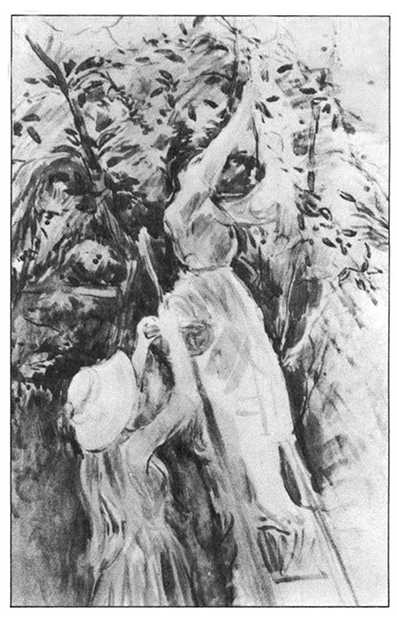
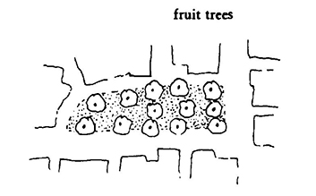

<section class="pattern-plate" aria-labelledby="t-fruit-trees">
<a href="/patterns">A Pattern Language</a> · <a href="/patterns#buildings">Buildings</a> · Pattern 170 · p. 794 · *
<h1 class="pattern-title" id="t-fruit-trees">Fruit Trees</h1><figure class="pattern-figure pl-figure"></figure><nav class="pattern-links" aria-label="Connections"><h2>Links to</h2><ul><li><a href="/patterns/common-land">67 Common Land</a></li><li><a href="/patterns/paths-and-goals">120 Paths And Goals</a></li><li><a href="/patterns/tree-places">171 Tree Places</a></li><li><a href="/patterns/garden-seat">176 Garden Seat</a></li></ul><h2>Linked from</h2><ul><li><a href="/patterns/connection-to-the-earth">168 Connection To The Earth</a></li><li><a href="/patterns/terraced-slope">169 Terraced Slope</a></li><li><a href="/patterns/tree-places">171 Tree Places</a></li><li><a href="/patterns/garden-growing-wild">172 Garden Growing Wild</a></li><li><a href="/patterns/trellised-walk">174 Trellised Walk</a></li><li><a href="/patterns/vegetable-garden">177 Vegetable Garden</a></li><li><a href="/patterns/compost">178 Compost</a></li></ul></nav></section><article class="pattern-text" aria-label="The text of Fruit Trees">
795… both the <a class="pl-ref" href="/patterns/common-land">COMMON LAND (67)</a> outside the workshops, offices and houses, and the private gardens which belong to individual buildings—HALF-HIDDEN GARDEN (HI), can be helped by planting fruit trees. After all, a garden, whether it is public or private, is a thing of use. Yet it is not a farm. That half way kind of garden which is useful, but also beautiful in spring and autumn, and a marvelous place to walk because it smells so wonderful, is the orchard.

◆ ◆ ◆

<strong>In the climates where fruit trees grow, the orchards give the land an almost magical identity: think of the orange groves of Southern California, the cherry trees of Japan, the olive trees of Greece. But the growth of cities seems always to destroy these trees and the quality they possess.</strong>

The fact that the trees are seasonal and bear fruit has special consequences. The presence of orchards adds an experience that has all but vanished from cities—the experience of growth, harvest, local sources of fresh food; walking down a city street, pulling an apple out of a tree, and biting into it.

Fruit trees on common land add much more to the neighborhood and the community than the same trees in private backyards: privately grown, the trees tend to produce more fruit than one household can consume. On public land, the trees concentrate the feeling of mutual benefit and responsibility. And because they require yearly care, pruning, and harvesting, the fruit trees naturally involve people in their common land. It is an obvious place where people can take responsibility for their local common land, have pride in the results, employ themselves and their children part time.

Imagine a community gradually being able to produce a portion of its own need for fruit, or cider, or preserves. In the beginning it would be a small portion indeed, but it would serve as a beginning. There is not much work involved if it is tackled communally, and the satisfaction is great.

796Therefore:

<strong>Plant small orchards of fruit trees in gardens and on common land along paths and streets, in parks, in neighborhoods: wherever there are well-established groups that can themselves care for the trees and harvest the fruit.</strong>

<figure class="pl-figure"></figure>
If you have an especially nice fruit tree, make a <a class="pl-ref" href="/patterns/tree-places">TREE PLACE (171)</a> under it, with a <a class="pl-ref" href="/patterns/garden-seat">GARDEN SEAT (176)</a>, or arrange a path so the tree can provide a natural goal along the path—<a class="pl-ref" href="/patterns/paths-and-goals">PATHS AND GOALS (120)</a>….
</article>

Christopher Alexander, Sara Ishikawa and Murray Silverstein, with Max Jacobson, Ingrid Fiksdahl-King and Shlomo Angel, <cite>A Pattern Language</cite> (Oxford University Press, 1977), pattern 170, pp. 794–796. Text and illustrations from the <a href="https://github.com/natureoforder/sources">Nature of Order sources</a> reading edition, transcribed from the 1977 printing; report errors on <a href="https://github.com/natureoforder/alexander-wiki/issues">GitHub</a>.

<a href="/patterns/terraced-slope">← 169 Terraced Slope</a> · <a href="/patterns">All 253 patterns</a> · <a href="/patterns/tree-places">171 Tree Places →</a>

