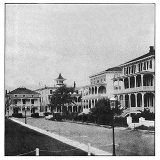
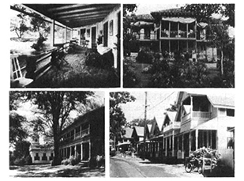
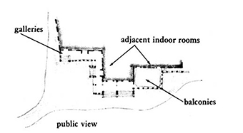

<section class="pattern-plate" aria-labelledby="t-gallery-surround">
<a href="/patterns">A Pattern Language</a> · <a href="/patterns#buildings">Buildings</a> · Pattern 166 · p. 777 · *
<h1 class="pattern-title" id="t-gallery-surround">Gallery Surround</h1><figure class="pattern-figure pl-figure"></figure><nav class="pattern-links" aria-label="Connections"><h2>Links to</h2><ul><li><a href="/patterns/pedestrian-street">100 Pedestrian Street</a></li><li><a href="/patterns/roof-garden">118 Roof Garden</a></li><li><a href="/patterns/arcades">119 Arcades</a></li><li><a href="/patterns/private-terrace-on-the-street">140 Private Terrace On The Street</a></li><li><a href="/patterns/building-edge">160 Building Edge</a></li><li><a href="/patterns/outdoor-room">163 Outdoor Room</a></li><li><a href="/patterns/six-foot-balcony">167 Six-Foot Balcony</a></li><li><a href="/patterns/half-open-wall">193 Half-Open Wall</a></li><li><a href="/patterns/column-place">226 Column Place</a></li></ul><h2>Linked from</h2><ul><li><a href="/patterns/shielded-parking">97 Shielded Parking</a></li><li><a href="/patterns/pedestrian-street">100 Pedestrian Street</a></li><li><a href="/patterns/courtyards-which-live">115 Courtyards Which Live</a></li><li><a href="/patterns/sheltering-roof">117 Sheltering Roof</a></li><li><a href="/patterns/roof-garden">118 Roof Garden</a></li><li><a href="/patterns/building-fronts">122 Building Fronts</a></li><li><a href="/patterns/entrance-room">130 Entrance Room</a></li><li><a href="/patterns/short-passages">132 Short Passages</a></li><li><a href="/patterns/open-stairs">158 Open Stairs</a></li><li><a href="/patterns/six-foot-balcony">167 Six-Foot Balcony</a></li><li><a href="/patterns/column-connections">227 Column Connections</a></li><li><a href="/patterns/sitting-wall">243 Sitting Wall</a></li></ul></nav></section><article class="pattern-text" aria-label="The text of Gallery Surround">
778… we continue to fill out the <a class="pl-ref" href="/patterns/building-edge">BUILDING EDGE (160)</a>. Assume that arcades have been built wherever they make sense—<a class="pl-ref" href="/patterns/arcades">ARCADES (119)</a>; there are still large areas within the building edge where BUILDING EDGE tells you to make something positive—but so far no patterns have explained how this can be done physically. This pattern shows you how you can complete the edge. It complements <a class="pl-ref" href="/patterns/roof-garden">ROOF GARDEN (118)</a> and <a class="pl-ref" href="/patterns/arcades">ARCADES (119)</a> and helps to enliven the <a class="pl-ref" href="/patterns/pedestrian-street">PEDESTRIAN STREET (100)</a>.

◆ ◆ ◆

<strong>If people cannot walk out from the building onto balconies and terraces which look toward the outdoor space around the building, then neither they themselves nor the people outside have any medium which helps them feel the building and the larger public world are intertwined.</strong>

We have discussed the importance of the building edge in two other patterns: <a class="pl-ref" href="/patterns/building-edge">BUILDING EDGE (160)</a> itself, and <a class="pl-ref" href="/patterns/arcades">ARCADES (119)</a>. In both cases, we explained how the arcades and the edge help to create space which people who are <em>outside</em> the building can use to help them feel more intimately connected with the building. These patterns, in short, look at the problem of connection from the point of view of the people <em>outside</em> the building.

In this pattern we discuss the same problem—but from the point of view of the people <em>inside</em> the building. We believe, simply, that every building needs at least one place, and preferably a whole range of places, where people can be still within the building, but in touch with the people and the scene outside. This problem has also been discussed in <a class="pl-ref" href="/patterns/private-terrace-on-the-street">PRIVATE TERRACE ON THE STREET (140)</a>. But that pattern deals only with one very important and highly specific occurrence of this need. The present pattern suggests that the need is completely general: very plainly, it is fundamental, an all-embracing necessity which applies to all buildings over and again.

779The need has been documented extensively. (See, for example, Anthony Wallace, <em>Housing and Social Structure</em>, Philadelphia Housing Authority, 1952; Federal Housing Authority, <em>The Livability Problem of 1,000 Families</em>, Washington, D. C., 1945.)

Windows on the street, while they have their own virtues, are simply not enough to satisfy this need. They usually occupy a very small part of the wall, and can only be used if a person stands at the edge of the room. The kinds of situations that are needed are far more rich and engrossing. We need places along the upper stories of the building’s edge where we can live comfortably, for hours, in touch with the street—playing cards, bringing work out on the terrace on a hot day, eating, scrambling with children or setting up an electric train, drying and folding the wash, sculpting with clay, paying the bills.

In short, almost all the basic human situations can be enriched by the qualities of the gallery surround. This is why we specify that each building should have as many versions of it as possible along its edge—porches, arcades, balconies, awnings, terraces, and galleries.

<figure class="pl-figure"><figcaption><em>Four examfles of this fattens</em>.</figcaption></figure>

780Therefore:

<strong>Whenever possible, and at every story, build porches, galleries, arcades, balconies, niches, outdoor seats, awnings, trellised rooms, and the like at the edges of buildings—especially where they open off public spaces and streets, and connect them by doors, directly to the rooms inside.</strong>

<figure class="pl-figure"></figure>
◆ ◆ ◆

A warning: take care that such places are not stuck artificially onto the building. Keep them real; find the places along the building edge that offer a direct and useful connection with the life indoors—the space outside the stair landing, the space to one side of the bedroom alcove, and so on.

These places should be an integral part of the building territory, and contain seats, tables, furniture, places to stand and talk, places to work outside—all in the public view—<a class="pl-ref" href="/patterns/private-terrace-on-the-street">PRIVATE TERRACE ON THE STREET (140)</a>, <a class="pl-ref" href="/patterns/outdoor-room">OUTDOOR ROOM (163)</a>; make the spaces deep enough to be really useful—<a class="pl-ref" href="/patterns/six-foot-balcony">SIX-FOOT BALCONY (167)</a>—with columns heavy enough to provide at least partial enclosure—<a class="pl-ref" href="/patterns/half-open-wall">HALFOPEN WALL (193)</a>, <a class="pl-ref" href="/patterns/column-place">COLUMN PLACES (226)</a>….
</article>

Christopher Alexander, Sara Ishikawa and Murray Silverstein, with Max Jacobson, Ingrid Fiksdahl-King and Shlomo Angel, <cite>A Pattern Language</cite> (Oxford University Press, 1977), pattern 166, pp. 777–780. Text and illustrations from the <a href="https://github.com/natureoforder/sources">Nature of Order sources</a> reading edition, transcribed from the 1977 printing; report errors on <a href="https://github.com/natureoforder/alexander-wiki/issues">GitHub</a>.

<a href="/patterns/opening-to-the-street">← 165 Opening To The Street</a> · <a href="/patterns">All 253 patterns</a> · <a href="/patterns/six-foot-balcony">167 Six-Foot Balcony →</a>

