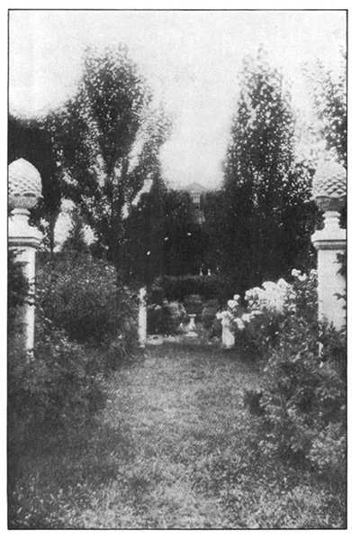
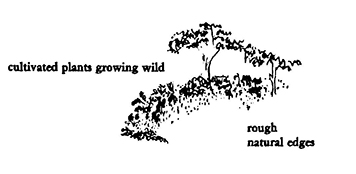

<section class="pattern-plate" aria-labelledby="t-garden-growing-wild">
<a href="/patterns">A Pattern Language</a> · <a href="/patterns#buildings">Buildings</a> · Pattern 172 · p. 801 · **
<h1 class="pattern-title" id="t-garden-growing-wild">Garden Growing Wild</h1><figure class="pattern-figure pl-figure"></figure><nav class="pattern-links" aria-label="Connections"><h2>Links to</h2><ul><li><a href="/patterns/still-water">71 Still Water</a></li><li><a href="/patterns/terraced-slope">169 Terraced Slope</a></li><li><a href="/patterns/fruit-trees">170 Fruit Trees</a></li><li><a href="/patterns/tree-places">171 Tree Places</a></li><li><a href="/patterns/greenhouse">175 Greenhouse</a></li><li><a href="/patterns/garden-seat">176 Garden Seat</a></li><li><a href="/patterns/raised-flowers">245 Raised Flowers</a></li></ul><h2>Linked from</h2><ul><li><a href="/patterns/site-repair">104 Site Repair</a></li><li><a href="/patterns/positive-outdoor-space">106 Positive Outdoor Space</a></li><li><a href="/patterns/half-hidden-garden">111 Half-Hidden Garden</a></li><li><a href="/patterns/connection-to-the-earth">168 Connection To The Earth</a></li><li><a href="/patterns/garden-seat">176 Garden Seat</a></li><li><a href="/patterns/sitting-wall">243 Sitting Wall</a></li></ul></nav></section><article class="pattern-text" aria-label="The text of Garden Growing Wild">
802… with terracing in place and trees taken care of—<a class="pl-ref" href="/patterns/terraced-slope">TERRACED SLOPE (169)</a>,<a class="pl-ref" href="/patterns/fruit-trees">FRUIT TREES (170)</a>, <a class="pl-ref" href="/patterns/tree-places">TREE PLACES (171)</a>, We come to the garden itself—to the ground and plants. In short, we must decide what kind of garden to have, what kind of plants to grow, what style of gardening is compatible with both artifice and nature.

◆ ◆ ◆

<strong>A garden which grows true to its own laws is not a wilderness, yet not entirely artificial either.</strong>

Many gardens are formal and artificial. The flower beds are trimmed like table cloths or painted designs. The lawns are clipped like perfect plastic fur. The paths are clean, like new polished asphalt. The furniture is new and clean, fresh from the department store.

These gardens have none of the quality which brings a garden to life—the quality of a wilderness, tamed, still wild, but cultivated enough to be in harmony with the buildings which surround it and the people who move in it. This balance of wilderness and cultivation reached a high point in the oldest English gardens.

In these gardens things are arranged so that the natural processes which come into being will maintain the condition of the garden and not degrade it. For example, mosses and grasses will grow between paving stones. In a sensible and natural garden, the garden is arranged so that this process enhances the garden and does not threaten it. In an unnatural garden these kinds of small events have constantly to be “looked after”—the gardener must constantly try to control and eradicate the processes of seeding, weeds, the spread of roots, the growth of grass.

In the garden growing wild the plants are chosen, and the boundaries placed, in such a way that the growth of things regulates itself. It does not need to be regulated by control. But it does not grow fiercely and undermine the ways in which it is planted. Natural wild plants, for example, are planted among 803flowers and grass, so that there is no room for so-called weeds to fill the empty spaces and then need weeding. Natural stone edges form the boundaries of grass so that there is no need to chop the turf and clip the edge every few weeks. Rocks and stones are placed where there are changes of level. And there are small rock plants placed between the stones, so that once again there is no room for weeds to grow.

A garden growing wild is healthier, more capable of stable growth, than the more clipped and artificial garden. The garden can be left alone, it will not go to ruin in one or two seasons.

And for the people too, the garden growing wild creates a more profound experience. The gardener is in the position of a good doctor, watching nature take its course, occasionally taking action, pruning, pulling out some species, only to give the garden more room to grow and become itself. By contrast, the gardens that have to be tended obsessively, enslave a person to them; you cannot learn from them in quite the same way.

Therefore:

<strong>Grow grasses, mosses, bushes, flowers, and trees in a way which comes close to the way that they occur in nature: intermingled, without barriers between them, without bare earth, without formal flower beds, and with all the boundaries and edges made in rough stone and brick and wood which become a part of the natural growth.</strong>

<figure class="pl-figure"></figure>
◆ ◆ ◆

804Include no formal elements, except where something is specifically called for by function—like a greenhouse—<a class="pl-ref" href="/patterns/greenhouse">GREENHOUSE (175)</a>, a quiet seat—<a class="pl-ref" href="/patterns/garden-seat">GARDEN SEAT (176)</a>, some water—<a class="pl-ref" href="/patterns/still-water">STILL WATER (71)</a>, or flowers placed just where people can touch them and smell them—<a class="pl-ref" href="/patterns/raised-flowers">RAISED FLOWERS (245)</a>….
</article>

Christopher Alexander, Sara Ishikawa and Murray Silverstein, with Max Jacobson, Ingrid Fiksdahl-King and Shlomo Angel, <cite>A Pattern Language</cite> (Oxford University Press, 1977), pattern 172, pp. 801–804. Text and illustrations from the <a href="https://github.com/natureoforder/sources">Nature of Order sources</a> reading edition, transcribed from the 1977 printing; report errors on <a href="https://github.com/natureoforder/alexander-wiki/issues">GitHub</a>.

<a href="/patterns/tree-places">← 171 Tree Places</a> · <a href="/patterns">All 253 patterns</a> · <a href="/patterns/garden-wall">173 Garden Wall →</a>

