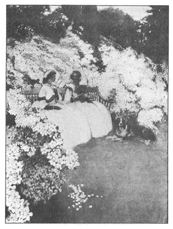
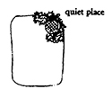

<section class="pattern-plate" aria-labelledby="t-garden-seat">
<a href="/patterns">A Pattern Language</a> · <a href="/patterns#buildings">Buildings</a> · Pattern 176 · p. 815
<h1 class="pattern-title" id="t-garden-seat">Garden Seat</h1><figure class="pattern-figure pl-figure"></figure><nav class="pattern-links" aria-label="Connections"><h2>Links to</h2><ul><li><a href="/patterns/city-country-fingers">3 City Country Fingers</a></li><li><a href="/patterns/quiet-backs">59 Quiet Backs</a></li><li><a href="/patterns/sunny-place">161 Sunny Place</a></li><li><a href="/patterns/garden-growing-wild">172 Garden Growing Wild</a></li><li><a href="/patterns/filtered-light">238 Filtered Light</a></li></ul><h2>Linked from</h2><ul><li><a href="/patterns/sacred-sites">24 Sacred Sites</a></li><li><a href="/patterns/hierarchy-of-open-space">114 Hierarchy Of Open Space</a></li><li><a href="/patterns/sequence-of-sitting-spaces">142 Sequence Of Sitting Spaces</a></li><li><a href="/patterns/a-place-to-wait">150 A Place To Wait</a></li><li><a href="/patterns/connection-to-the-earth">168 Connection To The Earth</a></li><li><a href="/patterns/fruit-trees">170 Fruit Trees</a></li><li><a href="/patterns/tree-places">171 Tree Places</a></li><li><a href="/patterns/garden-growing-wild">172 Garden Growing Wild</a></li><li><a href="/patterns/greenhouse">175 Greenhouse</a></li><li><a href="/patterns/seat-spots">241 Seat Spots</a></li></ul></nav></section><article class="pattern-text" aria-label="The text of Garden Seat">
816… with the character of the garden fixed—<a class="pl-ref" href="/patterns/garden-growing-wild">GARDEN GROWING WILD (172)</a>, we consider the special corners which make the garden valuable and somewhat secret. Of these, the most important is the <a class="pl-ref" href="/patterns/sunny-place">SUNNY PLACE (161)</a>, which has already been described, because it is so fundamental to the building. Now we add to this another seat, more private, where a person can go to sit and think and dream.

◆ ◆ ◆

<strong>Somewhere in every garden, there must be at least one spot, a quiet garden seat, in which a person—or two people—can reach into themselves and be in touch with nothing eke but nature.</strong>

Throughout the patterns in this pattern language we have said, over and again, how very essential it is to give ourselves environments in which we can be in touch with the nature we have sprung from—see especially <a class="pl-ref" href="/patterns/city-country-fingers">CITY COUNTRY FINGERS (3)</a> and <a class="pl-ref" href="/patterns/quiet-backs">QUIET BACKS (59)</a>. But among all the various statements of this fact there is not one so far which puts this need right in our own houses, as close to us as fire and food.

Wordsworth built his entire politics, as a poet, around the fact that tranquility in nature was a basic right to which everyone was entitled. He wanted to integrate the need for solitude-in-nature with city living. He imagined people literally stepping off busy streets and renewing themselves in private gardens—every day. And now many of us have come to learn that without such a place life in a city is impossible. There is so much activity, days are so easily filled with jobs, family, friends, things to do—that time alone is rare. And the more we live without the habit of stillness, the more we tie ourselves to this active life, the stranger and more disquieting the experience of stillness and solitude becomes: city people are notoriously busy-busy, and cannot be alone, without “input,” for a moment.

It is in this context that we propose the isolated garden seat: a place hidden in the garden where one or two people can sit alone, undisturbed, near growing things. It may be on a roof 817top, on the ground, perhaps even half-sunken in an embankment.

There are literally hundreds of old books about gardens which testify to this pattern. One is Hildegarde Hawthorne’s <em>The Lure of the Garden</em>, New York: The Century Co., 1911. We quote from a passage describing the special kind of small talk that is drawn out of people by quiet garden seats:

Perhaps, of all the various forms of gossip overheard by the garden, the loveliest is that between a young and an old person who are friends. Real friendship between the generations is rare, but when it exists it is of the finest. That youth is fortunate who can pour his perplexities into the ear of an older man or woman, and who knows a comradeship and an understanding exceeding in beauty the facile friendships created by like interests and common pursuits; and fortunate too the girl who is able to impart the emotions and ideas aroused in her by her early meetings with the world and life to some one old in experience but comprebendingly young in heart. Both of them will remember those hours long after the garden gate has closed behind their friend forever; as long, indeed, as they remember anything that went to the making of the best in them.

Therefore:

<strong>Make a quiet place in the garden—a private enclosure with a comfortable seat, thick planting, sun. Pick the place for the seat carefully; pick the place that will give you the most intense kind of solitude.</strong>

<figure class="pl-figure"></figure>
◆ ◆ ◆

Place the garden seat, like other outdoor seats, where it commands a view, is in the sun, is sheltered from the wind—seat spots (<em>241</em>); perhaps under bushes and trees where light is soft and dappled—<a class="pl-ref" href="/patterns/filtered-light">FILTERED LIGHT (238)</a>….
</article>

Christopher Alexander, Sara Ishikawa and Murray Silverstein, with Max Jacobson, Ingrid Fiksdahl-King and Shlomo Angel, <cite>A Pattern Language</cite> (Oxford University Press, 1977), pattern 176, pp. 815–817. Text and illustrations from the <a href="https://github.com/natureoforder/sources">Nature of Order sources</a> reading edition, transcribed from the 1977 printing; report errors on <a href="https://github.com/natureoforder/alexander-wiki/issues">GitHub</a>.

<a href="/patterns/greenhouse">← 175 Greenhouse</a> · <a href="/patterns">All 253 patterns</a> · <a href="/patterns/vegetable-garden">177 Vegetable Garden →</a>

