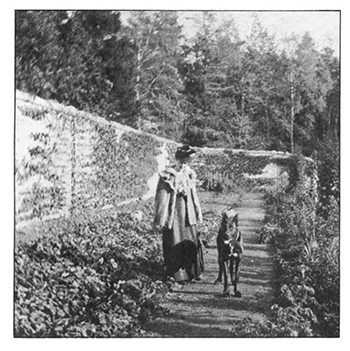
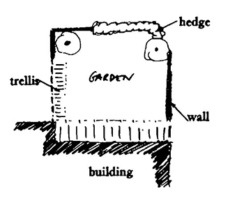

<section class="pattern-plate" aria-labelledby="t-garden-wall">
<a href="/patterns">A Pattern Language</a> · <a href="/patterns#buildings">Buildings</a> · Pattern 173 · p. 805 · *
<h1 class="pattern-title" id="t-garden-wall">Garden Wall</h1><figure class="pattern-figure pl-figure"></figure><nav class="pattern-links" aria-label="Connections"><h2>Links to</h2><ul><li><a href="/patterns/quiet-backs">59 Quiet Backs</a></li><li><a href="/patterns/accessible-green">60 Accessible Green</a></li><li><a href="/patterns/positive-outdoor-space">106 Positive Outdoor Space</a></li><li><a href="/patterns/hierarchy-of-open-space">114 Hierarchy Of Open Space</a></li><li><a href="/patterns/zen-view">134 Zen View</a></li><li><a href="/patterns/private-terrace-on-the-street">140 Private Terrace On The Street</a></li><li><a href="/patterns/trellised-walk">174 Trellised Walk</a></li></ul><h2>Linked from</h2><ul><li><a href="/patterns/bike-paths-and-racks">56 Bike Paths And Racks</a></li><li><a href="/patterns/accessible-green">60 Accessible Green</a></li><li><a href="/patterns/birth-places">65 Birth Places</a></li><li><a href="/patterns/adventure-playground">73 Adventure Playground</a></li><li><a href="/patterns/small-parking-lots">103 Small Parking Lots</a></li><li><a href="/patterns/positive-outdoor-space">106 Positive Outdoor Space</a></li><li><a href="/patterns/half-hidden-garden">111 Half-Hidden Garden</a></li><li><a href="/patterns/entrance-transition">112 Entrance Transition</a></li><li><a href="/patterns/courtyards-which-live">115 Courtyards Which Live</a></li><li><a href="/patterns/private-terrace-on-the-street">140 Private Terrace On The Street</a></li><li><a href="/patterns/bathing-room">144 Bathing Room</a></li><li><a href="/patterns/north-face">162 North Face</a></li><li><a href="/patterns/outdoor-room">163 Outdoor Room</a></li><li><a href="/patterns/connection-to-the-earth">168 Connection To The Earth</a></li><li><a href="/patterns/raised-flowers">245 Raised Flowers</a></li><li><a href="/patterns/ornament">249 Ornament</a></li></ul></nav></section><article class="pattern-text" aria-label="The text of Garden Wall">
806… in private houses, both the HALF-HIDDEN GARDEN (ill) and the <a class="pl-ref" href="/patterns/private-terrace-on-the-street">PRIVATE TERRACE ON THE STREET (140)</a> require walls. More generally, not only private gardens, but public gardens too, and even small parks and greens—<a class="pl-ref" href="/patterns/quiet-backs">QUIET BACKS (59)</a>, <a class="pl-ref" href="/patterns/accessible-green">ACCESSIBLE GREEN (60)</a>, need some kind of enclosure round them, to make them as beautiful and quiet as possible.

◆ ◆ ◆

<strong>Gardens and small public parks don’t give enough relief from noise unless they are well protected.</strong>

People need contact with trees and plants and water. In some way, which is hard to express, people are able to be more whole in the presence of nature, are able to go deeper into themselves, and are somehow able to draw sustaining energy from the life of plants and trees and water.

In a city, gardens and small parks try to solve this problem; but they are usually so close to traffic, noise, and buildings that the impact of nature is entirely lost. To be truly useful, in the deepest psychological sense, they must allow the people in them to be in touch with nature—and must be shielded from the sight and sound of passing traffic, city noises, and buildings. This requires walls, substantial high walls, and dense planting all around the garden.

In those few cases where there are small walled gardens in a city, open to the public—Alhambra, Copenhagen Royal Library Garden—these gardens almost always become famous. People understand and value the peace which they create.

… your garden or park wall of brick … has indeed often an unkind look on the outside, but there is more modesty in it than unkindness. It generally means, not that the builder of it wants to shut you out from the view of his garden, but from the view of himself: it is a frank statement that as he needs a certain portion of time to himself, so he needs a certain portion of ground to himself, and must not be stared at when he digs there in his shirt-sleeves, or plays at leapfrog with his boys from school, or talks over old times with his wife, walking up and down in the evening sunshine. Besides, the brick wall has good practical service in it, and shelters you from the east wind, and ripens your peaches and nectarines, and glows in autumn like a sunny bank. And, moreover, your brick wall, if you build it properly, so that it shall stand long enough, is a beautiful thing when it is old, and has assumed its grave purple red, touched with mossy green…. (John Ruskin, <em>The Two Paths</em>, New York: Dutton, 1907, pp. 202–205.)

807

<figure class="pl-figure"></figure>
<em>Walled gardens</em>—<em>Mughal</em>.

This pattern applies to all private gardens and to small parks in cities. We are not convinced that it applies to <em>all</em> small parks—but it is hard to differentiate precisely between the places where a walled garden is desirable and the places where it is not. There are definitely situations where a small park, and perhaps even a small garden that is <em>open</em> to the rush of life around it, is just right. However, there are far more parks and gardens left open, that need to be walled, than vice versa, so we emphasize the walled condition.

Therefore:

<strong>Form some kind of enclosure to protect the interior of a quiet garden from the sights and sounds of passing traffic. If it is a large garden or a park, the enclosure can 808be soft, can include bushes, trees, slopes, and so on. The smaller the garden, however, the harder and more definite the enclosure must become. In a very small garden, form the enclosure with buildings or walls; even hedges and fences will not be enough to keep out sound.</strong>

<figure class="pl-figure"></figure>
◆ ◆ ◆

Use the garden wall to help form positive outdoor space—<a class="pl-ref" href="/patterns/positive-outdoor-space">POSITIVE OUTDOOR SPACE (106)</a>; but pierce it with balustrades and windows to make connections between garden and street, or garden and garden—<a class="pl-ref" href="/patterns/private-terrace-on-the-street">PRIVATE TERRACE ON THE STREET (140)</a>, <a class="pl-ref" href="/patterns/trellised-walk">TRELLISED WALK (174)</a>, HALF-OPEN WALL (l93), and above all, give it openings to make views into other larger and more distant spaces <a class="pl-ref" href="/patterns/hierarchy-of-open-space">HIERARCHY OF OPEN SPACE (114)</a>, <a class="pl-ref" href="/patterns/zen-view">ZEN VIEW (134)</a>….
</article>

Christopher Alexander, Sara Ishikawa and Murray Silverstein, with Max Jacobson, Ingrid Fiksdahl-King and Shlomo Angel, <cite>A Pattern Language</cite> (Oxford University Press, 1977), pattern 173, pp. 805–808. Text and illustrations from the <a href="https://github.com/natureoforder/sources">Nature of Order sources</a> reading edition, transcribed from the 1977 printing; report errors on <a href="https://github.com/natureoforder/alexander-wiki/issues">GitHub</a>.

<a href="/patterns/garden-growing-wild">← 172 Garden Growing Wild</a> · <a href="/patterns">All 253 patterns</a> · <a href="/patterns/trellised-walk">174 Trellised Walk →</a>

