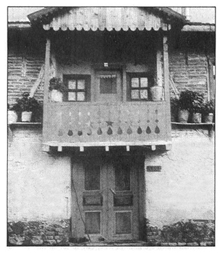
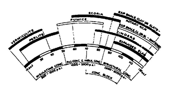
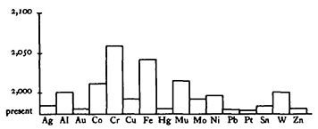
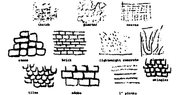

<section class="pattern-plate" aria-labelledby="t-good-materials">
<a href="/patterns">A Pattern Language</a> · <a href="/patterns#construction">Construction</a> · Pattern 207 · p. 955 · **
<h1 class="pattern-title" id="t-good-materials">Good Materials</h1><figure class="pattern-figure pl-figure"></figure><nav class="pattern-links" aria-label="Connections"><h2>Links to</h2><ul><li><a href="/patterns/structure-follows-social-spaces">205 Structure Follows Social Spaces</a></li><li><a href="/patterns/efficient-structure">206 Efficient Structure</a></li><li><a href="/patterns/gradual-stiffening">208 Gradual Stiffening</a></li><li><a href="/patterns/lapped-outside-walls">234 Lapped Outside Walls</a></li><li><a href="/patterns/soft-inside-walls">235 Soft Inside Walls</a></li></ul><h2>Linked from</h2><ul><li><a href="/patterns/structure-follows-social-spaces">205 Structure Follows Social Spaces</a></li><li><a href="/patterns/efficient-structure">206 Efficient Structure</a></li><li><a href="/patterns/gradual-stiffening">208 Gradual Stiffening</a></li><li><a href="/patterns/box-columns">216 Box Columns</a></li><li><a href="/patterns/perimeter-beams">217 Perimeter Beams</a></li><li><a href="/patterns/wall-membrane">218 Wall Membrane</a></li><li><a href="/patterns/floor-ceiling-vaults">219 Floor-Ceiling Vaults</a></li><li><a href="/patterns/roof-vaults">220 Roof Vaults</a></li><li><a href="/patterns/stair-vault">228 Stair Vault</a></li><li><a href="/patterns/soft-tile-and-brick">248 Soft Tile And Brick</a></li><li><a href="/patterns/warm-colors">250 Warm Colors</a></li></ul></nav></section><article class="pattern-text" aria-label="The text of Good Materials">
956… the principles of structure allow you to imagine a building in which materials are distributed in the most efficient way, congruent with the social spaces given by the plan—<a class="pl-ref" href="/patterns/structure-follows-social-spaces">STRUCTURE FOLLOWS SOCIAL SPACES (205)</a>, <a class="pl-ref" href="/patterns/efficient-structure">EFFICIENT STRUCTURE (206)</a>. But of course the structural conception is still only schematic. It can only become firm and cogent in your mind when you know what materials the building will be made of. This pattern helps you settle on materials.

◆ ◆ ◆

<strong>There is a fundamental conflict in the nature of materials for building in industrial society.</strong>

On the one hand, an organic building requires materials which consist of hundreds of small pieces, put together, each one of them hand cut, each one shaped to be unique according to its position. On the other hand, the high cost of labor, and the ease of mass production, tend to create materials which are large, identical, not cuttable or modifiable, and not adaptable to idiosyn-cracies of plan. These “modem” materials tend to destroy the organic quality of natural buildings and, indeed, to make it impossible. In addition, modern materials tend to be flimsy and hard to maintain—so that buildings deteriorate more rapidly than in a pre-industrial society where a building can be maintained and improved for hundreds of years by patient attention.

The central problem of materials, then, is to find a collection of materials which are small in scale, easy to cut on site, easy to work on site without the aid of huge and expensive machinery, easy to vary and adapt, heavy enough to be solid, longlasting or easy to maintain, and yet easy to build, not needing specialized labor, not expensive in labor, and universally obtainable and cheap.

Furthermore, this class of good materials must be ecologically sound: biodegradable, low in energy consumption, and not based on deacceptable resources.

When we take all these requirements together, they suggest a 957rather startling class of “good materials”—quite different from the materials in common use today. The following discussion is our attempt to begin to define this class of materials. It is certainly incomplete; but perhaps it can help you to think through the problem of materials more carefully.

We start with what we call “bulk materials”—the materials that occur in the greatest volume in a given building. They may account for as much as 80 per cent of the total volume of materials used in a building. Traditionally, bulk materials have been earth, concrete, wood, brick, stone, snow…. Today the bulk materials are essentially wood and concrete and, in the very large buildings, steel.

When we analyze these materials strictly, according to our criteria, we find that stone and brick meet most of the requirements, but are often out of the question where labor is expensive, because they are labor intensive.

Wood is excellent in many ways. Where it is available people use it in great quantities, and where it is not available people are trying to get hold of it. Unfortunately the forests have been terribly managed; many have been devastated; and the price of heavy lumber has skyrocketed. From today’s paper: “Since the end of federal economic controls the price of lumber has been jumping about 15 percent a month and is now about 55 percent above what it was a year ago.” <em>San Francisco Chronicle</em>, February 11, 1973. We shall therefore look upon wood as a precious material, which should not be used as a bulk material or for structural purposes.

Steel as a bulk material seems out of the question. We do not need it for high buildings since they do not make social sense—four-story limit (21). And for smaller buildings it is expensive, impossible to modify, high energy in production.

Earth is an interesting bulk material. But it is hard to stabilize, and it makes incredibly heavy walls because it has to be so thick. Where this is appropriate, and where the earth is available, however, it is certainly one of the “good materials.”

Regular concrete is too dense. It is heavy and hard to work. After it sets one cannot cut into it, or nail into it. And its surface is ugly, cold, and hard in feeling, unless covered by expensive finishes not integral to the structure.

958And yet concrete, in some form, is a fascinating material. It is fluid, strong, and relatively cheap. It is available in almost every part of the world. A University of California professor of engineering sciences, P. Kumar Mehta, has even just recently found a way of converting abandoned rice husks into Portland cement.

Is there any way of combining all these good qualities of concrete and also having a material which is light in weight, easy to work, with a pleasant finish? <em>There is. It is possible to use a whole range of ultra-lightweight concretes which have a density and compressive strength very similar to that of wood. They are easy to work with, can be nailed with ordinary nails, cut with a saw, drilled with wood-working tools, easily refaired</em>.

<em>We believe that ultra-lightweight concrete is one of the most fundamental bulk materials of the future</em>.

To make this as clear as possible, we shall now discuss the range of lightweight concretes. Our experiments lead us to believe that the best lightweight concretes, the ones most useful for building, are those whose densities lie in the range of 40 to 60 pounds per cubic foot and which develop some 600 to I00 psi in compression.

Oddly enough, this particular specification lies in the least developed part of the presently available range of concretes. As we can see from the following diagram, the so-called “structural” concretes are usually more dense (at least 90 pounds per cubic foot) and much stronger. The most common “lightweight” concretes use vermiculite as an aggregate, are used for underflooring and insulation, and are very light, but they do not usually develop enough strength to be structurally useful—most 959often about 300 psi in compression. However, a range of mixed lightweight aggregates, containing vermiculite, perlite, pumice, and expanded shale in different proportions, can easily generate 40–60 pound, 600 psi concretes anywhere in the world. We have had very good luck with a mix of 1–2–3: cement-kylite-vermiculite.

<figure class="pl-figure"><figcaption><em>Currently available concrete mixes</em>.</figcaption></figure>

Beyond the bulk materials, there are the materials used in relatively smaller quantities for framework, surfaces, and finishes. These are the “secondary” materials.

When buildings are built with manageable secondary materials, they can be repaired with the same materials: repair becomes continuous with the original building. And the buildings are more apt to be repaired if it is easy to do so and if the user can do it himself bit by bit without having to rely on skilled workers or special equipment. With prefabricated materials this is impossible, the materials are inherently unrepairable. When prefabricated finish materials are damaged they must be replaced with an entirely new component.

Take the case of a garden patio. It can be made as a continuous concrete slab. When the ground shifts slightly underneath this slab, the slab cracks and buckles. This is quite unrepairable for the user. It requires that the entire slab be broken out (which requires relatively heavy-duty equipment) and replaced—by professional skilled labor. On the other hand, it would have been possible to build the patio initially out of many small bricks, tiles, or stones. When the ground shifts, the user is then able to lift up the broken tiles, add some more earth, and replace the tile—all without the aid of expensive machinery or professional help. And if one of the tiles or bricks becomes damaged, it can be easily replaced.

What are the good secondary materials? Wood, which we want to avoid as a bulk material, is excellent as a secondary material for doors, finishes, windows, furniture. Plywood, particle board, and gypsum board can all be cut, nailed, trimmed, and are relatively cheap. Bamboo, thatch, plaster, paper, corrugated metals, chicken wire, canvas, cloth, vinyl, rope, slate, fiberglass, nonchlorinated plastics are all examples of secondary materials which do rather well against our criteria. Some are dubious ecologically—that is, the fiberglass and the corrugated metals—but again, 960these sheet materials need only be used in moderation, to form and finish and trim the bulk materials.

Finally, there are some materials which our criteria exclude entirely—either as bulk or secondary materials. They are expensive, hard to adapt to idiosyncratic plans, they require high energy production techniques, they are in limited reserves…. for example: steel panels and rolled steel sections; aluminum; hard and prestressed concrete; chlorinated foams; structural lumber; cement plaster; immense sections of plate glass….

And, for any optimist who thinks he can go on using steel reinforcing bars forever—consider the following fact. Even iron, abundant as it is all over the earth’s surface, is a depletable resource. If consumption keeps growing at its present rate of increase (as it very well may, given the vast parts of the world not yet using resources at American and western consumption levels), the resources of iron will run out in 2050.

<figure class="pl-figure"><figcaption><em>Years at which various metals will be depleted assuming current usage rate continues to increase as it did between 1960 and 1968</em>.</figcaption></figure>

Therefore:

<strong>Use only biodegradable, low energy consuming materials, which are easy to cut and modify on site. For bulk materials we suggest ultra-lightweight 40–60 lbs. concrete and earth-based materials like tamped earth, brick, and tile. For secondary materials, use wood planks, gypsum, plywood, cloth, chickenwire, paper, cardboard, particle board, corrugated iron, lime plasters, bamboo, rope, and tile.</strong>

961

<figure class="pl-figure"></figure>
ultra-light weight concrete or organic or earth-based materials

◆ ◆ ◆

In <a class="pl-ref" href="/patterns/gradual-stiffening">GRADUAL STIFFENINGE (208)</a>, we shall work out the way of using these materials that goes with <a class="pl-ref" href="/patterns/structure-follows-social-spaces">STRUCTURE FOLLOWS SOCIAL SPACES (205)</a> and <a class="pl-ref" href="/patterns/efficient-structure">EFFICIENT STRUCTURE (206)</a>. Try to use the materials in such a way as to allow their own texture to show themselves—<a class="pl-ref" href="/patterns/lapped-outside-walls">LAPPED OUTSIDE WALLS (234)</a>, <a class="pl-ref" href="/patterns/soft-inside-walls">SOFT INSIDE WALLS (235)</a>….
</article>

Christopher Alexander, Sara Ishikawa and Murray Silverstein, with Max Jacobson, Ingrid Fiksdahl-King and Shlomo Angel, <cite>A Pattern Language</cite> (Oxford University Press, 1977), pattern 207, pp. 955–961. Text and illustrations from the <a href="https://github.com/natureoforder/sources">Nature of Order sources</a> reading edition, transcribed from the 1977 printing; report errors on <a href="https://github.com/natureoforder/alexander-wiki/issues">GitHub</a>.

<a href="/patterns/efficient-structure">← 206 Efficient Structure</a> · <a href="/patterns">All 253 patterns</a> · <a href="/patterns/gradual-stiffening">208 Gradual Stiffening →</a>

