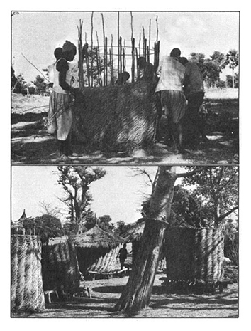
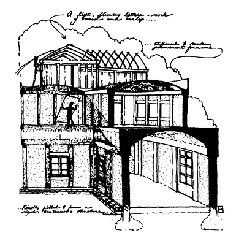
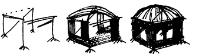

<section class="pattern-plate" aria-labelledby="t-gradual-stiffening">
<a href="/patterns">A Pattern Language</a> · <a href="/patterns#construction">Construction</a> · Pattern 208 · p. 962 · **
<h1 class="pattern-title" id="t-gradual-stiffening">Gradual Stiffening</h1><figure class="pattern-figure pl-figure"></figure><nav class="pattern-links" aria-label="Connections"><h2>Links to</h2><ul><li><a href="/patterns/structure-follows-social-spaces">205 Structure Follows Social Spaces</a></li><li><a href="/patterns/efficient-structure">206 Efficient Structure</a></li><li><a href="/patterns/good-materials">207 Good Materials</a></li><li><a href="/patterns/roof-layout">209 Roof Layout</a></li><li><a href="/patterns/floor-and-ceiling-layout">210 Floor And Ceiling Layout</a></li><li><a href="/patterns/thickening-the-outer-walls">211 Thickening The Outer Walls</a></li><li><a href="/patterns/columns-at-the-corners">212 Columns At The Corners</a></li><li><a href="/patterns/final-column-distribution">213 Final Column Distribution</a></li><li><a href="/patterns/perimeter-beams">217 Perimeter Beams</a></li><li><a href="/patterns/wall-membrane">218 Wall Membrane</a></li><li><a href="/patterns/floor-ceiling-vaults">219 Floor-Ceiling Vaults</a></li><li><a href="/patterns/roof-vaults">220 Roof Vaults</a></li></ul><h2>Linked from</h2><ul><li><a href="/patterns/structure-follows-social-spaces">205 Structure Follows Social Spaces</a></li><li><a href="/patterns/good-materials">207 Good Materials</a></li><li><a href="/patterns/columns-at-the-corners">212 Columns At The Corners</a></li><li><a href="/patterns/wall-membrane">218 Wall Membrane</a></li><li><a href="/patterns/frames-as-thickened-edges">225 Frames As Thickened Edges</a></li><li><a href="/patterns/stair-vault">228 Stair Vault</a></li><li><a href="/patterns/dormer-windows">231 Dormer Windows</a></li></ul></nav></section><article class="pattern-text" aria-label="The text of Gradual Stiffening">
963… in <a class="pl-ref" href="/patterns/structure-follows-social-spaces">STRUCTURE FOLLOWS SOCIAL SPACES (205)</a> and <a class="pl-ref" href="/patterns/efficient-structure">EFFICIENT STRUCTURE (206)</a> we have set down the beginnings of philosophy, an approach, to construction, GOOD MATERIALS (207 tells us something about the materials we ought to use in order to meet human and ecological demands. Now, before we start the practical task of making a structural layout for a building, it is necessary to consider one more philosophical pattern: one which defines the process of construction that will make it possible to use the right materials and get the overall conception of the structure right.

◆ ◆ ◆

<strong>The fundamental philosophy behind the use of pattern languages is that buildings should be uniquely adapted to individual needs and sites; and that the plans of buildings should be rather loose and fluid, in order to accommodate these subtleties.</strong>

This requires an entirely new attitude toward the process of construction. We may define this attitude by saying that it is desirable to build a building in such a way that it starts out loose and flimsy while final adaptations in plan are made, and then gets stiffened gradually during the process of construction, so that each additional act of construction makes the structure sounder.

To understand this philosophy properly, it is helpful to imagine a building being made like a basket. A few strands are put in place. They are very flimsy. Other strands are woven in. Gradually the basket gets stiffer and stiffer. Its final structural strength is only reached from the cooperation of all the members, and is not reached until the building is completely finished. In this sense, such a process produces a building in which all parts of it are working structurally—see <a class="pl-ref" href="/patterns/efficient-structure">EFFICIENT STRUCTURE (206)</a>.

Why does the principle of gradual stiffening seem so sensible as a <em>process</em> of building?

To begin with, such a structure allows the actual building process to be a creative act. It allows the building to be built up 964gradually. Members can be moved around before they are firmly in place. All those detailed design decisions which can never be worked out in advance on paper, can be made during the building process. And it allows you to see the space in three dimensions as a whole, each step of the way, as more material is added.

This means that since each new material that is added in the process must adapt perfectly to the framework that is there, each new material must be more adaptable, more flexible, more capable of coping with variation, than the last. Thus, though the building as a whole goes from flimsy to strong, the actual materials that are added go from the strongest and stiffest, to the gradually less stiff, until finally fluid materials are added.

The essence of this process is very fundamental indeed. We may understand it best by comparing the work of a fifty-year-old carpenter with the work of a novice. The experienced carpenter keeps going. He doesn’t have to keep stopping, because every action he performs, is calculated in such a way that some later action can put it right to the extent that it is imperfect now. What is critical here, is the sequence of events. The carpenter never takes a step which he cannot correct later; so he can keep working, confidently, steadily.

The novice, by comparison, spends a great deal of his time trying to figure out what to do. He does this essentially because he knows that an action he takes now may cause unretractable problems a little further down the line; and if he is not careful, he will find himself with a joint that requires the shortening of some crucial member—at a stage when it is too late to shorten that member. The fear of these kinds of mistakes forces him to spend hours trying to figure ahead: and it forces him to work as far as possible to exact drawings because they will guarantee that he avoids these kinds of mistakes.

The difference between the novice and the master is simply that the novice has not learnt, yet, how to do things in such a way that he can afford to make small mistakes. The master knows that the sequence of his actions will always allow him to cover his mistakes a little further down the line. It is this simple but essential knowledge which gives the work of a master carpenter its wonderful, smooth, relaxed, and almost unconcerned simplicity.

965In a building we have exactly the same problem, only greatly magnified. Essentially, most modem construction has the character of the novice’s work, not of the master’s. The builders do not know how to be relaxed, how to deal with earlier mistakes by later detailing; they do not know the proper sequence of events; and they do not, usually, have a building system, or a construction process, which allows them to develop this kind of relaxed and casual wisdom. Instead, like the novice, they work exactly to finely detailed drawings; the building is extremely uptight as it gets made; any departure from the exact drawings is liable to cause severe problems, may perhaps make it necessary to pull out whole sections of the work.

This novice-like and panic-stricken attention to detail has two very serious results. First, like the novice, the architects spend a great deal of time trying to work things out ahead of time, not smoothly building. Obviously, this costs money; and helps create these machine-like “perfect” buildings. Second, a vastly more serious consequence: the details control the whole. The beauty and subtlety of the plan in which patterns have held free sway over the design suddenly becomes tightened and destroyed because, in fear that details won’t work out, the details of connections, and components, are allowed to control the plan. As a result, rooms get to be slightly the wrong shape, windows go out of position, spaces between doors and walls get altered just enough to make them useless. In a word, the whole character of modem architecture, namely the control of larger space by piddling details of construction, takes over.

What is needed is the opposite—a process in which details are fitted to the whole. This is the secret of the master carpenter; it is described in detail in <em>The Timeless Way of Building</em> as the foundation of all organic form and all successful building. The process of gradual stiffening, which we describe here, is the physical and procedural embodiment of this essential principle. We now ask how, in practice, it is possible to create a gradually stiffened structure within the context defined by the pattern <a class="pl-ref" href="/patterns/good-materials">GOOD MATERIALS (207)</a>.

Facts about materials give us the starting point we need.

1. <em>Sheet materials are easy to produce and make the best connections</em>.

966In traditional society there are few sheet materials. However, factory production tends to make sheets more easily than other forms of material. As we move into an age of mass production, sheet materials become plentiful and are naturally strong, light, and cheap. Gypsum board, plywood, cloth, vinyl, canvas, fiberglass, particle board, wood planks, corrugated metals, chicken wire, are all examples.

And sheet materials are the strongest for connections. Connections are the weak points in a structure. Sheet materials are easy to connect, because connections can join surfaces to one another. Anything made out of sheets is inherently stronger than something made of lumps or sticks.

2. <em>Ultra-lightweight concrete is an excellent fill material—it has the density of wood, is strong, light, easy to cut, easy to repair, easy to nail into—and is available everywhere. This is discussed fully in <a class="pl-ref" href="/patterns/good-materials">GOOD MATERIALS (207)</a></em>.

3. <em>However, any kind of concrete needs formwork; and the cost of formwork is enormous</em>.

This makes it very expensive indeed to build any complex form; and within conventional building systems, it more or less rules out the kind of “organic” structure which we have described. Furthermore, in regular concrete work, the formwork is eventually wasted, thrown away.

We believe that the finishes in any sensible building system should be integral with the process of construction and the structure itself (as they are in almost all traditional buildings)—and that any building system in which finishes have to be “added” to the building are wasteful, and unnatural.

4. <em>We therefore propose that ultra-lightweight concrete be poured into forms which are made of the easily available sheet materials: and that these materials are then left in place to form the finish</em>.

The sheet materials can be any combination of cloth, canvas, wood planks, gypsum boards, fiberboards, plywood, paper, plastered chickenwire, corrugated metals, and where it is possible, tile, brick, or stone—see <a class="pl-ref" href="/patterns/good-materials">GOOD MATERIALS (207)</a>. For the ultra-lightweight concrete we recommend a perlite, expanded shale, or pumice aggregate. Tamped earth, adobe, nonchlorinated foams, may also do instead of the concrete, if loads allow it.

967

<figure class="pl-figure"><figcaption><em>One version of gradual stiffening, using one inch planks, gypsum board and burlap as sheets,with ultra-lightweight concrete as fill</em>.</figcaption></figure>

The drawing above, shows one particular realisation of this kind of gradual stiffening. But the principle is far more general than this particular use of it. Indeed, it occurs, in one way or another, in almost all traditional forms of building. Eskimo igloo construction and African basket structures are both gradually stiffened structures, where each next step copes with the existing framework, adds to it, and stiffens it. The stone buildings of Alberobello in southern Italy are examples. So is Elizabethan halftimber construction.

968Therefore:

<strong>Recognize that you are not assembling a building from components like an erector set, but that you are instead weaving a structure which starts out globally complete, but flimsy; then gradually making it stiller but still rather flimsy; and only finally making it completely stiff and strong.</strong>

<strong>We believe that in our own time, the most natural version of this process is to put up a shell of sheet materials, and then make it fully strong by filling it with a compressive fill.</strong>

<figure class="pl-figure"><figcaption><em>soft skin formwork compressive fill</em></figcaption></figure>

◆ ◆ ◆

Choose the most natural materials you can, for the outer shell itself—thin wood planks for columns, canvas or burlap for the vaults, plaster board or plank or bricks or hollow tiles for walls—<a class="pl-ref" href="/patterns/good-materials">GOOD MATERIALS (207)</a>.

Use ultra-lightweight 40 to 60 pounds perlite concrete for the compressive fill—it has the same density as wood and can be cut and nailed like wood, both during the construction and in later years when repairs become necessary—<a class="pl-ref" href="/patterns/good-materials">GOOD MATERIALS (207)</a>.

Build up the columns first, then fill them with the ultralightweight concrete; then build up the beams and fill them; then the vaults, and cover them with a thin coat of concrete which hardens to form a shell; then fill that shell with even lighter weight materials to form the floors; then make the walls and window frames, and fill them; and finally, the roof, again a thin cloth vault covered with a coat of concrete to form a shell—BOX COLUMNS (2l6), <a class="pl-ref" href="/patterns/perimeter-beams">PERIMETER BEAM (217)</a>, <a class="pl-ref" href="/patterns/wall-membrane">WALL MEMBRANE (218)</a>, <a class="pl-ref" href="/patterns/floor-ceiling-vaults">FLOOR-CEILING VAULTS (219)</a>, <a class="pl-ref" href="/patterns/roof-vaults">ROOF VAULTS (220)</a>….

969<em>within this philosophy of structure, on the basis of the flans which you have made, work out the complete structural layout; this is the last thing you do on fafer, before you actually start to build-</em>,

<a class="pl-ref" href="/patterns/roof-layout">209. ROOF LAYOUT</a>

<a class="pl-ref" href="/patterns/floor-and-ceiling-layout">210. FLOOR AND CEILING LAYOUT</a>

<a class="pl-ref" href="/patterns/thickening-the-outer-walls">211. THICKENING THE OUTER WALLS</a>

<a class="pl-ref" href="/patterns/columns-at-the-corners">212. COLUMNS AT THE CORNERS</a>

<a class="pl-ref" href="/patterns/final-column-distribution">213. FINAL COLUMN DISTRIBUTION</a>
</article>

Christopher Alexander, Sara Ishikawa and Murray Silverstein, with Max Jacobson, Ingrid Fiksdahl-King and Shlomo Angel, <cite>A Pattern Language</cite> (Oxford University Press, 1977), pattern 208, pp. 962–969. Text and illustrations from the <a href="https://github.com/natureoforder/sources">Nature of Order sources</a> reading edition, transcribed from the 1977 printing; report errors on <a href="https://github.com/natureoforder/alexander-wiki/issues">GitHub</a>.

<a href="/patterns/good-materials">← 207 Good Materials</a> · <a href="/patterns">All 253 patterns</a> · <a href="/patterns/roof-layout">209 Roof Layout →</a>

