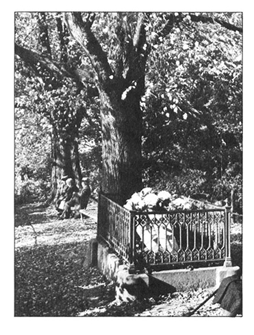
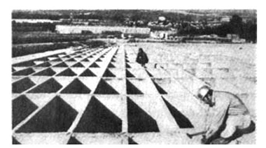
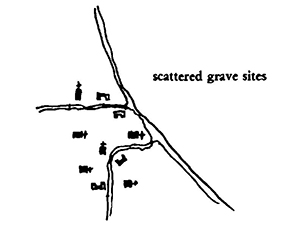

<section class="pattern-plate" aria-labelledby="t-grave-sites">
<a href="/patterns">A Pattern Language</a> · <a href="/patterns#towns">Towns</a> · Pattern 70 · p. 353 · *
<h1 class="pattern-title" id="t-grave-sites">Grave Sites</h1><figure class="pattern-figure pl-figure"></figure><nav class="pattern-links" aria-label="Connections"><h2>Links to</h2><ul><li><a href="/patterns/life-cycle">26 Life Cycle</a></li><li><a href="/patterns/holy-ground">66 Holy Ground</a></li><li><a href="/patterns/common-land">67 Common Land</a></li><li><a href="/patterns/seat-spots">241 Seat Spots</a></li></ul><h2>Linked from</h2><ul><li><a href="/patterns/neighborhood-boundary">15 Neighborhood Boundary</a></li><li><a href="/patterns/life-cycle">26 Life Cycle</a></li><li><a href="/patterns/children-in-the-city">57 Children In The City</a></li><li><a href="/patterns/accessible-green">60 Accessible Green</a></li><li><a href="/patterns/holy-ground">66 Holy Ground</a></li></ul></nav></section><article class="pattern-text" aria-label="The text of Grave Sites">
354… according to <a class="pl-ref" href="/patterns/life-cycle">life cycle (26)</a> the transitions of a person’s life must be available and visible in every community. Death is no exception. This pattern helps to integrate the fact of death with the public spaces of each neighborhood, and, by its very existence, helps to form identifiable NEIGHBORHOODS (14), and <a class="pl-ref" href="/patterns/holy-ground">holy ground (66)</a> and <a class="pl-ref" href="/patterns/common-land">common land (67)</a>.

◆ ◆ ◆

<strong>No people who turn their backs on death can be alive. The presence of the dead among the living will be a daily fact in any society which encourages its people to live.</strong>

Huge cemeteries on the outskirts of cities, or in places no one ever visits, impersonal funeral rites, taboos which hide the fact of death from children, all conspire to keep the fact of death away from us, the living. If you live in a modern suburb, ask yourself how comfortable you would be if your house were next to a graveyard. Very likely the thought frightens you. But this is only because we are no longer used to it. We shall be healthy, when graves of friends and family, and memorials to the people of the recent and the distant past, are intermingled with our houses, in small grave yards, as naturally as winter always comes before the spring.

In every culture there is some form of intense ceremony surrounding death, grieving for the dead, and disposal of the body. There are thousands of variations, but the point is always to give the community of friends left alive the chance to reconcile themselves to the facts of death: the emptiness, the loss; their own transience.

These ceremonies bring people into contact with the experience of mortality, and in this way, they bring us closer to the facts of life, as well as death. When these experiences are integrated with the environment and each person’s life, we arc able to live through them fully and go on. But when circumstances or custom prevent us from making contact with the experience of mortality, and living with it, we are left depressed, diminished, 355less alive. There is a great deal of clinical evidence to support this notion.

In one documented case, a young boy lost his grandmother; the people around him told him that she had merely “gone away” to “protect his feelings.” The boy was uneasily aware that something had happened, but in this atmosphere of secrecy, could not know it for what it was and could not therefore experience it fully. Instead of being protected, he became a victim of a massive neurosis, which was only cured, many years later, when he finally recognized, and lived through the fact of his grandmother’s death.

This case, and others which make it abundantly clear that a person must live through the death of those he loves as fully as possible, in order to remain emotionally healthy, have been described by Eric Lindemann. We have lost the crucial reference for this work, but two other papers by Lindemann converge on the same point: “Symptomatology and Management of Acute Grief,” <em>American Journal of Psychiatry</em>, 1944, <em>101</em>, 141–48; and “A Study of Grief: Emotional Responses to Suicide,” <em>Pastoral Psychology</em>, 1953, 4(39), 9–13. We also recommend a recent paper by Robert Kastenbaum, on the ways in which children explore their mortality: “The Kingdom Where Nobody Dies,” <em>Saturday Review</em>, January 1973, pp. 33–38.

<figure class="pl-figure"></figure>
*A concrete honeycomb graveyard in Colma, California. The suferintendant of the cemetery said, “Families will never see the sinking* … <em>which so distressed them in older farts of the cemetery…</em>.”

In the big industrial cities, during the past 100 years, the ceremonies of death and their functional power for the living have 356been completely undermined. What were once beautifully simple forms of mourning have been replaced by grotesque cemeteries, plastic flowers, everything but the reality of death. And above all, the small graveyards which once put people into daily contact with the fact of death, have vanished—replaced by massive cemeteries, far away from people’s daily business.

What must be done to set things right? We can solve the problem by fusing some of the old ritual forms with the kinds of situations we face today.

1. Most important, it is essential to break down the scale of modern cemeteries, and to reinstate the connection between burial grounds and local communities. Intense decentralization: a person can choose a spot for himself, in parks, common lands, on his land.

2. The right setting requires some enclosure; paths beside the gravesites; the graves visible, and protected by low walls, edges, trees.

3. Property rights. There must be some legal basis for hallowing small pieces of ground—to give a guarantee that the ground a person chooses will not be sold and developed.

4. With increasing population, it is obviously impossible to go on and on covering the land with graves or memorials. We suggest a process similar to the one followed in traditional Greek villages. The graveyards occupy a fixed area, enough to cope with the dead of 200 years. After 200 years, remains are put out to sea—except for those whose memory is still alive.

5. The ritual itself has to evolve from a group with some shared values, at least a family, perhaps a group that shares a religious view. Three of the basics: friends carrying the casket through the streets in procession; simple pine coffins or urns; gathering round the grave.

Therefore:

<strong>Never build massive cemeteries. Instead, allocate pieces of land throughout the community as grave sites—corners of parks, sections of paths, gardens, beside gateways—where memorials to people who have died can be ritually placed with inscriptions and mementos which celebrate their life. 357Give each grave site an edge, a path, and a quiet corner where people can sit. By custom, this is hallowed ground.</strong>

<figure class="pl-figure"></figure>
◆ ◆ ◆

If possible, keep them in places which are quiet—quiet backs (59); and provide a simple seat or a bench under a tree, where people can be alone with their memories—tree places (171), <a class="pl-ref" href="/patterns/seat-spots">seat spots (241)</a>….
</article>

Christopher Alexander, Sara Ishikawa and Murray Silverstein, with Max Jacobson, Ingrid Fiksdahl-King and Shlomo Angel, <cite>A Pattern Language</cite> (Oxford University Press, 1977), pattern 70, pp. 353–357. Text and illustrations from the <a href="https://github.com/natureoforder/sources">Nature of Order sources</a> reading edition, transcribed from the 1977 printing; report errors on <a href="https://github.com/natureoforder/alexander-wiki/issues">GitHub</a>.

<a href="/patterns/public-outdoor-room">← 69 Public Outdoor Room</a> · <a href="/patterns">All 253 patterns</a> · <a href="/patterns/still-water">71 Still Water →</a>

