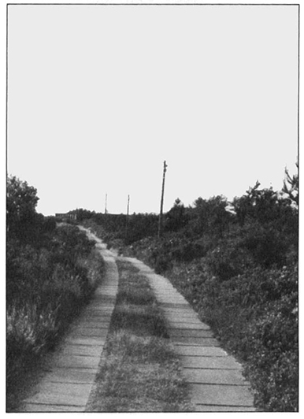
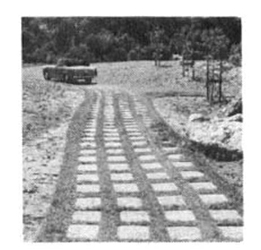
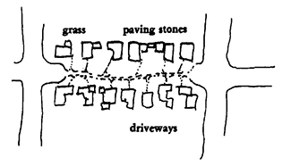

<section class="pattern-plate" aria-labelledby="t-green-streets">
<a href="/patterns">A Pattern Language</a> · <a href="/patterns#towns">Towns</a> · Pattern 51 · p. 266 · **
<h1 class="pattern-title" id="t-green-streets">Green Streets</h1><figure class="pattern-figure pl-figure"></figure><nav class="pattern-links" aria-label="Connections"><h2>Links to</h2><ul><li><a href="/patterns/scattered-work">9 Scattered Work</a></li><li><a href="/patterns/looped-local-roads">49 Looped Local Roads</a></li><li><a href="/patterns/t-junctions">50 T Junctions</a></li><li><a href="/patterns/network-of-paths-and-cars">52 Network Of Paths And Cars</a></li><li><a href="/patterns/common-land">67 Common Land</a></li><li><a href="/patterns/raised-flowers">245 Raised Flowers</a></li></ul><h2>Linked from</h2><ul><li><a href="/patterns/the-countryside">7 The Countryside</a></li><li><a href="/patterns/local-transport-areas">11 Local Transport Areas</a></li><li><a href="/patterns/parallel-roads">23 Parallel Roads</a></li><li><a href="/patterns/degrees-of-publicness">36 Degrees Of Publicness</a></li><li><a href="/patterns/housing-in-between">48 Housing In Between</a></li><li><a href="/patterns/network-of-paths-and-cars">52 Network Of Paths And Cars</a></li><li><a href="/patterns/children-in-the-city">57 Children In The City</a></li><li><a href="/patterns/common-land">67 Common Land</a></li><li><a href="/patterns/connected-play">68 Connected Play</a></li><li><a href="/patterns/animals">74 Animals</a></li><li><a href="/patterns/small-parking-lots">103 Small Parking Lots</a></li><li><a href="/patterns/hierarchy-of-open-space">114 Hierarchy Of Open Space</a></li><li><a href="/patterns/private-terrace-on-the-street">140 Private Terrace On The Street</a></li><li><a href="/patterns/street-windows">164 Street Windows</a></li><li><a href="/patterns/sitting-wall">243 Sitting Wall</a></li><li><a href="/patterns/paving-with-cracks-between-the-stones">247 Paving With Cracks Between The Stones</a></li></ul></nav></section><article class="pattern-text" aria-label="The text of Green Streets">
267… this pattern helps to give the character of local roads. Even though it only defines the surface of the road, and the position of parking, the gradual emergence of this pattern in an area, can be used, piecemeal, to create <a class="pl-ref" href="/patterns/looped-local-roads">looped local roads (49)</a>, <a class="pl-ref" href="/patterns/t-junctions">t junctions (50)</a>, and <a class="pl-ref" href="/patterns/common-land">common land (67)</a>. This pattern was inspired by a beautiful road in the north of Denmark, built by Anne-Marie Rubin, and illustrated here.

◆ ◆ ◆

<strong>There is too much hot hard asphalt in the world. A local road, which only gives access to buildings, needs a few stones for the wheels of the cars; nothing more. Most of it can still be green.</strong>

In a typical low density American suburb, more than 50 per cent of the land is covered with concrete or asphalt paving. In some areas, like downtown Los Angeles, it is more than 65 per cent.

This concrete and asphalt have a terrible effect on the local environment. They destroy the microclimate; they do nothing useful with the solar energy that falls on them; they are unpleasant to walk on; there is nowhere to sit; nowhere for children to play; the natural drainage of the ground is devastated; animals and plants can hardly survive.

The fact is that asphalt and concrete are only suitable for use on high speed roads. They are unsuitable, and quite unnecessary, on local roads, where a few cars are moving in and out. When local roads are paved, wide and smooth, like major roads, drivers are encouraged to travel past our houses at 35 or 40 miles per hour. What is needed, instead, on local roads is a grassy surface that is adapted to the primary uses of the common land between the buildings, with j ust enough hard paving to cope with the few cars that do go on it.

The best solution is a field of grass, with paving stones set into it. This arrangement provides for animals and children and makes the street a focal point for the neighborhood. On hot summer 268days the air over the grass surface is 10 to 14 degrees cooler than the air over an asphalt road. And the cars are woven into this scheme, but they do not dominate it.

<figure class="pl-figure"><figcaption><em>Paving stones</em>.</figcaption></figure>

Of course, such a scheme raises immediately the question of parking. How shall it be organized? It is possible to arrange for parking on green streets, so long as it is parking for residents and their guests, only. When overflow parking from shopping streets and work communities sprawls onto streets that were intended to be quiet neighborhoods, the character of the neighborhood is drastically altered. The residents generally resent this situation. Often it means they cannot park in front of their own homes. The neighborhood becomes a parking lot for strangers who care nothing about it, who simply store their cars there.

The green street will only work if it is based on the principle that the street need not, and should not, provide for more parking than its people need. Parking for visitors can be in small parking lots at the ends of the street; parking for people in the individual houses and workshops can either be in the same parking lots or in the driveways of the buildings.

This does not imply that commercial activities, shops, and businesses should be excluded from residential areas. In fact, as we have said in <a class="pl-ref" href="/patterns/scattered-work">scattered work (9)</a>, it is extremely important to build such functions into neighborhoods. The point is, however, that businesses cannot assume when they move into a neighborhood that they have the right to a huge amount of free parking. They must pay for their parking; and they must pay for it in a way which is consistent with the environmental needs of the neighborhood.

269Therefore:

<strong>On local roads, closed to through traffic, plant grass all over the road and set occasional paving stones into the grass to form a surface for the wheels of those cars that need access to the street Make no distinction between street and sidewalk. Where houses open off the street, put in more paving stones or gravel to let cars turn onto their own land.</strong>

<figure class="pl-figure"></figure>
◆ ◆ ◆

When a road is a green street, it is so pleasant that it naturally tends to attract activity to it. In this case, the paths and the green street are one—common land (67). However, even when the street is green, it may be pleasant to put in occasional very small lanes, a few feet wide, at right angles to the green streets, according to <a class="pl-ref" href="/patterns/network-of-paths-and-cars">network of paths and cars (52)</a>. In order to preserve the greenness of the street, it will be essential, too, to keep parked cars in driveways on the individual lots, or in tiny parking lots, at the ends of the street, reserved for the house owners and their visitors—small parking lots (103). Fruit trees and flowers will make the street more beautiful—fruit trees (170), <a class="pl-ref" href="/patterns/raised-flowers">raised flowers (245)</a>—and the paving stones which form the beds for cars to drive on, can themselves be laid with cracks between them and with grass and moss and flowers in the cracks between the stones—paving with cracks between the stones (247)….
</article>

Christopher Alexander, Sara Ishikawa and Murray Silverstein, with Max Jacobson, Ingrid Fiksdahl-King and Shlomo Angel, <cite>A Pattern Language</cite> (Oxford University Press, 1977), pattern 51, pp. 266–269. Text and illustrations from the <a href="https://github.com/natureoforder/sources">Nature of Order sources</a> reading edition, transcribed from the 1977 printing; report errors on <a href="https://github.com/natureoforder/alexander-wiki/issues">GitHub</a>.

<a href="/patterns/t-junctions">← 50 T Junctions</a> · <a href="/patterns">All 253 patterns</a> · <a href="/patterns/network-of-paths-and-cars">52 Network Of Paths And Cars →</a>

