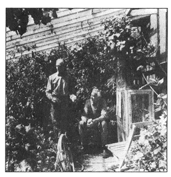
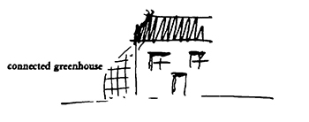

<section class="pattern-plate" aria-labelledby="t-greenhouse">
<a href="/patterns">A Pattern Language</a> · <a href="/patterns#buildings">Buildings</a> · Pattern 175 · p. 812
<h1 class="pattern-title" id="t-greenhouse">Greenhouse</h1><figure class="pattern-figure pl-figure"></figure><nav class="pattern-links" aria-label="Connections"><h2>Links to</h2><ul><li><a href="/patterns/house-cluster">37 House Cluster</a></li><li><a href="/patterns/work-community">41 Work Community</a></li><li><a href="/patterns/common-land">67 Common Land</a></li><li><a href="/patterns/bulk-storage">145 Bulk Storage</a></li><li><a href="/patterns/garden-seat">176 Garden Seat</a></li><li><a href="/patterns/vegetable-garden">177 Vegetable Garden</a></li><li><a href="/patterns/compost">178 Compost</a></li><li><a href="/patterns/window-place">180 Window Place</a></li><li><a href="/patterns/waist-high-shelf">201 Waist-High Shelf</a></li></ul><h2>Linked from</h2><ul><li><a href="/patterns/connection-to-the-earth">168 Connection To The Earth</a></li><li><a href="/patterns/garden-growing-wild">172 Garden Growing Wild</a></li><li><a href="/patterns/trellised-walk">174 Trellised Walk</a></li></ul></nav></section><article class="pattern-text" aria-label="The text of Greenhouse">
813… to keep a garden alive, it is almost essential that there be a “workshop”—a kind of halfway house between the garden and the house itself, where seedlings grow, and where, in temperate climates, plants can grow in spite of cold. In a <a class="pl-ref" href="/patterns/house-cluster">HOUSE CLUSTER (37)</a> or a <a class="pl-ref" href="/patterns/work-community">WORK COMMUNITY (41)</a>, this workshop makes an essential contribution to the <a class="pl-ref" href="/patterns/common-land">COMMON LAND (67)</a>.

◆ ◆ ◆

<strong>Many efforts are being made to harness solar energy by converting it into hot water or electric power. And yet the easiest way to harness solar energy is the most obvious and the oldest: namely, to trap the heat inside a greenhouse and use it for growing flowers and vegetables.</strong>

Imagine a simple greenhouse, attached to a living room, turned to the winter sun, and filled with shelves for flowers and vegetables. It has an entrance from the house—so you can go into it and use it in the winter without going outdoors. And it has an entrance from the garden—so you can use it as a workshop while you are out in the garden and not have to walk through the house.

This greenhouse then becomes a wonderful place: a source of life, a place where flowers can be grown as part of the life of the house. The classic conservatory was a natural part of countless houses in the temperate climates.

For someone who has not experienced a greenhouse as an extension of the house, it may be hard to recognize how fundamental it becomes. It is a world unto itself, as definite and wonderful as fire or water, and it provides an experience which can hardly be matched by any other pattern. Hewitt Ryan, the psychiatrist for whom we built the clinic in Modesto with the help of this pattern language, thought greenhouses so essential that he included one as a basic part of the clinic: a place beside the common area, where people could reintegrate themselves by growing seedlings that would be gradually transplanted to form gardens for the clinic.

814Several recent “energy-systems” Inspired by the ecology movement have sought to make greenhouses a fundamental part of human settlements. For example, Grahame Gaines’ self-contained eco-house includes a large greenhouse as a source of heat and food. (See <em>London Observer</em>, October 1972.) And Chahroudi’s Grow Hole—a glazed sunken pit for growing vegetables in winter—is another kind of greenhouse (<em>Progressive Architecture,</em> July 1970, p. 85).

Therefore:

<strong>In temperate climates, build a greenhouse as part of your house or office, so that it is both a “room” of the house which can be reached directly without going outdoors and a part of the garden which can be reached directly from the garden.</strong>

<figure class="pl-figure"></figure>
◆ ◆ ◆

Place the greenhouse so that it has easy access to the <a class="pl-ref" href="/patterns/vegetable-garden">VEGETABLE GARDEN (177)</a> and the <a class="pl-ref" href="/patterns/compost">COMPOST (178)</a>. Arrange its interior so that it is surrounded with <a class="pl-ref" href="/patterns/waist-high-shelf">WAIST-HIGH SHELVES (201)</a> and plenty of storage space—<a class="pl-ref" href="/patterns/bulk-storage">BULK STORAGE (145)</a>; perhaps give it a special seat, where it is possible to sit comfortably—<a class="pl-ref" href="/patterns/garden-seat">GARDEN SEAT (176)</a>, <a class="pl-ref" href="/patterns/window-place">WINDOW PLACE (180)</a>….
</article>

Christopher Alexander, Sara Ishikawa and Murray Silverstein, with Max Jacobson, Ingrid Fiksdahl-King and Shlomo Angel, <cite>A Pattern Language</cite> (Oxford University Press, 1977), pattern 175, pp. 812–814. Text and illustrations from the <a href="https://github.com/natureoforder/sources">Nature of Order sources</a> reading edition, transcribed from the 1977 printing; report errors on <a href="https://github.com/natureoforder/alexander-wiki/issues">GitHub</a>.

<a href="/patterns/trellised-walk">← 174 Trellised Walk</a> · <a href="/patterns">All 253 patterns</a> · <a href="/patterns/garden-seat">176 Garden Seat →</a>

