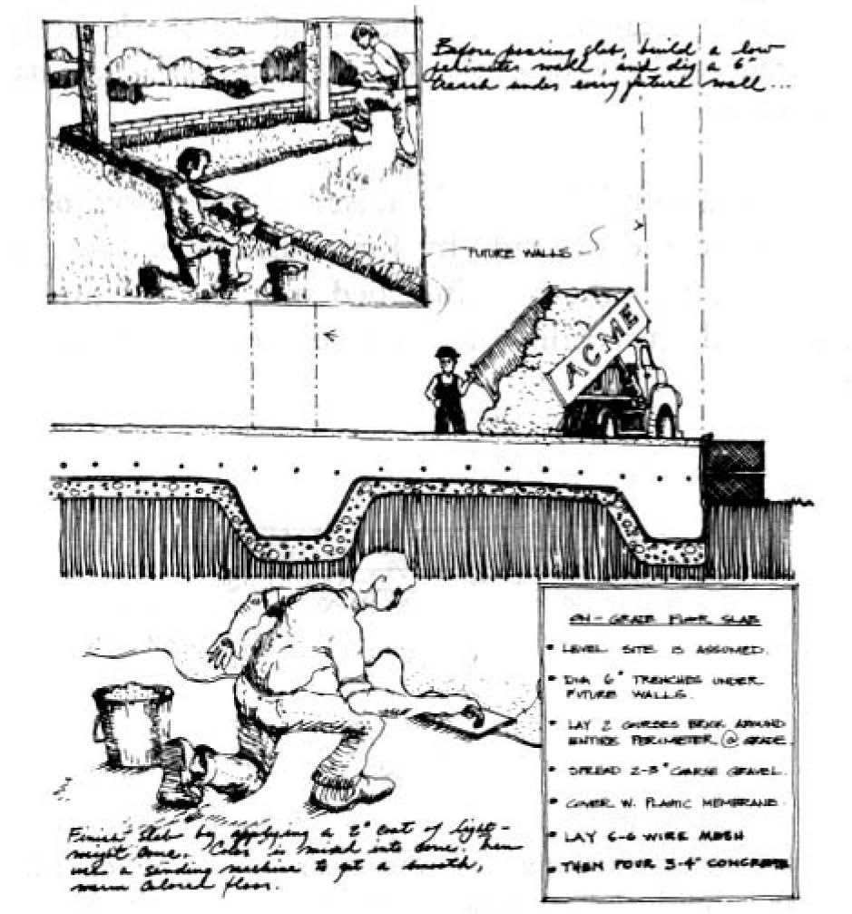
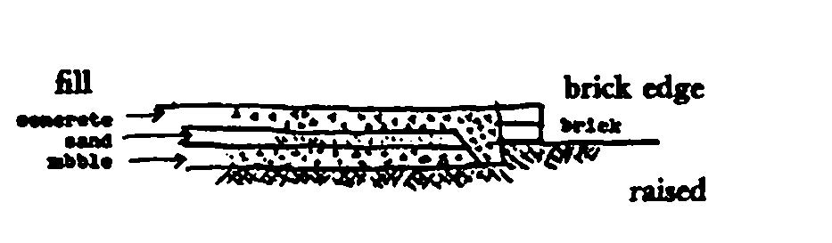

<section class="pattern-plate" aria-labelledby="t-ground-floor-slab">
<a href="/patterns">A Pattern Language</a> · <a href="/patterns#construction">Construction</a> · Pattern 215 · p. 1009
<h1 class="pattern-title" id="t-ground-floor-slab">Ground Floor Slab</h1><nav class="pattern-links" aria-label="Connections"><h2>Links to</h2><ul><li><a href="/patterns/connection-to-the-earth">168 Connection To The Earth</a></li><li><a href="/patterns/efficient-structure">206 Efficient Structure</a></li><li><a href="/patterns/columns-at-the-corners">212 Columns At The Corners</a></li><li><a href="/patterns/root-foundations">214 Root Foundations</a></li><li><a href="/patterns/floor-ceiling-vaults">219 Floor-Ceiling Vaults</a></li><li><a href="/patterns/floor-surface">233 Floor Surface</a></li><li><a href="/patterns/soft-tile-and-brick">248 Soft Tile And Brick</a></li></ul><h2>Linked from</h2><ul><li><a href="/patterns/bulk-storage">145 Bulk Storage</a></li><li><a href="/patterns/connection-to-the-earth">168 Connection To The Earth</a></li><li><a href="/patterns/final-column-distribution">213 Final Column Distribution</a></li><li><a href="/patterns/root-foundations">214 Root Foundations</a></li><li><a href="/patterns/floor-surface">233 Floor Surface</a></li></ul></nav></section><article class="pattern-text" aria-label="The text of Ground Floor Slab">
… this pattern helps to complete CONNECTION TO THE EARTH (l68), <a class="pl-ref" href="/patterns/efficient-structure">EFFICIENT STRUCTURE (206)</a>, <a class="pl-ref" href="/patterns/columns-at-the-corners">COLUMNS AT THE CORNERS (212)</a>, and <a class="pl-ref" href="/patterns/root-foundations">ROOT FOUNDATIONS (214)</a>. It is a simple slab, which forms the ground floor of the building, ties the root foundations to one another, and also allows you to form simple strip foundations as part of the slab, to support the walls.

◆ ◆ ◆

<strong>The slab is the easiest, cheapest, and most natural way to lay a ground floor.</strong>

<figure class="pl-figure"></figure>
<strong><em>A raised ground floor slab built inside a brick perimeter wall</em></strong>

1010When the ground is relatively level, a concrete slab which sits directly on the ground is the most natural and cheapest way of building a ground floor. Wood floors are expensive, need air space underneath them, and need to be built up on continuous foundation walls or beams. Prefabricated floor panels also need a structure of some sort to support them. A slab floor, on the other hand, uses the earth for support, and can supply the foundations which are needed to support walls, by simple thickening.

The one trouble with slabs is that they can easily feel cold and damp. We believe that this feeling is at least as much a psychological one as a physical one (given a well-made and insulated slab), and that the feeling is most pronounced with slabs that are on grade. We therefore propose that the slab be raised from the ground. This can be done by not excavating the ground at all, instead only leveling it, and placing the usual bed of rubble and gravel on top of the ground. (In normal practice, the ground is excavated so that the top of the rubble is slightly below grade, and the top of the slab only <em>just</em> above the ground.)

Therefore:

<strong>Build a ground floor slab, raised slightly—six or nine inches above the ground—by first building a low perimeter wall around the building, tied into the column foundations, and then filling it with rubble, gravel, and concrete.</strong>

<figure class="pl-figure"></figure>
◆ ◆ ◆

Finish the public areas of the floor in brick, or tile, or waxed and polished lightweight concrete, or even beaten earth; as for those areas which will be more private, build them one 1011step up or one step down, with a lightweight concrete finish that can be felted and carpeted—<a class="pl-ref" href="/patterns/floor-surface">FLOOR SURFACE (233)</a>.

Build the low wall which forms the edge of the ground floor slab out of brick, and tie it directly into all the terraces and paths around the building —<a class="pl-ref" href="/patterns/connection-to-the-earth">CONNECTION TO THE EARTH (168)</a>, <a class="pl-ref" href="/patterns/soft-tile-and-brick">SOFT TILE AND BRICK (248)</a>. If you are building on a steep sloped site, build part of the ground floor as a vaulted floor instead of excavating to form a slab —<a class="pl-ref" href="/patterns/floor-ceiling-vaults">FLOOR-CEILING VAULTS (219)</a>….
</article>

Christopher Alexander, Sara Ishikawa and Murray Silverstein, with Max Jacobson, Ingrid Fiksdahl-King and Shlomo Angel, <cite>A Pattern Language</cite> (Oxford University Press, 1977), pattern 215, pp. 1009–1011. Text and illustrations from the <a href="https://github.com/natureoforder/sources">Nature of Order sources</a> reading edition, transcribed from the 1977 printing; report errors on <a href="https://github.com/natureoforder/alexander-wiki/issues">GitHub</a>.

<a href="/patterns/root-foundations">← 214 Root Foundations</a> · <a href="/patterns">All 253 patterns</a> · <a href="/patterns/box-columns">216 Box Columns →</a>

