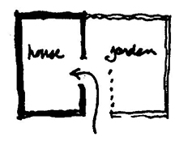
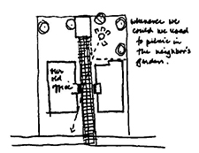
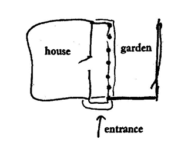

<section class="pattern-plate" aria-labelledby="t-half-hidden-garden">
<a href="/patterns">A Pattern Language</a> · <a href="/patterns#buildings">Buildings</a> · Pattern 111 · p. 545 · *
<h1 class="pattern-title" id="t-half-hidden-garden">Half-Hidden Garden</h1><nav class="pattern-links" aria-label="Connections"><h2>Links to</h2><ul><li><a href="/patterns/house-cluster">37 House Cluster</a></li><li><a href="/patterns/row-houses">38 Row Houses</a></li><li><a href="/patterns/work-community">41 Work Community</a></li><li><a href="/patterns/your-own-home">79 Your Own Home</a></li><li><a href="/patterns/building-complex">95 Building Complex</a></li><li><a href="/patterns/site-repair">104 Site Repair</a></li><li><a href="/patterns/south-facing-outdoors">105 South Facing Outdoors</a></li><li><a href="/patterns/main-entrance">110 Main Entrance</a></li><li><a href="/patterns/entrance-transition">112 Entrance Transition</a></li><li><a href="/patterns/courtyards-which-live">115 Courtyards Which Live</a></li><li><a href="/patterns/private-terrace-on-the-street">140 Private Terrace On The Street</a></li><li><a href="/patterns/garden-growing-wild">172 Garden Growing Wild</a></li><li><a href="/patterns/garden-wall">173 Garden Wall</a></li></ul><h2>Linked from</h2><ul><li><a href="/patterns/south-facing-outdoors">105 South Facing Outdoors</a></li><li><a href="/patterns/long-thin-house">109 Long Thin House</a></li><li><a href="/patterns/entrance-transition">112 Entrance Transition</a></li><li><a href="/patterns/hierarchy-of-open-space">114 Hierarchy Of Open Space</a></li><li><a href="/patterns/private-terrace-on-the-street">140 Private Terrace On The Street</a></li></ul></nav></section><article class="pattern-text" aria-label="The text of Half-Hidden Garden">
… this pattern helps to form the fundamental layout of <a class="pl-ref" href="/patterns/house-cluster">HOUSE CLUSTERS (37)</a>, <a class="pl-ref" href="/patterns/row-houses">ROW HOUSES (38)</a>, <a class="pl-ref" href="/patterns/work-community">WORK COMMUNITY (41)</a>,<a class="pl-ref" href="/patterns/your-own-home">YOUR OWN HOME (79)</a>, and <a class="pl-ref" href="/patterns/building-complex">BUILDING COMPLEX (95)</a>, because it influences the relative position of the buildings and their gardens. Since it affects the position of the buildings, and the shape and position of the gardens, it can also be used to help create <a class="pl-ref" href="/patterns/south-facing-outdoors">SOUTH FACING OUTDOORS (105)</a> and to help the general process of <a class="pl-ref" href="/patterns/site-repair">SITE REPAIR (104)</a>.

◆ ◆ ◆

<strong>If a garden is too close to the street, people won’t use it because it isn’t private enough. But if it is too far from the street, then it won’t be used either, because it is too isolated.</strong>

Start by thinking about the front gardens which you know. They are often decorative, lawns, flowers. But how often are people sitting there? Except at those special moments, when people want specifically to be watching the street, the front garden is nothing but a decoration. The half-private family groups, drinks with friends, playing ball with the children, lying in the grass—these need more protection than the typical front garden can create.

And the back gardens do not really solve the problem either. Those back gardens which are entirely isolated, entirely “in back”—are so remote from the street, that people often don’t feel comfortable there either. Often the back garden is so remote from the street, that you can’t hear people coming to the house; you have no sense of any larger, more open space, no sense of other people—only the enclosed, isolated, fenced-in world of one family. Children, so much more spontaneous and intuitive, give us a view in microcosm. How rarely they play in the full back garden; how much more often they prefer these side yards and gardens which have some privacy, yet also some exposure to the street.

546It seems then, that the proper place for a garden is neither in front, nor fully behind. The garden needs a certain degree of privacy, yet also wants some kind of tenuous connection to the street and entrance. This balance can only be created in a situation where the garden is half in front, half in back—in a word, at the side, protected by a wall from too great an exposure to the street; and yet open enough, through paths, gates, arcades, trellises, so that people in the garden still have a glimpse of the street, a view of the front door or the path to the front door.

All this requires a revolution in the normal conception of a “lot.” Lots are usually narrow along the street and deep. But to create half-hidden gardens, the lots must be long along the street, and shallow, so that each house can have a garden at its side. This gives the following archetype for house and half-hidden.

<figure class="pl-figure"><figcaption><em>Archetype of a half-hidden garden</em>.</figcaption></figure>

There are many ways of developing this idea. One version we experienced in an old house where we once had our offices was particularly interesting.

<figure class="pl-figure"></figure>
<em>Another example</em>,

547The garden that <em>toe</em> used was to the back, but behind the <em>next-door</em> house. It worked perfectly as a half-hidden garden for our house. We were able to sit there privately and have our lunch, and work on warm days, and still be in touch with the main entrance and even a glimpse of the street. But our own back garden was entirely hidden—and we never used it.

Therefore:

<strong>Do not place the garden fully in front of the house, nor fully to the back. Instead, place it in some kind of half-way position, side-by-side with the house, in a position which is half-hidden from the street, and half-exposed.</strong>

<figure class="pl-figure"></figure>
◆ ◆ ◆

If possible, use this pattern to influence, the shape of house lots too, and make them as near double squares along the street as possible; build a partial wall around the garden, and locate the entrance to the house between the house and the garden, so that people in the garden can be private, yet still aware of the street, and aware of anybody coming up to the house—<a class="pl-ref" href="/patterns/main-entrance">MAIN ENTRANCE (110)</a>, <a class="pl-ref" href="/patterns/garden-wall">GARDEN WALL (173)</a>; allow the garden to grow wild—<a class="pl-ref" href="/patterns/garden-growing-wild">GARDEN GROWING WILD (172)</a>, and make the passage through, or alongside it, a major part of the transition between street and house—<a class="pl-ref" href="/patterns/entrance-transition">ENTRANCE TRANSITION (112)</a>. Half-hidden gardens may be <a class="pl-ref" href="/patterns/courtyards-which-live">COURTYARDS WHICH LIVE (115)</a>, ROOF GARDENS (ll8), Or a <a class="pl-ref" href="/patterns/private-terrace-on-the-street">PRIVATE TERRACE ON THE STREET (140)</a>….
</article>

Christopher Alexander, Sara Ishikawa and Murray Silverstein, with Max Jacobson, Ingrid Fiksdahl-King and Shlomo Angel, <cite>A Pattern Language</cite> (Oxford University Press, 1977), pattern 111, pp. 545–547. Text and illustrations from the <a href="https://github.com/natureoforder/sources">Nature of Order sources</a> reading edition, transcribed from the 1977 printing; report errors on <a href="https://github.com/natureoforder/alexander-wiki/issues">GitHub</a>.

<a href="/patterns/main-entrance">← 110 Main Entrance</a> · <a href="/patterns">All 253 patterns</a> · <a href="/patterns/entrance-transition">112 Entrance Transition →</a>

