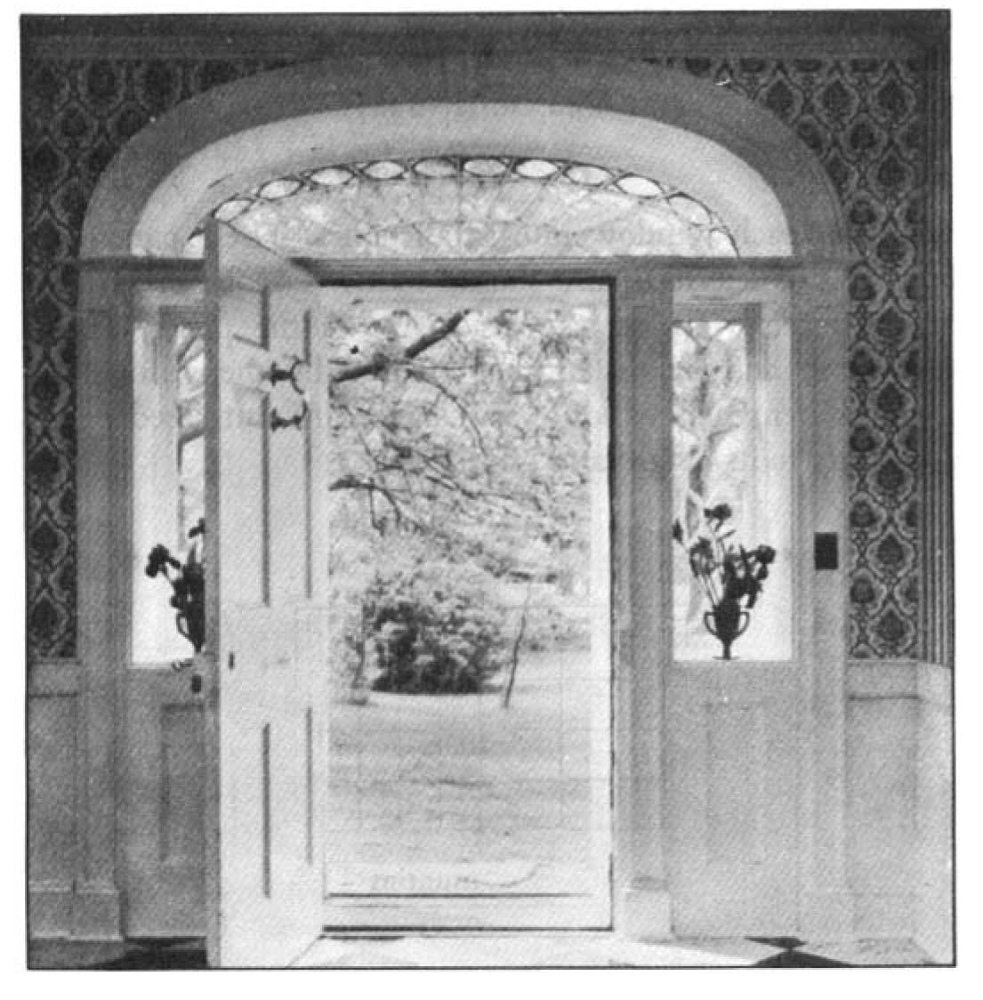
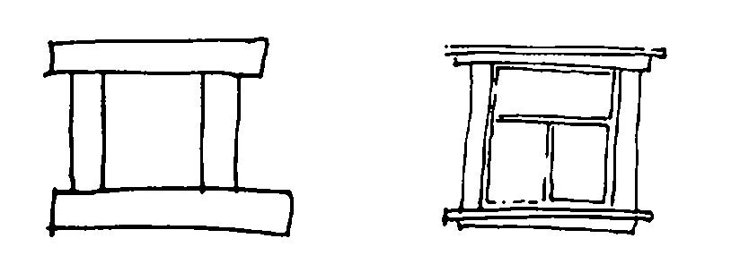
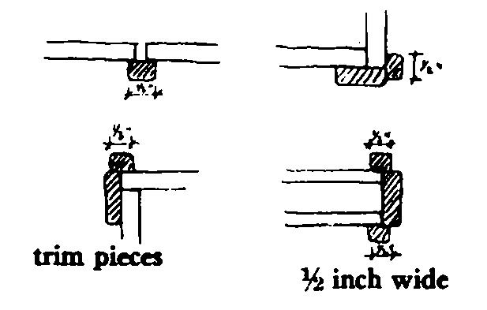

<section class="pattern-plate" aria-labelledby="t-half-inch-trim">
<a href="/patterns">A Pattern Language</a> · <a href="/patterns#construction">Construction</a> · Pattern 240 · p. 1112 · **
<h1 class="pattern-title" id="t-half-inch-trim">Half-Inch Trim</h1><figure class="pattern-figure pl-figure"></figure><nav class="pattern-links" aria-label="Connections"><h2>Links to</h2><ul><li><a href="/patterns/box-columns">216 Box Columns</a></li><li><a href="/patterns/perimeter-beams">217 Perimeter Beams</a></li><li><a href="/patterns/floor-ceiling-vaults">219 Floor-Ceiling Vaults</a></li><li><a href="/patterns/frames-as-thickened-edges">225 Frames As Thickened Edges</a></li><li><a href="/patterns/lapped-outside-walls">234 Lapped Outside Walls</a></li><li><a href="/patterns/soft-inside-walls">235 Soft Inside Walls</a></li><li><a href="/patterns/seat-spots">241 Seat Spots</a></li><li><a href="/patterns/front-door-bench">242 Front Door Bench</a></li><li><a href="/patterns/sitting-wall">243 Sitting Wall</a></li><li><a href="/patterns/canvas-roofs">244 Canvas Roofs</a></li><li><a href="/patterns/raised-flowers">245 Raised Flowers</a></li><li><a href="/patterns/climbing-plants">246 Climbing Plants</a></li><li><a href="/patterns/paving-with-cracks-between-the-stones">247 Paving With Cracks Between The Stones</a></li><li><a href="/patterns/soft-tile-and-brick">248 Soft Tile And Brick</a></li><li><a href="/patterns/ornament">249 Ornament</a></li><li><a href="/patterns/warm-colors">250 Warm Colors</a></li></ul><h2>Linked from</h2><ul><li><a href="/patterns/deep-reveals">223 Deep Reveals</a></li><li><a href="/patterns/roof-caps">232 Roof Caps</a></li><li><a href="/patterns/soft-inside-walls">235 Soft Inside Walls</a></li><li><a href="/patterns/small-panes">239 Small Panes</a></li><li><a href="/patterns/ornament">249 Ornament</a></li><li><a href="/patterns/warm-colors">250 Warm Colors</a></li></ul></nav></section><article class="pattern-text" aria-label="The text of Half-Inch Trim">
1113… and this pattern finishes the joints between <a class="pl-ref" href="/patterns/soft-inside-walls">SOFT INSIDE WALLS (235)</a>, or <a class="pl-ref" href="/patterns/lapped-outside-walls">LAPPED OUTSIDE WALLS (234)</a> and the various floors and vaults and frames and stiffeners and ornaments which are set into the walls: <a class="pl-ref" href="/patterns/box-columns">BOX COLUMNS (216)</a>, <a class="pl-ref" href="/patterns/perimeter-beams">PERIMETER BEAMS (217)</a>, <a class="pl-ref" href="/patterns/floor-ceiling-vaults">FLOOR-CEILING VAULTS (219)</a>, <a class="pl-ref" href="/patterns/frames-as-thickened-edges">FRAMES AS THICKENED EDGES (225)</a>, and <a class="pl-ref" href="/patterns/ornament">ORNAMENT (249)</a>.

◆ ◆ ◆

<strong>Totalitarian, machine buildings do not require trim because they are precise enough to do without. But they buy their precision at a dreadful price: by killing the possibility of freedom in the building plan.</strong>

A free and natural building cannot be conceived without the possibility of finishing it with trim, to cover up the minor variations which have arisen in the plan, and during its construction.

For example, when nailing a piece of gypsum board to a column—if the board is cut on site—it is essential that the cut can be inaccurate within a half-inch or so. If it has to be more accurate, there will be a great waste of material, and on-site cutting time and labor will increase, and, finally, the very possibility of adapting each part of the building to the exact subtleties of the plan and site will be in jeopardy.

It is in response to difficulties of this sort that modern system building has arisen. Here tolerances are very low indeed—inch and even lower—and there is no need for trim to cover up inaccuracies. However, the precision of the components can only be obtained by the most tyrannical control over the plan. This one aspect of construction has by itself destroyed the builder’s capacity to make a building which is natural, organic, and adapted to the site.

If, as we suggest, the building procedure is looser and allows much larger tolerance—even mistakes on the order of half an inch or more—then the use of trim to cover the connection between materials becomes essential. Indeed, within this attitude to building, the trim is not a trivial decoration added as a finishing touch, but an essential phase of the construction. We see, then, 1114that trim, so often associated with older buildings, and treated as an emblem of nostalgia, is in fact a vital part of the process of making buildings natural.

Finally, it is worth adding a note about the actual size of the trim pieces. Buildings built in the last 25 years often make a virtue out of boldness, and there is a tendency to use very large oversized pieces of trim instead of small pieces. Within the framework of this philosophy, it might seem right to use pieces of trim 2 or 3 inches thick for their effect and heaviness. We believe that this is wrong: Trim which is too large, or too thick, doesn’t do its job. This is not a matter of style. There is a psychological reason for making sure that every component in the building has at least some pieces of trim which are of the order of half an inch or an inch thick, <em>and no more</em>.

Compare the following two examples of trim. For some reason the right-hand one, in which the trim is finer, is closer and better adapted to our feelings than the left-hand one.

<figure class="pl-figure"><figcaption><em>Chunky trim ….fine scale trim</em>.</figcaption></figure>

The reason for this seems to be the following. Our own bodies and the natural surroundings in which we evolved contain a continuous hierarchy of details, ranging all the way from the molecular fine structure to gross features like arms and legs (in our own bodies) and trunks and branches (in our natural surroundings).

We know from results in cognitive psychology that any one step in this hierarchy can be no more than 1:5, 1:7, or 1:10 if we are to perceive it as a natural hierarchy. We cannot understand a hierarchy in which there is a jump in scale of 1:20 or more. It is this fact which makes it necessary for our surroundings, even when man-made, to display a similar continuum of detail.

Most materials have some kind of natural fibrous or crystalline 1115structure at the scale of about 120 inch. But if the smallest building detail dimensions are of the order of 2 or 3 inches, this leaves a jump of 1140 or 1:60 between these details and the fine structure of the material.

In order to allow us to perceive a connection between the fine building construction and the fine structure of the materials, it is essential that the smallest building details be of the order of a half inch or so, so that it is no more than about 10 times the size of the granular and fibrous texture of the materials.

Therefore:

<strong>Wherever two materials meet, place a piece of trim over the edge of the connection. Choose the pieces of trim so that the smallest piece, in each component, is always of the order of <em>Vi</em> inch wide. The trim can be wood, plaster, terracotta….</strong>

<figure class="pl-figure"></figure>
◆ ◆ ◆

In many cases, you may be able to use the trim to form the ornaments—<a class="pl-ref" href="/patterns/ornament">ORNAMENT (249)</a>; and trims may occasionally be colored: even tiny amounts can help to make the light in a room warm—<a class="pl-ref" href="/patterns/warm-colors">WARM COLORS (250)</a>….

<em>1117<strong>build outdoor details to finish the outdoors as fully as the indoor spaces;</strong></em>

<a class="pl-ref" href="/patterns/seat-spots">241. SEAT SPOTS</a>

<a class="pl-ref" href="/patterns/front-door-bench">242. FRONT DOOR BENCH</a>

<a class="pl-ref" href="/patterns/sitting-wall">243. SITTING WALL</a>

<a class="pl-ref" href="/patterns/canvas-roofs">244. CANVAS ROOFS</a>

<a class="pl-ref" href="/patterns/raised-flowers">245. RAISED FLOWERS</a>

<a class="pl-ref" href="/patterns/climbing-plants">246. CLIMBING PLANTS</a>

<a class="pl-ref" href="/patterns/paving-with-cracks-between-the-stones">247. PAVING WITH CRACKS BETWEEN THE STONES</a>

<a class="pl-ref" href="/patterns/soft-tile-and-brick">248. SOFT TILE AND BRICK</a>
</article>

Christopher Alexander, Sara Ishikawa and Murray Silverstein, with Max Jacobson, Ingrid Fiksdahl-King and Shlomo Angel, <cite>A Pattern Language</cite> (Oxford University Press, 1977), pattern 240, pp. 1112–1117. Text and illustrations from the <a href="https://github.com/natureoforder/sources">Nature of Order sources</a> reading edition, transcribed from the 1977 printing; report errors on <a href="https://github.com/natureoforder/alexander-wiki/issues">GitHub</a>.

<a href="/patterns/small-panes">← 239 Small Panes</a> · <a href="/patterns">All 253 patterns</a> · <a href="/patterns/seat-spots">241 Seat Spots →</a>

