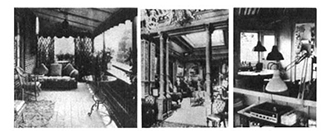
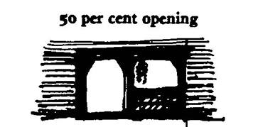

<section class="pattern-plate" aria-labelledby="t-half-open-wall">
<a href="/patterns">A Pattern Language</a> · <a href="/patterns#buildings">Buildings</a> · Pattern 193 · p. 893 · *
<h1 class="pattern-title" id="t-half-open-wall">Half-Open Wall</h1><nav class="pattern-links" aria-label="Connections"><h2>Links to</h2><ul><li><a href="/patterns/building-thoroughfare">101 Building Thoroughfare</a></li><li><a href="/patterns/arcades">119 Arcades</a></li><li><a href="/patterns/the-flow-through-rooms">131 The Flow Through Rooms</a></li><li><a href="/patterns/half-private-office">152 Half-Private Office</a></li><li><a href="/patterns/six-foot-balcony">167 Six-Foot Balcony</a></li><li><a href="/patterns/alcoves">179 Alcoves</a></li><li><a href="/patterns/workspace-enclosure">183 Workspace Enclosure</a></li><li><a href="/patterns/sitting-circle">185 Sitting Circle</a></li><li><a href="/patterns/the-shape-of-indoor-space">191 The Shape Of Indoor Space</a></li><li><a href="/patterns/interior-windows">194 Interior Windows</a></li><li><a href="/patterns/columns-at-the-corners">212 Columns At The Corners</a></li><li><a href="/patterns/column-place">226 Column Place</a></li><li><a href="/patterns/column-connections">227 Column Connections</a></li><li><a href="/patterns/small-panes">239 Small Panes</a></li><li><a href="/patterns/ornament">249 Ornament</a></li></ul><h2>Linked from</h2><ul><li><a href="/patterns/arcades">119 Arcades</a></li><li><a href="/patterns/private-terrace-on-the-street">140 Private Terrace On The Street</a></li><li><a href="/patterns/gallery-surround">166 Gallery Surround</a></li><li><a href="/patterns/six-foot-balcony">167 Six-Foot Balcony</a></li><li><a href="/patterns/alcoves">179 Alcoves</a></li><li><a href="/patterns/workspace-enclosure">183 Workspace Enclosure</a></li><li><a href="/patterns/sitting-circle">185 Sitting Circle</a></li><li><a href="/patterns/bed-alcove">188 Bed Alcove</a></li><li><a href="/patterns/dressing-rooms">189 Dressing Rooms</a></li><li><a href="/patterns/the-shape-of-indoor-space">191 The Shape Of Indoor Space</a></li><li><a href="/patterns/interior-windows">194 Interior Windows</a></li></ul></nav></section><article class="pattern-text" aria-label="The text of Half-Open Wall">
… <a class="pl-ref" href="/patterns/the-shape-of-indoor-space">THE SHAPE OF INDOOR SPACE (191)</a> defines the shapes of rooms and minor rooms. This pattern gives more detail to the walls between these rooms. Wherever there are <a class="pl-ref" href="/patterns/half-private-office">HALF-PRIVATEOFFICES (152)</a>, <a class="pl-ref" href="/patterns/six-foot-balcony">SIX-FOOT BALCONIES (167)</a>, <a class="pl-ref" href="/patterns/alcoves">ALCOVES (179)</a>; <a class="pl-ref" href="/patterns/sitting-circle">SITTING CIRCLES (185)</a>, BED ALCOVES (l88), <a class="pl-ref" href="/patterns/building-thoroughfare">BUILDING THOROUGHFARES (101)</a>, <a class="pl-ref" href="/patterns/arcades">ARCADES (119)</a>, Or <a class="pl-ref" href="/patterns/the-flow-through-rooms">THE FLOW THROUGH ROOMS (131)</a>, the spaces must be given a subtle balance of enclosure and openness by partly opening up the walls or keeping them half-open.

<figure class="pl-figure"></figure>
<strong>Rooms which are too closed prevent the natural flow of social occasions, and the natural process of transition from one social moment to another. And rooms which are too open will not support the differentiation of events which social life requires.</strong>

A solid room, for instance, with four walls around it can obviously sustain activities which are quite different from the activities in the next room. In this sense it is excellent. But it is very hard for people to join in these activities or leave them naturally. This is only possible if the door is glazed, or if there is a window in the wall, or if there is an opening, so that people can gradually come forward, just when there is a lull in the conversation, and naturally become a part of what is happening.

On the other hand, an open space with no walls around it, just a place marked by a carpet on the floor and a chair arrangement, but entirely open to the spaces all around it, is so exposed that people never feel entirely comfortable there. No one activity can establish itself because it is too vulnerable; and so the things that happen there tend to be rather bland—a drink, reading the paper, watching television, staring at the view, “sitting around”: you will not find animated conversations, arguments, excitement, 894people making things, painting, card games, charades, or someone practicing the violin. People let themselves go into these more highly differentiated activities, when there is some degree of enclosure around them—at least a half-wall, a railing, columns, some separation from the other nearby spaces.

In short, the subtle conflict between exposure and enclosure naturally requires a balance. But for some reason the modern images of rooms and indoor space lead people to the two extremes, and hardly ever to the balance which is needed.

The kind of space which most easily supports both differentiation of activities and the transition between different activities has less enclosure than a solid room, and more enclosure—far more—than a space inside an open plan.

A wall which is half-open, half-enclosed—an arch, a trellised wall, a wall that is counter height with ornamented columns, a wall suggested by the reduction of the opening or the enlargement of the columns at the corners, a colonnade of columns in the wall—all these help get the balance of enclosure and openness right; and in these places people feel comfortable as a result.

<figure class="pl-figure"><figcaption><em>Examples</em>.</figcaption></figure>

From <a class="pl-ref" href="/patterns/workspace-enclosure">workspace enclosure (183)</a> we have some evidence for the amount of enclosure required. We found there that a person is comfortable when he is about “half” enclosed—when he has material around him on about two sides, or the four sides around him are about half solid and half-open.

We therefore guess that the enclosure of any half-open wall should itself consist of about 50 per cent void and 50 per cent solid. This does not mean that it has to be a screen. For example, 895a combination of thick columns, deep beams, arched openings, also creates this balance of openings and enclosures. A railing is too open. But a balustrade with thick supports will often be just right.

This applies very strongly to outdoor rooms and balconies; and equally to all those indoor spaces which are connected to larger rooms but partly separate from them—an alcove, workspace, kitchen, bed. In all these cases the wall which forms the enclosure and separates the smaller space from the larger one, needs to be partially open and partially closed.

Among ourselves and many of our friends, we have found that the urge to remodel a house is virtually one and the same with the urge to create half-open walls between various parts of the house. It seems that without ever naming this pattern, people have the instinct to “open up” a room; or to give “more enclosure” to some other space.

Therefore:

<strong>Adjust the walls, openings, and windows in each indoor space until you reach the right balance between open, flowing space and closed cell-like space. Do not take it for granted that each space is a room; nor, on the other hand, that all spaces must flow into each other. The right balance will always lie between these extremes: no one room entirely enclosed; and no space totally connected to another. Use combinations of columns, half-open walls, porches, indoor windows, sliding doors, low sills, french doors, sitting walls, and so on, to hit the right balance.</strong>

<figure class="pl-figure"></figure>
◆ ◆ ◆

896Wherever a small space is in a larger space, yet slightly separate from it, make the wall between the two about half-open and half-solid—<a class="pl-ref" href="/patterns/alcoves">ALCOVES (179)</a>, <a class="pl-ref" href="/patterns/workspace-enclosure">WORKSPACE ENCLOSURE (183)</a>. Concentrate the solids and the openings, so that there are essentially a large number of smallish openings, each framed by thick columns, waist high shelves, deep soffits, and arches or braces in the corners, with ornament where solids and openings meet—<a class="pl-ref" href="/patterns/interior-windows">INTERIOR WINDOWS (194)</a>, <a class="pl-ref" href="/patterns/columns-at-the-corners">COLUMNS AT THE CORNERS (212)</a>, <a class="pl-ref" href="/patterns/column-place">COLUMN PLACE (226)</a>, <a class="pl-ref" href="/patterns/column-connections">COLUMN CONNECTIONS (227)</a>, <a class="pl-ref" href="/patterns/small-panes">SMALL PANES (239)</a>, <a class="pl-ref" href="/patterns/ornament">ORNAMENT (249)</a>….
</article>

Christopher Alexander, Sara Ishikawa and Murray Silverstein, with Max Jacobson, Ingrid Fiksdahl-King and Shlomo Angel, <cite>A Pattern Language</cite> (Oxford University Press, 1977), pattern 193, pp. 893–896. Text and illustrations from the <a href="https://github.com/natureoforder/sources">Nature of Order sources</a> reading edition, transcribed from the 1977 printing; report errors on <a href="https://github.com/natureoforder/alexander-wiki/issues">GitHub</a>.

<a href="/patterns/windows-overlooking-life">← 192 Windows Overlooking Life</a> · <a href="/patterns">All 253 patterns</a> · <a href="/patterns/interior-windows">194 Interior Windows →</a>

