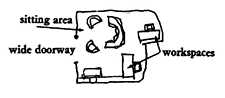

<section class="pattern-plate" aria-labelledby="t-half-private-office">
<a href="/patterns">A Pattern Language</a> · <a href="/patterns#buildings">Buildings</a> · Pattern 152 · p. 717
<h1 class="pattern-title" id="t-half-private-office">Half-Private Office</h1><nav class="pattern-links" aria-label="Connections"><h2>Links to</h2><ul><li><a href="/patterns/intimacy-gradient">127 Intimacy Gradient</a></li><li><a href="/patterns/flexible-office-space">146 Flexible Office Space</a></li><li><a href="/patterns/small-work-groups">148 Small Work Groups</a></li><li><a href="/patterns/rooms-to-rent">153 Rooms To Rent</a></li><li><a href="/patterns/teenagers-cottage">154 Teenager’s Cottage</a></li><li><a href="/patterns/old-age-cottage">155 Old Age Cottage</a></li><li><a href="/patterns/settled-work">156 Settled Work</a></li><li><a href="/patterns/home-workshop">157 Home Workshop</a></li><li><a href="/patterns/open-stairs">158 Open Stairs</a></li><li><a href="/patterns/light-on-two-sides-of-every-room">159 Light On Two Sides Of Every Room</a></li><li><a href="/patterns/workspace-enclosure">183 Workspace Enclosure</a></li><li><a href="/patterns/sitting-circle">185 Sitting Circle</a></li><li><a href="/patterns/the-shape-of-indoor-space">191 The Shape Of Indoor Space</a></li><li><a href="/patterns/windows-overlooking-life">192 Windows Overlooking Life</a></li></ul><h2>Linked from</h2><ul><li><a href="/patterns/master-and-apprentices">83 Master And Apprentices</a></li><li><a href="/patterns/intimacy-gradient">127 Intimacy Gradient</a></li><li><a href="/patterns/short-passages">132 Short Passages</a></li><li><a href="/patterns/sequence-of-sitting-spaces">142 Sequence Of Sitting Spaces</a></li><li><a href="/patterns/bulk-storage">145 Bulk Storage</a></li><li><a href="/patterns/flexible-office-space">146 Flexible Office Space</a></li><li><a href="/patterns/small-work-groups">148 Small Work Groups</a></li><li><a href="/patterns/workspace-enclosure">183 Workspace Enclosure</a></li><li><a href="/patterns/half-open-wall">193 Half-Open Wall</a></li></ul></nav></section><article class="pattern-text" aria-label="The text of Half-Private Office">
… within the overall arrangement of group space and individual working space provided by <a class="pl-ref" href="/patterns/intimacy-gradient">INTIMACY GRADIENT (127)</a>, <a class="pl-ref" href="/patterns/flexible-office-space">FLEXIBLE OFFICE SPACE (146)</a>, and <a class="pl-ref" href="/patterns/small-work-groups">SMALL WORK GROUPS (148)</a>, this pattern shapes the individual rooms and offices. The pattern also helps to generate the organization of these larger patterns.

◆ ◆ ◆

<strong>What is the right balance between privacy and connection in office work?</strong>

The totally private office has a devastating effect on the flow of human relationships within a work group, and entrenches the ugly quality of office hierarchies. At the same time, there are moments when privacy is essential; and to some extent nearly every job of work needs to be free from random interruption.

Everyone who has experienced office work reports some version of this problem. In our own experience—as members of a working team of architects—we have faced the problem in hundreds of ways. The best evidence we have to report is our own experience as a work group.

Over the last seven years we moved our offices on several occasions. At one point we moved to a large old house: large enough for some of us to have private rooms and others to share rooms. In a matter of months our social coherence as a group was on the point of breakdown. The workings of the group became formalized; easy-going communication vanished; the entire atmosphere changed from a setting which sustained our growth as a group to an office bureaucracy, where people made appointments with each other, left notes in special boxes, and nervously knocked on each other’s doors.

For a while we were virtually unable to produce any interesting work.

It gradually dawned on us that the environment of the house was playing a powerful role in the breakdown. As we started to pay attention to it, we noticed that those rooms which were still functioning—the places where we would all gather to talk 718over the work—had a special characteristic: they were only <em>halfprivate</em>, even though the workspaces within them were strongly marked.

As we thought it out, it seemed that almost every place where we had found ourselves working well together had these characteristics: no office was entirely private; most offices were for more than one person; but even when an office was only for one, it had a kind of simple common area at its front and everyone felt free to drop in and stay for a moment. And the desks themselves were always built up as private domains within and toward the edges of these offices, so that doors could always be left wide open. Eventually we rearranged ourselves until each person had some version of this pattern.

The pattern works so well, that we recommend it to everyone in similar circumstances.

Therefore:

<strong>Avoid closed off, separate, or private offices. Make every workroom, whether it is for a group of two or three people or for one person, half-open to the other workgroups and the world immediately beyond it. At the front, just inside the door, make comfortable sitting space, with the actual workspace(s) away from the door, and further back.</strong>

<figure class="pl-figure"></figure>
◆ ◆ ◆

Shape each office in detail, according to <a class="pl-ref" href="/patterns/the-shape-of-indoor-space">THE SHAPE OF INDOOR SPACE (191)</a>; give it windows on at least two sides—<a class="pl-ref" href="/patterns/light-on-two-sides-of-every-room">LIGHT ON TWO SIDES OF EVERY ROOM (159)</a>; make individual workspaces in the corners—<a class="pl-ref" href="/patterns/workspace-enclosure">WORKSPACE ENCLOSURE (183)</a>, looking out of windows—<a class="pl-ref" href="/patterns/windows-overlooking-life">WINDOWS OVERLOOKING LIFE (192)</a>; make the sitting area toward the door as comfortable as possible—<a class="pl-ref" href="/patterns/sitting-circle">SITTING CIRCLE (185)</a>

719<em>add those small outbuildings which must be slightly independent from the main structure, and put in the access from the upper stories to the street and gardens;</em>

<a class="pl-ref" href="/patterns/rooms-to-rent">153. ROOMS TO RENT</a>

<a class="pl-ref" href="/patterns/teenagers-cottage">154. TEENAGER’S COTTAGE</a>

<a class="pl-ref" href="/patterns/old-age-cottage">155. OLD AGE COTTAGE</a>

<a class="pl-ref" href="/patterns/settled-work">156. SETTLED WORK</a>

<a class="pl-ref" href="/patterns/home-workshop">157. HOME WORKSHOP</a>

<a class="pl-ref" href="/patterns/open-stairs">158. OPEN STAIRS</a>
</article>

Christopher Alexander, Sara Ishikawa and Murray Silverstein, with Max Jacobson, Ingrid Fiksdahl-King and Shlomo Angel, <cite>A Pattern Language</cite> (Oxford University Press, 1977), pattern 152, pp. 717–719. Text and illustrations from the <a href="https://github.com/natureoforder/sources">Nature of Order sources</a> reading edition, transcribed from the 1977 printing; report errors on <a href="https://github.com/natureoforder/alexander-wiki/issues">GitHub</a>.

<a href="/patterns/small-meeting-rooms">← 151 Small Meeting Rooms</a> · <a href="/patterns">All 253 patterns</a> · <a href="/patterns/rooms-to-rent">153 Rooms To Rent →</a>

