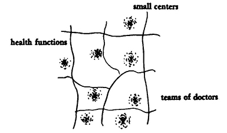

<section class="pattern-plate" aria-labelledby="t-health-center">
<a href="/patterns">A Pattern Language</a> · <a href="/patterns#towns">Towns</a> · Pattern 47 · p. 252 · *
<h1 class="pattern-title" id="t-health-center">Health Center</h1><nav class="pattern-links" aria-label="Connections"><h2>Links to</h2><ul><li><a href="/patterns/birth-places">65 Birth Places</a></li><li><a href="/patterns/local-sports">72 Local Sports</a></li><li><a href="/patterns/adventure-playground">73 Adventure Playground</a></li><li><a href="/patterns/home-workshop">157 Home Workshop</a></li><li><a href="/patterns/vegetable-garden">177 Vegetable Garden</a></li></ul><h2>Linked from</h2><ul><li><a href="/patterns/activity-nodes">30 Activity Nodes</a></li><li><a href="/patterns/old-people-everywhere">40 Old People Everywhere</a></li><li><a href="/patterns/necklace-of-community-projects">45 Necklace Of Community Projects</a></li><li><a href="/patterns/still-water">71 Still Water</a></li><li><a href="/patterns/local-sports">72 Local Sports</a></li><li><a href="/patterns/small-services-without-red-tape">81 Small Services Without Red Tape</a></li><li><a href="/patterns/a-place-to-wait">150 A Place To Wait</a></li><li><a href="/patterns/opening-to-the-street">165 Opening To The Street</a></li></ul></nav></section><article class="pattern-text" aria-label="The text of Health Center">
… the explicit recognition of the life cycle as the basis for every individual life will do a great deal to help people’s health in the community—life cycle (26); this pattern describes the more specific institutions which help people to care for themselves and their health.

◆ ◆ ◆

<strong>More than 90 per cent of the people walking about in an ordinary neighborhood are unhealthy, judged by simple biological criteria. This ill health cannot be cured by hospitals or medicine.</strong>

Hospitals put the emphasis on sickness. They are enormously expensive; they are inconvenient because they are too centralized; and they tend to create sickness, rather than cure it, because doctors get paid when people are sick.

By contrast, in traditional Chinese medicine, people pay the doctor only when they are healthy; when they are sick, he is obliged to treat them, without payment. The doctors have incentives to keep people well.

A system of health care which is actually capable of keeping people healthy, in both mind and body, must put its emphasis on health, not sickness. It must therefore be physically decentralized so that it is as close as possible to people’s everyday activities. And it must be able to encourage people in daily practices that lead to health. The core of the solution, as far as we can see, must be a system of small, widely distributed, health centers, which encourage physical activities—swimming, dancing, sports, and fresh air—and provide medical treatment only as an incidental side of these activities.

There is converging evidence and speculation in the health 253care literature that health center* with these characteristics, organized according to the philosophy of health maintenance, are critical. (See, for example: William H. Glazier, “The Task of Medicine,” <em>Scientific American</em>, Vol. 228, No. 4, April 1973, pp. 13–17; and Milton Roemer, “Nationalized Medicine for America,” <em>Transaction</em>, September 1971, p. 31.)

We know of several attempts to develop health care programs which are in line with this proposal. In most of the cases, though, the programs fall short in their hopes because, despite their good intentions, they still tend to cater to the sick, they do not work to maintain health. Take, for example, the so-called “community mental health centers” encouraged by the United States National Institute of Mental Health during the late 1960’s. On paper, these centers are intended to encourage health, not cure sickness.

In practice it is a very different story. We visited one of the most advanced, in San Anselmo, California. The patients sit around all day long; their eyes are glazed; they are half-enthusiastically doing “clay therapy” or “paint therapy.” One patient came up to us and said, “Doctor,” his eyes shining with happiness, “this is a wonderful mental health center; it is the very best one I have ever been in.” In short, the patients are kept as patients; they understand themselves to be patients; in certain cases they even revel in their role as patients. They have no useful occupation, no work, nothing useful they can show at the end of a day, nothing to be proud of. The center, for all its intentions to be human, in fact reinforces the patients’ idea of their own sickness and encourages the behavior of sickness, even while it is preaching and advocating health.

The same is true for the Kaiser-Permanente program in California. The Kaiser hospitals have been hailed in a recent article as “ones which shift the emphasis away from treatment of illness and toward the maintenance of health (William H. Glazier,”The Task of Medicine”). Members of Kaiser are entitled to a multi-phasic examination yearly, intended to give every member a complete picture of the state of his health. But the conception of health which is created by this multi-phasic program is still “freedom from sickness.” It is essentially negative. There is no effort made toward the positive creation and maintenance of actual, blooming, health. And besides, the Kaiser Center 254is still nothing but a giant hospital. People are treated as numbers; the center is so large and concentrated that the doctors cannot possibly see their patients as people in their natural communities. They see them as patients.

The only health center we know which actually devoted itself to health instead of sickness was the famous Peckham Health Center in England. The Peckham Center was a club, run by two doctors, focused on a swimming pool, a dance floor, and a cafe. In addition, there were doctors’ offices, and it was understood that families—never individuals—would receive periodic check-ups as part of their activities around the swimming and dancing. Under these conditions, people used the center regularly, during the day and at night. The question of their health became fused with the ordinary life of the community, and this set the stage for a most extraordinary kind of health care.

For example, it seems that many of the mothers in working-class pre-war England, were ashamed of their own bodies. This shame reached such proportions that they were ashamed of suckling and holding their own babies, and in many cases they actually did not want their babies as a result. The Peckham Center was able to dismantle this syndrome entirely by its emphasis on health. The program of swimming and dancing, coupled with the family checkups, allowed women to become proud of their own bodies; they no longer felt afraid of their own newborn babies, no longer felt shame about their bodies; the babies felt wanted; and the incidence of emotional disturbance and childhood psychosis among the children in later years was drastically reduced within the Peckham population, starting exactly from the year when the health center began its operation.

This kind of profound biological connection between physical health, family life, and emotional welfare was truly the beginning of a new era in human biology. It is described, beautifully, and at length, by two doctors from Peckham Center (Innes Pearse and Lucy Crocker, <em>The Peckham Experiment, A Study in the Living Structure of Society</em>, New Haven: Yale University Press, 1946). Only when biological ideas of this depth and power are taken seriously will it be possible to have real health centers, instead of sickness centers.

255Therefore:

<strong>Gradually develop a network of small health centers, perhaps one per community of 7000, across the city; each equipped to treat everyday disease—both mental and physical, in children and adults—but organized essentially around a functional emphasis on those recreational and educational activities which help keep people in good health, like swimming and dancing.</strong>

<figure class="pl-figure"></figure>
◆ ◆ ◆

Keep the medical teams small and independent—small services without red tape (81), but coordinated with each other and other clinics, like <a class="pl-ref" href="/patterns/birth-places">birth places (65)</a>—throughout the town. Give each center some functions that fuse with the ordinary course of local work and recreation: swimming pool, workshops, sauna, gym, vegetable garden, greenhouse. But don’t force these facilities to form a continuous “health park”—knit them together loosely with other parts of the town—housing in between (4.8), <a class="pl-ref" href="/patterns/local-sports">LOCAL SPORTS (72)</a>, <a class="pl-ref" href="/patterns/adventure-playground">ADVENTURE PLAYGROUND (73)</a>, <a class="pl-ref" href="/patterns/home-workshop">HOME WORKSHOP (157)</a>, <a class="pl-ref" href="/patterns/vegetable-garden">VEGETABLE GARDEN (177)</a>. Perhaps the most important subsidiary pattern for helping people to keep healthy is the opportunity for swimming; ideally, try and put a swimming pool on every block—still water (71)….
</article>

Christopher Alexander, Sara Ishikawa and Murray Silverstein, with Max Jacobson, Ingrid Fiksdahl-King and Shlomo Angel, <cite>A Pattern Language</cite> (Oxford University Press, 1977), pattern 47, pp. 252–255. Text and illustrations from the <a href="https://github.com/natureoforder/sources">Nature of Order sources</a> reading edition, transcribed from the 1977 printing; report errors on <a href="https://github.com/natureoforder/alexander-wiki/issues">GitHub</a>.

<a href="/patterns/market-of-many-shops">← 46 Market Of Many Shops</a> · <a href="/patterns">All 253 patterns</a> · <a href="/patterns/housing-in-between">48 Housing In Between →</a>

