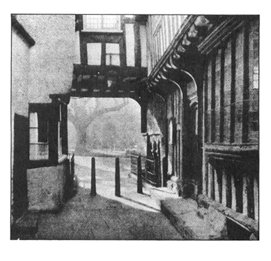
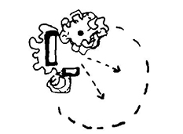
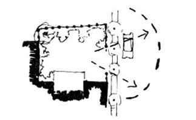
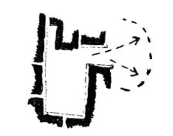
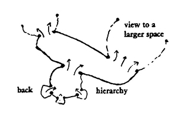

<section class="pattern-plate" aria-labelledby="t-hierarchy-of-open-space">
<a href="/patterns">A Pattern Language</a> · <a href="/patterns#buildings">Buildings</a> · Pattern 114 · p. 557 · *
<h1 class="pattern-title" id="t-hierarchy-of-open-space">Hierarchy Of Open Space</h1><figure class="pattern-figure pl-figure"></figure><nav class="pattern-links" aria-label="Connections"><h2>Links to</h2><ul><li><a href="/patterns/the-countryside">7 The Countryside</a></li><li><a href="/patterns/looped-local-roads">49 Looped Local Roads</a></li><li><a href="/patterns/green-streets">51 Green Streets</a></li><li><a href="/patterns/accessible-green">60 Accessible Green</a></li><li><a href="/patterns/small-public-squares">61 Small Public Squares</a></li><li><a href="/patterns/common-land">67 Common Land</a></li><li><a href="/patterns/site-repair">104 Site Repair</a></li><li><a href="/patterns/south-facing-outdoors">105 South Facing Outdoors</a></li><li><a href="/patterns/positive-outdoor-space">106 Positive Outdoor Space</a></li><li><a href="/patterns/half-hidden-garden">111 Half-Hidden Garden</a></li><li><a href="/patterns/activity-pockets">124 Activity Pockets</a></li><li><a href="/patterns/private-terrace-on-the-street">140 Private Terrace On The Street</a></li><li><a href="/patterns/garden-seat">176 Garden Seat</a></li></ul><h2>Linked from</h2><ul><li><a href="/patterns/circulation-realms">98 Circulation Realms</a></li><li><a href="/patterns/positive-outdoor-space">106 Positive Outdoor Space</a></li><li><a href="/patterns/long-thin-house">109 Long Thin House</a></li><li><a href="/patterns/courtyards-which-live">115 Courtyards Which Live</a></li><li><a href="/patterns/something-roughly-in-the-middle">126 Something Roughly In The Middle</a></li><li><a href="/patterns/garden-wall">173 Garden Wall</a></li><li><a href="/patterns/sitting-wall">243 Sitting Wall</a></li></ul></nav></section><article class="pattern-text" aria-label="The text of Hierarchy Of Open Space">
558… the main outdoor spaces are given their character by <a class="pl-ref" href="/patterns/site-repair">site REPAIR (104)</a>, <a class="pl-ref" href="/patterns/south-facing-outdoors">SOUTH FACING OUTDOORS (105)</a> and <a class="pl-ref" href="/patterns/positive-outdoor-space">positive outdoor space (106)</a>. But you can refine them, and complete their character by making certain that every space always has a view out into some other larger one, and that all the spaces work together to form hierarchies.

◆ ◆ ◆

<strong>Outdoors, people always try to find a spot where they can have their backs protected, looking out toward some larger opening, beyond the space immediately in front of them.</strong>

In short, people do not sit facing brick walls—they place themselves toward the view or toward whatever there is in the distance that comes nearest to a view.

Simple as this observation is, there is almost no more basic statement to make about the way people place themselves in space. And this observation has enormous implications for the spaces in which people can feel comfortable. Essentially, it means that any place where people can feel comfortable has

1. A back.

2. A view into a larger space.

In order to understand the implications of this pattern, let us look at the three major cases where it applies.

In the very smallest of outdoor spaces, in private gardens, this pattern tells you to make a corner of the space as a “back” with a seat, looking out on the garden. If it is rightly made, this corner will be snug, but not at all claustrophobic.

<figure class="pl-figure"><figcaption><em>Seat and garden</em>.</figcaption></figure>

559Slightly larger in scale, there is the connection between a terrace or an outdoor room of some kind and a larger open space, the street or a square. The most common form of the pattern at this scale is the front stoop, which forms a definite enclosure and a back, off the public street.

<figure class="pl-figure"><figcaption><em>Terrace and street or square</em>.</figcaption></figure>

At the largest scale, this pattern tells you to open up public squares and greens, at one end, to great vistas. At this scale, the square itself acts as a kind of back which a person can occupy, and from which he can look out upon an even larger expanse.

<figure class="pl-figure"><figcaption><em>Square and vista</em>.</figcaption></figure>

Therefore:

<strong>Whatever space you are shaping—whether it is a garden, terrace, street, park, public outdoor room, or courtyard, make sure of two things. First, make at least one smaller space, which looks into it and forms a natural back for it Second, place it, and its openings, so that it looks into at least one larger space.</strong>

<strong>When you have done this, every outdoor space will have 560a natural “back”; and every person who takes up the natural position, with his back to this “back,” will be looking out toward some larger distant view.</strong>

<figure class="pl-figure"></figure>
◆ ◆ ◆

For example: garden seats open to gardens—<a class="pl-ref" href="/patterns/garden-seat">GARDEN SEAT (176)</a>, <a class="pl-ref" href="/patterns/half-hidden-garden">HALF-HIDDEN GARDEN (106)</a>; activity pockets open to public squares—<a class="pl-ref" href="/patterns/activity-pockets">ACTIVITY POCKETS (124)</a>, <a class="pl-ref" href="/patterns/small-public-squares">SMALL PUBLIC SQUARE (61)</a>; gardens open to local roads—<a class="pl-ref" href="/patterns/private-terrace-on-the-street">PRIVATE TERRACE ON THE STREET (140)</a>, <a class="pl-ref" href="/patterns/looped-local-roads">LOOPED LOCAL ROAD (49)</a>, roads Open to fields <a class="pl-ref" href="/patterns/green-streets">GREEN STREETS (51)</a>, <a class="pl-ref" href="/patterns/accessible-green">ACCESSIBLE GREENS (60)</a>; fields open to the countryside, on a great vista—<a class="pl-ref" href="/patterns/common-land">COMMON LAND (67)</a>, <a class="pl-ref" href="/patterns/the-countryside">THE COUNTRYSIDE (7)</a>. Make certain that each piece of the hierarchy is arranged so that people can be comfortably settled within it, oriented out toward the next larger space….
</article>

Christopher Alexander, Sara Ishikawa and Murray Silverstein, with Max Jacobson, Ingrid Fiksdahl-King and Shlomo Angel, <cite>A Pattern Language</cite> (Oxford University Press, 1977), pattern 114, pp. 557–560. Text and illustrations from the <a href="https://github.com/natureoforder/sources">Nature of Order sources</a> reading edition, transcribed from the 1977 printing; report errors on <a href="https://github.com/natureoforder/alexander-wiki/issues">GitHub</a>.

<a href="/patterns/car-connection">← 113 Car Connection</a> · <a href="/patterns">All 253 patterns</a> · <a href="/patterns/courtyards-which-live">115 Courtyards Which Live →</a>

