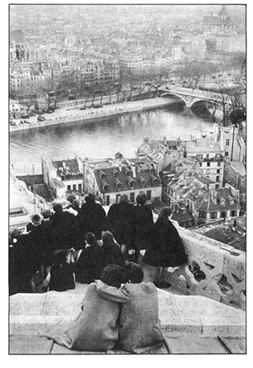
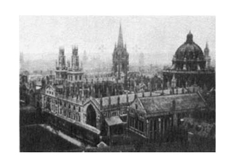
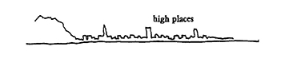

<section class="pattern-plate" aria-labelledby="t-high-places">
<a href="/patterns">A Pattern Language</a> · <a href="/patterns#towns">Towns</a> · Pattern 62 · p. 315 · *
<h1 class="pattern-title" id="t-high-places">High Places</h1><figure class="pattern-figure pl-figure"></figure><nav class="pattern-links" aria-label="Connections"><h2>Links to</h2><ul><li><a href="/patterns/four-story-limit">21 Four-Story Limit</a></li><li><a href="/patterns/small-public-squares">61 Small Public Squares</a></li><li><a href="/patterns/holy-ground">66 Holy Ground</a></li><li><a href="/patterns/zen-view">134 Zen View</a></li><li><a href="/patterns/open-stairs">158 Open Stairs</a></li></ul><h2>Linked from</h2><ul><li><a href="/patterns/four-story-limit">21 Four-Story Limit</a></li><li><a href="/patterns/children-in-the-city">57 Children In The City</a></li><li><a href="/patterns/something-roughly-in-the-middle">126 Something Roughly In The Middle</a></li></ul></nav></section><article class="pattern-text" aria-label="The text of High Places">
316… according to <a class="pl-ref" href="/patterns/four-story-limit">four-story limit (21)</a>, most roofs in the community are no higher than four stories, about 40 or 50 feet. However, it is very important that this height limit be punctuated, just occasionally, by higher buildings which have special functions. They can help the character of the <a class="pl-ref" href="/patterns/small-public-squares">small public squares (61)</a> and <a class="pl-ref" href="/patterns/holy-ground">holy ground (66)</a>; they can give particular identity to their communities, provided that they do not occur more frequently than one in each community of 7000 (12).

◆ ◆ ◆

<strong>The instinct to climb up to some high place, from which you can look down and survey your world, seems to be a fundamental human instinct.</strong>

The tiniest hamlets have a dominating landmark—usually the church tower. Great cities have hundreds of them. The instinct to build these towers is certainly not merely Christian; the same thing happens in different cultures and religions, all over the world. Persian villages have pigeon towers; Turkey, its minarets; San Gimignano, its houses in the form of towers; castles, their lookouts; Athens, its Acropolis; Rio, its rock.

These high places have two separate and complementary functions. They give people a place to climb up to, from which they can look down upon their world. And they give people a place which they can see from far away and orient themselves toward, when they are on the ground.

Listen to Proust:

Combray at a distance, from a twenty-mile radius, as we used to see it from the railway when we arrived there every year in Holy Week, was no more than a church epitomising the town, representing it, speaking of it and for it to the horizon, and as one drew near, gathering close about its long, dark cloak, sheltering from the wind, on the open plain, as a shepherd gathers his sheep, the woolly grey backs of its blocking houses….

From a long way off one could distinguish and identify the steeple of Sainte-Hilaire inscribing its unforgetable form upon a horizon beneath which Combray had not yet appeared; when from the train 317which brought us down from Paris at Eastertime my father caught sight of it, as it slipped into every fold of the sky in turn, its little iron cock veering continually in all directions, he could say: “Come, get your wraps together, we are there.” (Marcel Proust, <em>Swann’s Way.)</em>

<figure class="pl-figure"><figcaption><em>Oxford: the city of dreaming sfires</em>.</figcaption></figure>

High places are equally important, too, as places from which to look down: places that give a spectacular, comprehensive view of the town. Visitors can go to them to get a sense of the entire area they have come to; and the people who live there can do so too—to reassess the shape and scope of their surroundings. But these visits to the high places will have no freshness or exhilaration if there is a ride to the top in a car or elevator. To get a full sense of the magnificence of the view, it seems necessary to work for it, to leave the car or elevator, and to climb. The act of climbing, even if only for a few steps, clears the mind and prepares the body.

As for distribution, we suggest about one of these high places for each community of 7000, high enough to be seen throughout the community. If high places are less frequent, they tend to be too special, and they have less power as landmarks.

Therefore:

<strong>Build occasional high places as landmarks throughout the city. They can be a natural part of the topography, or towers, or part of the roofs of the highest local building—but, in any case, they should include a physical climb.</strong>

318

<figure class="pl-figure"></figure>
◆ ◆ ◆

Elaborate the area around the base of the high place—it is a natural position for a small public square (61); give the stair which leads up to the top, openings with views out, so that people can stop on the stair, sit down, look out, and be seen while they are climbing—stair seats (125), <a class="pl-ref" href="/patterns/zen-view">zen view (134)</a>, <a class="pl-ref" href="/patterns/open-stairs">open stairs (158)</a>….
</article>

Christopher Alexander, Sara Ishikawa and Murray Silverstein, with Max Jacobson, Ingrid Fiksdahl-King and Shlomo Angel, <cite>A Pattern Language</cite> (Oxford University Press, 1977), pattern 62, pp. 315–318. Text and illustrations from the <a href="https://github.com/natureoforder/sources">Nature of Order sources</a> reading edition, transcribed from the 1977 printing; report errors on <a href="https://github.com/natureoforder/alexander-wiki/issues">GitHub</a>.

<a href="/patterns/small-public-squares">← 61 Small Public Squares</a> · <a href="/patterns">All 253 patterns</a> · <a href="/patterns/dancing-in-the-street">63 Dancing In The Street →</a>

