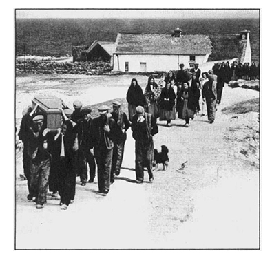
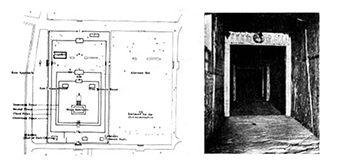
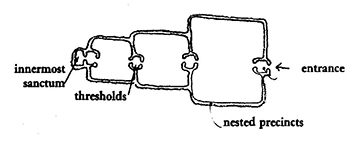

<section class="pattern-plate" aria-labelledby="t-holy-ground">
<a href="/patterns">A Pattern Language</a> · <a href="/patterns#towns">Towns</a> · Pattern 66 · p. 331 · *
<h1 class="pattern-title" id="t-holy-ground">Holy Ground</h1><figure class="pattern-figure pl-figure"></figure><nav class="pattern-links" aria-label="Connections"><h2>Links to</h2><ul><li><a href="/patterns/common-land">67 Common Land</a></li><li><a href="/patterns/connected-play">68 Connected Play</a></li><li><a href="/patterns/public-outdoor-room">69 Public Outdoor Room</a></li><li><a href="/patterns/grave-sites">70 Grave Sites</a></li><li><a href="/patterns/still-water">71 Still Water</a></li><li><a href="/patterns/local-sports">72 Local Sports</a></li><li><a href="/patterns/adventure-playground">73 Adventure Playground</a></li><li><a href="/patterns/animals">74 Animals</a></li><li><a href="/patterns/tree-places">171 Tree Places</a></li></ul><h2>Linked from</h2><ul><li><a href="/patterns/sacred-sites">24 Sacred Sites</a></li><li><a href="/patterns/life-cycle">26 Life Cycle</a></li><li><a href="/patterns/children-in-the-city">57 Children In The City</a></li><li><a href="/patterns/high-places">62 High Places</a></li><li><a href="/patterns/pools-and-streams">64 Pools And Streams</a></li><li><a href="/patterns/grave-sites">70 Grave Sites</a></li></ul></nav></section><article class="pattern-text" aria-label="The text of Holy Ground">
332… we have defined the need for a full life cycle, with rites of passage between stages of the cycle—life cycle (26); and we have recommended that certain pieces of land be set aside because of their importance and meaning—sacred sites (24). This pattern gives the detailed organization of the space around these places. The organization is so powerful, that to some extent it can itself create the sacredness of sites, perhaps even encourage the slow emergence of coherent rites of passage.

◆ ◆ ◆

<strong>What is a church or temple? It is a place of worship, spirit, contemplation, of course. But above all, from a human point of view, it is a gateway. A person comes into the world through the church. He leaves it through the church. And, at each of the important thresholds of his life, he once again steps through the church.</strong>

The rites that accompany birth, puberty, marriage, and death are fundamental to human growth. Unless these rites are given the emotional weight they need, it is impossible for a man or woman to pass thoroughly from one stage of life to another.

In all traditional societies, where these rites are treated with enormous power and respect, the rites, in one form or another, arc supported by parts of the physical environment which have the character of gates. Of course, a gate, or gateway, by itself cannot create a rite. But it is also true that the rites cannot evolve in an environment which specifically ignores them or makes them trivial. A hospital is no place for a baptism j a funeral home makes it impossible to feel the meaning of a funeral.

In functional terms, it is essential that each person have the opportunity to enter into some kind of social communion with his fellows at the times when he himself or his friends pass through these critical points in their lives. And this social communion at this moment needs to be rooted in some place which is recognized as a kind of spiritual gateway for these events.

What physical shape or organization must this “gateway” have 333in order to support the rites of passage, and in order to create the sanctity and holiness and feeling of connection to the earth which makes the rites significant.

Of course, it will vary in detail, from culture to culture. Whatever it is exactly that is held to be sacred—whether it is nature, god, a special place, a spirit, holy relics, the earth itself, or an idea—it takes different forms, in different cultures, and requires different physical environments to support it.

However, we do believe that one fundamental characteristic is invariant from culture to culture. In all cultures it seems that whatever it is that is holy will only be felt as holy, if it is hard to reach, if it requires layers of access, waiting, levels of approach, a gradual unpeeling, gradual revelation, passage through a series of gates. There are many examples: the Inner City of Peking; the fact that anyone who has audience with the Pope must wait in each of seven waiting rooms; the Aztec sacrifices took place on stepped pyramids, each step closer to the sacrifice; the Ise shrine, the most famous shrine in Japan, is a nest of precincts, each one inside the other.

<figure class="pl-figure"><figcaption><em>Layers of access</em>.</figcaption></figure>

Even in an ordinary Christian church, you pass first through the churchyard, then through the nave; then, on special occasions, beyond the altar rail into the chancel and only the priest himself is able to go into the tabernacle. The holy bread is sheltered by five layers of ever more difficult approach.

This layering, or nesting of precincts, seems to correspond to 334a fundamental aspect of human psychology. We believe that every community, regardless of its particular faith, regardless of whether it even has a faith in any organized sense, needs some place where this feeling of slow, progressive access through gates to a holy center may be experienced. When such a place exists in a community, even if it is not associated with any particular religion, we believe that the feeling of holiness, in some form or other, will gradually come to life there among the people who share in the experience.

Therefore:

<strong>In each community and neighborhood, identify some sacred site as consecrated ground, and form a series of nested precincts, each marked by a gateway, each one progressively more private, and more sacred than the last, the innermost a final sanctum that can only be reached by passing through all of the outer ones.</strong>

<figure class="pl-figure"></figure>
◆ ◆ ◆

At each threshold between precincts build a gate—main gateways (53); at each gate, a place to pause with a new view toward the next most inner place—zen view (134); and at the innermost sanctum, something very quiet and able to inspire—perhaps a view, or no more than a simple tree, or pool—pools and streams (64), <a class="pl-ref" href="/patterns/tree-places">tree places (171)</a>….

335<em>in each house cluster and work community, frovide the smaller bits of common land, to frovide for local versions of the same needs:</em>

<a class="pl-ref" href="/patterns/common-land">67. COMMON LAND</a>

<a class="pl-ref" href="/patterns/connected-play">68. CONNECTED PLAY</a>

<a class="pl-ref" href="/patterns/public-outdoor-room">69. PUBLIC OUTDOOR ROOM</a>

<a class="pl-ref" href="/patterns/grave-sites">70. GRAVE SITES</a>

<a class="pl-ref" href="/patterns/still-water">71. STILLWATER</a>

<a class="pl-ref" href="/patterns/local-sports">72. LOCAL SPORTS</a>

<a class="pl-ref" href="/patterns/adventure-playground">73. ADVENTURE PLAYGROUND</a>

<a class="pl-ref" href="/patterns/animals">74. ANIMALS</a>
</article>

Christopher Alexander, Sara Ishikawa and Murray Silverstein, with Max Jacobson, Ingrid Fiksdahl-King and Shlomo Angel, <cite>A Pattern Language</cite> (Oxford University Press, 1977), pattern 66, pp. 331–335. Text and illustrations from the <a href="https://github.com/natureoforder/sources">Nature of Order sources</a> reading edition, transcribed from the 1977 printing; report errors on <a href="https://github.com/natureoforder/alexander-wiki/issues">GitHub</a>.

<a href="/patterns/birth-places">← 65 Birth Places</a> · <a href="/patterns">All 253 patterns</a> · <a href="/patterns/common-land">67 Common Land →</a>

