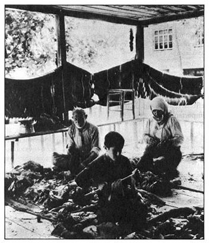
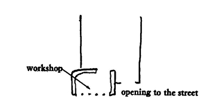

<section class="pattern-plate" aria-labelledby="t-home-workshop">
<a href="/patterns">A Pattern Language</a> · <a href="/patterns#buildings">Buildings</a> · Pattern 157 · p. 737
<h1 class="pattern-title" id="t-home-workshop">Home Workshop</h1><figure class="pattern-figure pl-figure"></figure><nav class="pattern-links" aria-label="Connections"><h2>Links to</h2><ul><li><a href="/patterns/scattered-work">9 Scattered Work</a></li><li><a href="/patterns/men-and-women">27 Men And Women</a></li><li><a href="/patterns/house-cluster">37 House Cluster</a></li><li><a href="/patterns/your-own-home">79 Your Own Home</a></li><li><a href="/patterns/self-governing-workshops-and-offices">80 Self-Governing Workshops And Offices</a></li><li><a href="/patterns/light-on-two-sides-of-every-room">159 Light On Two Sides Of Every Room</a></li><li><a href="/patterns/sunny-place">161 Sunny Place</a></li><li><a href="/patterns/opening-to-the-street">165 Opening To The Street</a></li><li><a href="/patterns/the-shape-of-indoor-space">191 The Shape Of Indoor Space</a></li><li><a href="/patterns/windows-overlooking-life">192 Windows Overlooking Life</a></li></ul><h2>Linked from</h2><ul><li><a href="/patterns/scattered-work">9 Scattered Work</a></li><li><a href="/patterns/network-of-learning">18 Network Of Learning</a></li><li><a href="/patterns/health-center">47 Health Center</a></li><li><a href="/patterns/teen-age-society">84 Teen-Age Society</a></li><li><a href="/patterns/indoor-sunlight">128 Indoor Sunlight</a></li><li><a href="/patterns/childrens-realm">137 Children’s Realm</a></li><li><a href="/patterns/a-room-of-ones-own">141 A Room Of One’s Own</a></li><li><a href="/patterns/half-private-office">152 Half-Private Office</a></li><li><a href="/patterns/rooms-to-rent">153 Rooms To Rent</a></li><li><a href="/patterns/teenagers-cottage">154 Teenager’s Cottage</a></li><li><a href="/patterns/settled-work">156 Settled Work</a></li><li><a href="/patterns/open-stairs">158 Open Stairs</a></li><li><a href="/patterns/workspace-enclosure">183 Workspace Enclosure</a></li></ul></nav></section><article class="pattern-text" aria-label="The text of Home Workshop">
738… at the center of each <a class="pl-ref" href="/patterns/house-cluster">HOUSE CLUSER (37)</a> and in <a class="pl-ref" href="/patterns/your-own-home">YOUR OWN HOME (79)</a> there needs to be one room or outbuilding, which is freely attached and accessible from the outside. This is the workshop. The following pattern tells us how important workshops are, how widely they ought to be scattered, how omnipresent, and when they are built, how easy to reach, and how public they should always be. It helps to reinforce the patterns of <a class="pl-ref" href="/patterns/scattered-work">SCATTERED WORK (9)</a>, NETWORK OF LEARNING (l8), and <a class="pl-ref" href="/patterns/men-and-women">MEN AND WOMEN (27)</a>.

◆ ◆ ◆

<strong>As the decentralization of work becomes more and more effective* the workshop in the home grows and grows in importance.</strong>

We have explained in <a class="pl-ref" href="/patterns/scattered-work">SCATTERED WORK (9)</a>, NETWORK OF LEARNING (l8), <a class="pl-ref" href="/patterns/men-and-women">MEN AND WOMEN (27)</a>, <a class="pl-ref" href="/patterns/self-governing-workshops-and-offices">SELF-GOVERNING WORKSHOPS AND OFFICES (80)</a>, and other patterns that we imagine a society in which work and family are far more intermingled than today; a society in which people—businessmen, artists, craftsmen, shopkeepers, professionals—work for themselves, alone and in small groups, with much more relation to their immediate surroundings than they have today.

In such a society, the home workshop becomes far more than a basement or a garage hobby shop. It becomes an integral part of every house; as central to the house’s function as the kitchen or the bedrooms. And we believe its most important characteristic is its relationship to the public street. For most of us, work life is relatively public. Certainly, compared to the privacy of the hearth, it is a public affair. Even where the public relationship is slight, there is something to be gained, both for the worker and the community, by enlarging the connection between the two.

In the case of the home workshop, the public nature of the work is especially valuable. It brings the workshop out of the realm of backyard hobbies and into the public domain. The people working there have a view of the street; they are exposed 739to the people passing by. And the people passing learn something about the nature of the community. The children especially are enlivened by this contact. And according to the nature of the work, the public connection takes the form of a shopfront, a driveway for loading and unloading materials, a work bench in the open, a small meeting room …

We therefore advocate provision for a substantial workshop with all the character of a real workplace and some degree of connection to the public street: at least a glancing connection so that people can see in and out; and perhaps a full connection, like an open shop front.

Therefore:

<strong>Make a place in the home, where substantial work can be done; not just a hobby, but a job. Change the zoning laws to encourage modest, quiet work operations to locate in neighborhoods. Give the workshop perhaps a few hundred square feet; and locate it so it can be seen from the street and the owner can hang out a shingle.</strong>

<figure class="pl-figure"></figure>
◆ ◆ ◆

Give the workshop a corner where it is especially nice to work <a class="pl-ref" href="/patterns/light-on-two-sides-of-every-room">LIGHT ON TWO SIDES (159)</a>, WORKSPACE ENCLOSURE (l 83); a strong connection to the street—<a class="pl-ref" href="/patterns/opening-to-the-street">OPENING TO THE STREET (165)</a>, <a class="pl-ref" href="/patterns/windows-overlooking-life">WINDOWS OVERLOOKING LIFE (192)</a>; perhaps a place to work in the sun on warm days—<a class="pl-ref" href="/patterns/sunny-place">SUNNY PLACE (161)</a>. For the shape of the workshop and its construction, start with <a class="pl-ref" href="/patterns/the-shape-of-indoor-space">THE SHAPE OF INDOOR SPACE (191)</a>….
</article>

Christopher Alexander, Sara Ishikawa and Murray Silverstein, with Max Jacobson, Ingrid Fiksdahl-King and Shlomo Angel, <cite>A Pattern Language</cite> (Oxford University Press, 1977), pattern 157, pp. 737–739. Text and illustrations from the <a href="https://github.com/natureoforder/sources">Nature of Order sources</a> reading edition, transcribed from the 1977 printing; report errors on <a href="https://github.com/natureoforder/alexander-wiki/issues">GitHub</a>.

<a href="/patterns/settled-work">← 156 Settled Work</a> · <a href="/patterns">All 253 patterns</a> · <a href="/patterns/open-stairs">158 Open Stairs →</a>

