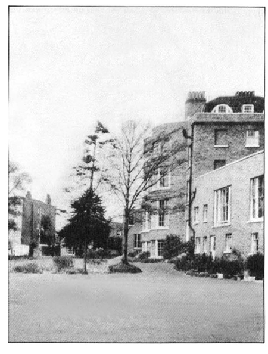
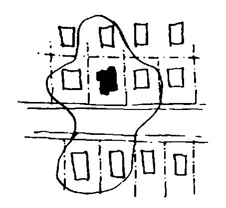
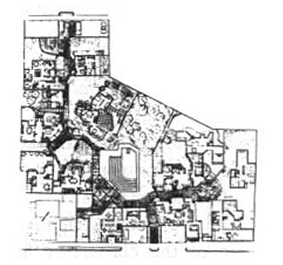
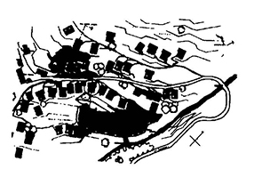
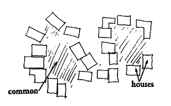

<section class="pattern-plate" aria-labelledby="t-house-cluster">
<a href="/patterns">A Pattern Language</a> · <a href="/patterns#towns">Towns</a> · Pattern 37 · p. 197 · **
<h1 class="pattern-title" id="t-house-cluster">House Cluster</h1><figure class="pattern-figure pl-figure"></figure><nav class="pattern-links" aria-label="Connections"><h2>Links to</h2><ul><li><a href="/patterns/identifiable-neighborhood">14 Identifiable Neighborhood</a></li><li><a href="/patterns/density-rings">29 Density Rings</a></li><li><a href="/patterns/household-mix">35 Household Mix</a></li><li><a href="/patterns/degrees-of-publicness">36 Degrees Of Publicness</a></li><li><a href="/patterns/common-land">67 Common Land</a></li><li><a href="/patterns/the-family">75 The Family</a></li></ul><h2>Linked from</h2><ul><li><a href="/patterns/lace-of-country-streets">5 Lace Of Country Streets</a></li><li><a href="/patterns/the-countryside">7 The Countryside</a></li><li><a href="/patterns/mosaic-of-subcultures">8 Mosaic Of Subcultures</a></li><li><a href="/patterns/identifiable-neighborhood">14 Identifiable Neighborhood</a></li><li><a href="/patterns/density-rings">29 Density Rings</a></li><li><a href="/patterns/interchange">34 Interchange</a></li><li><a href="/patterns/household-mix">35 Household Mix</a></li><li><a href="/patterns/degrees-of-publicness">36 Degrees Of Publicness</a></li><li><a href="/patterns/housing-in-between">48 Housing In Between</a></li><li><a href="/patterns/looped-local-roads">49 Looped Local Roads</a></li><li><a href="/patterns/still-water">71 Still Water</a></li><li><a href="/patterns/house-for-a-small-family">76 House For A Small Family</a></li><li><a href="/patterns/house-for-a-couple">77 House For A Couple</a></li><li><a href="/patterns/small-parking-lots">103 Small Parking Lots</a></li><li><a href="/patterns/half-hidden-garden">111 Half-Hidden Garden</a></li><li><a href="/patterns/home-workshop">157 Home Workshop</a></li><li><a href="/patterns/sunny-place">161 Sunny Place</a></li><li><a href="/patterns/greenhouse">175 Greenhouse</a></li><li><a href="/patterns/compost">178 Compost</a></li></ul></nav></section><article class="pattern-text" aria-label="The text of House Cluster">
198… the fundamental unit of organization within the neighborhood—<a class="pl-ref" href="/patterns/identifiable-neighborhood">IDENTIFIABLE NEIGHBORHOOD (14)</a>—is the cluster of a dozen houses. By varying the density and composition of different clusters, this pattern may also help to generate <a class="pl-ref" href="/patterns/density-rings">DENSITY RINGS (29)</a>, <a class="pl-ref" href="/patterns/household-mix">HOUSEHOLD MIX (35)</a>. and <a class="pl-ref" href="/patterns/degrees-of-publicness">DEGREES OF PUBLICNESS (36)</a>.

◆ ◆ ◆

<strong>People will not feel comfortable in their houses unless a group of houses forms a cluster, with the public land between them jointly owned by all the householders.</strong>

When houses are arranged on streets, and the streets owned by the town, there is no way in which the land immediately outside the houses can reflect the needs of families and individuals living in those houses. The land will only gradually get shaped to meet their needs if they have direct control over the land and its repair.

This pattern is based on the idea that the cluster of land and homes immediately around one’s own home is of special importance. It is the source for gradual differentiation of neighborhood land use, and it is the natural focus of neighborly interaction.

Herbert Gans, in <em>The Levittowners</em> (New York: Pantheon, 1967), has collected some powerful evidence for this tendency. Gans surveyed visiting habits on a typical block tract development. Of the 149 people he surveyed, <em>all of them were engaged in some pattern of regular visiting with their neighbors</em>. The interesting finding is the morphology of this visiting pattern.

Consider the following diagram-one like it can be made for almost every house in a tract. There is a house on either side, one or two across the street, and one directly behind, across a garden fence.

<em>Ninety-three per cent of all the neighborhood visiting engaged in by the subjects is confined to this spatial cluster</em>.

199

<figure class="pl-figure"><figcaption><em>On a typical block each home is at the center of its own cluster</em>.</figcaption></figure>

And when asked “Whom do you visit most?”91 per cent said the people they visit most are immediately across the street or next door.

The beauty of this finding is its indication of the strength of the <em>spatial</em> cluster to draw people together into neighborly contact. <em>The most obvious and tribal-like cluster-the homes on either side and across the street-forms roughly a circle, and it is there that most contact occurs</em>. And if we add to this shape the home immediately behind, although it is separated by private gardens and a fence, we can account for nearly all the visiting that goes on in the Levittown neighborhood.

<em>We conclude that people continue to act according to the laws of a spatial cluster, even when the block layout and the neighborhood plan do their best to destroy this unit and make it anonymous</em>.

Gans’ data underscore our intuitions: people want to be part of a neighborly spatial cluster; contact between people sharing such a cluster is a vital function. And this need stands, even when people are able to drive and ace friends all over the city.

What about the size of the cluster? What is the appropriate size? I n Gans’ investigations each home stands at the center of a cluster of five or six other homes. But this is certainly not a natural limit for a housing cluster since the Levittown block layouts are so confining. In our experience, when the siting of the homes is attuned to the cluster pattern, the natural limit arises entirely from the balance between the informality and coherence of the group.

200The clusters seem to work best if they have between 8 and 12 houses each. With one representative from each family, this is the number of people that can sit round a common meeting table, can talk to each other directly, face to face, and can therefore make wise decisions about the land they hold in common. With 8 or 10 households, people can meet over a kitchen table, exchange news on the street and in the gardens, and generally, without much special attention, keep in touch with the whole of the group. When there are more than 10 or 12 homes forming a cluster, this balance is strained. We therefore set an upper limit of around 12 on the number of households that can be naturally drawn into a cluster. Of course, the average size for clusters might be less, perhaps around 6 or 8; and clusters of 3, 4, or 5 homes can work perfectly well.

Now, assuming that a group of neighbors, or a neighborhood association, or a planner, wants to give some expression to this pattern, what are the critical issues?

First, the geometry. In a new neighborhood, with houses built on the ground, we imagine quite dramatic clusters, with the houses built around or to the side of common land; and with a core to the cluster that gradually tapers off at the edges.

<figure class="pl-figure"><figcaption><em>A cluster of 12 houses</em>.</figcaption></figure>

In ex1stmg neighborhoods of free-standing houses, the pattern must be brought into play gradually by relaxing zoning ordinances, and allowing people to gradually knit together clusters out of the existing grid—see <a class="pl-ref" href="/patterns/common-land">COMMON LAND (67)</a> and <a class="pl-ref" href="/patterns/the-family">THE FAMILY (75)</a>. It is even possible to implement the pattern with

201<strong>row houses</strong> (38) and <strong>housing hills</strong> (39). In this case the configuration of the rows, and the wings of the apartment building, form the cluster.

In all cases common land which is shared by the cluster is an essential ingredient. It acts as a focus and physically knits the group together. This common land can be as small as a path or as large as a green.

On the other hand, care must be taken not to make the clusters too tight or self-contained, so that they exclude the larger community or seem too constricting and claustrophobic. There needs to be some open endedness and overlapping among clusters.

<figure class="pl-figure"><figcaption><em>Overlapping clusters in a Turkish village</em>.</figcaption></figure>

Along with the shape of the cluster, the way in which it is owned is critical. <em>If the pattern of ownership is not in accord with the physical properties of the clustery the pattern will not take hold</em>. Very simply, the cluster must be owned and maintained by its constituent households. The households must be able to organize themselves as a corporation, capable of owning all the common land they share. There are many examples of tiny, user-owned housing corporations such as this. We know several places in our region where such experiments are under way, and places where they have been established for many years. And we have heard, from visitors to the Center, of similar developments in various parts of the world.

We advocate a system of ownership where the deed to one home carries with it part ownership in the cluster to which the home belongs; and ideally, this in turn carries with it part ownership 202in the neighborhood made up of several clusters. In this way, ever<em>y</em> owner is automatically a shareholder in several levels of public land. And each level, beginning with the homes in their clusters, is a political unit with the power to control the processes of its own growth and repair.

Under such a system, the housing, whether in low or high density neighborhoods, can gradually find its way toward an abiding expression of the cluster. And the clusters themselves will come to support a quality of neighborhood life that, from our broken down neighborhoods now, we can only dimly perceive.

The unavowed secret of man is that he wants to be confirmed in his being and his existence by his fellow men and that he wishes them to make it possible for him to confirm them, and … not merely in the family, in the party assembly or in the public house, but also in the course of neighborly encounters, perhaps when he or the other steps out of the door of his house or to the window of his house and the greeting with which they greet each other will be accompanied by a glance of well-wishing, a glance in which curiosity, mistrust, and routine will have been overcome by a mutual sympathy: the one gives the other to understand that he affirms his presence. This is the indispensable minimum of humanity. (Martin Buber, <em>Gleanings</em>, New York: Simon and Schuster, 1969, p. 94.)

Therefore:

<strong>Arrange houses to form very rough, but identifiable clusters of 8 to 12 households around some common land and paths. Arrange the clusters so that anyone can walk through them, without feeling like a trespasser.</strong>

<figure class="pl-figure"></figure>
◆ ◆ ◆

203Use this pattern as it is for low densities, up to about 15 houses per acre; at higher densities, modify the cluster with the additional structure given by <strong>row houses</strong> (38) or <strong>housing hill</strong> (39). Always provide common land between the houses—<strong>common land</strong> (67) and a shared common workshop—<strong>home workshop</strong> (157). Arrange paths clearly—<strong>circulation realms</strong> (98)—and lay these paths out in such a way that they create busier paths and backwaters, even within the cluster—<strong>degrees of publicness</strong> (36); keep parking in <strong>small parking lots</strong> (103), and make the houses in the cluster suit the households which will live there—<strong>the family</strong> (75), <strong>house for a small family</strong> (76), <strong>HOUSE FOR A COUPLE</strong> (77), <strong>HOUSE FOR ONE PERSON</strong> (78), <strong>YOUR OWN HOME</strong> (79)….
</article>

Christopher Alexander, Sara Ishikawa and Murray Silverstein, with Max Jacobson, Ingrid Fiksdahl-King and Shlomo Angel, <cite>A Pattern Language</cite> (Oxford University Press, 1977), pattern 37, pp. 197–203. Text and illustrations from the <a href="https://github.com/natureoforder/sources">Nature of Order sources</a> reading edition, transcribed from the 1977 printing; report errors on <a href="https://github.com/natureoforder/alexander-wiki/issues">GitHub</a>.

<a href="/patterns/degrees-of-publicness">← 36 Degrees Of Publicness</a> · <a href="/patterns">All 253 patterns</a> · <a href="/patterns/row-houses">38 Row Houses →</a>

