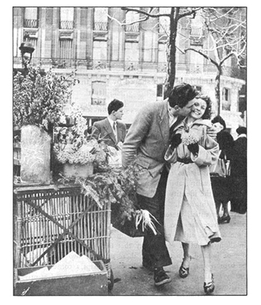
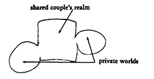

<section class="pattern-plate" aria-labelledby="t-house-for-a-couple">
<a href="/patterns">A Pattern Language</a> · <a href="/patterns#towns">Towns</a> · Pattern 77 · p. 385 · *
<h1 class="pattern-title" id="t-house-for-a-couple">House For A Couple</h1><figure class="pattern-figure pl-figure"></figure><nav class="pattern-links" aria-label="Connections"><h2>Links to</h2><ul><li><a href="/patterns/house-cluster">37 House Cluster</a></li><li><a href="/patterns/the-family">75 The Family</a></li><li><a href="/patterns/couples-realm">136 Couple’s Realm</a></li></ul><h2>Linked from</h2><ul><li><a href="/patterns/household-mix">35 Household Mix</a></li><li><a href="/patterns/row-houses">38 Row Houses</a></li><li><a href="/patterns/animals">74 Animals</a></li><li><a href="/patterns/the-family">75 The Family</a></li><li><a href="/patterns/house-for-one-person">78 House For One Person</a></li><li><a href="/patterns/your-own-home">79 Your Own Home</a></li><li><a href="/patterns/wings-of-light">107 Wings Of Light</a></li><li><a href="/patterns/couples-realm">136 Couple’s Realm</a></li><li><a href="/patterns/a-room-of-ones-own">141 A Room Of One’s Own</a></li><li><a href="/patterns/open-stairs">158 Open Stairs</a></li></ul></nav></section><article class="pattern-text" aria-label="The text of House For A Couple">
386… again, ideally, every couple is a part of a larger group household—the family (75). If this can not be so, try to build the house for the couple in such a way as to tie it together with some other households, to form the beginnings of a group household, or, if this fails, at least to form the beginnings of a <a class="pl-ref" href="/patterns/house-cluster">house cluster (37)</a>.

◆ ◆ ◆

<strong>In a small household shared by two, the most important problem which arises is the possibility that each may have too little opportunity for solitude or privacy.</strong>

Consider these forces:

1. Of course, the couple need a shared realm, where they can function together, invite friends, be alone together. This realm needs to be made up of functions which they share.

2. But it is also true that each partner is trying to maintain an individuality, and not be submerged in the identity of the other, or the identity of the “couple.” Each partner needs <em>Space</em> to nourish this need.

It is essential, therefore, that a small house be conceived as a place where the two people may be together but where, from time to time, either one of them may also be alone, in comfort, in dignity, and in such a way that the other does not feel left out or isolated. To this end, there must be two small places—perhaps rooms, perhaps large alcoves, perhaps a corner, screened off by a half-wall—places which are clearly understood as private territories, where each person can keep to himself, pursue his or her own activities.

Still, the problem of the balance of privacy in a couple’s lives is delicate. Even with a small place of one’s own, tenuously connected to the house, one partner may feel left out at various moments. While we believe that the solution proposed in this pattern helps, the problem will not be entirely settled until the couple itself is in some close, neighborly, and family-like relationship 387to other adults. Then, when one needs privacy, the other has other possibilities for companionship at hand. This idea and its physical implications are discussed in the pattern, <a class="pl-ref" href="/patterns/the-family">the family (75)</a>.

Once the opportunity for withdrawal is satisfied, there is also a genuine opportunity for the couple to be together; and then the house can be a place where genuine intimacy, genuine connection can happen.

There is one other problem, unique to a house for a couple, that must be mentioned. In the first years of a couple’s life, as they learn more about each other, and find out if indeed they have a future together, the evolution of the house plays a vital role. Improving the house, fixing it up, enlarging it, provides a frame for learning about one another; it brings out conflict, and offers the chance, like almost no other activity, for concrete resolution and growth. This suggests that a couple find a place that they can change gradually over the years, and <em>not</em> build or buy for themselves a “dream” home from scratch. The experience of making simple changes in the house, and tuning it to their lives, provides some grist for their own growth. Therefore, it is best to start small, with plenty of room for growth and change.

Therefore:

<strong>Conceive a house for a couple as being made up of two kinds of places—a shared couple’s realm and individual private worlds. Imagine the shared realm as half-public and half-intimate; and the private worlds as entirely individual and private.</strong>

<figure class="pl-figure"></figure>
388

◆ ◆ ◆

Again, treat the house as a distinct piece of territory, in some fashion owned by its users—your own home (79). Lay out the common part, according to the pattern <a class="pl-ref" href="/patterns/couples-realm">couple’s realm (136)</a>, and give both persons an individual world of their own where they can be alone—a room of one’s own (141)….
</article>

Christopher Alexander, Sara Ishikawa and Murray Silverstein, with Max Jacobson, Ingrid Fiksdahl-King and Shlomo Angel, <cite>A Pattern Language</cite> (Oxford University Press, 1977), pattern 77, pp. 385–388. Text and illustrations from the <a href="https://github.com/natureoforder/sources">Nature of Order sources</a> reading edition, transcribed from the 1977 printing; report errors on <a href="https://github.com/natureoforder/alexander-wiki/issues">GitHub</a>.

<a href="/patterns/house-for-a-small-family">← 76 House For A Small Family</a> · <a href="/patterns">All 253 patterns</a> · <a href="/patterns/house-for-one-person">78 House For One Person →</a>

