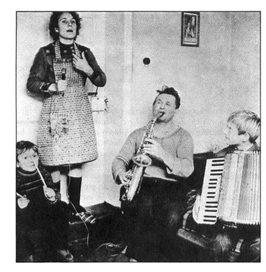
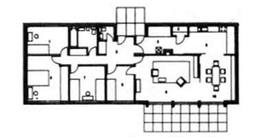
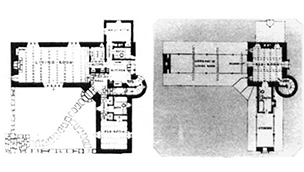
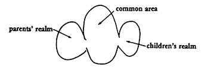

<section class="pattern-plate" aria-labelledby="t-house-for-a-small-family">
<a href="/patterns">A Pattern Language</a> · <a href="/patterns#towns">Towns</a> · Pattern 76 · p. 381 · *
<h1 class="pattern-title" id="t-house-for-a-small-family">House For A Small Family</h1><figure class="pattern-figure pl-figure"></figure><nav class="pattern-links" aria-label="Connections"><h2>Links to</h2><ul><li><a href="/patterns/house-cluster">37 House Cluster</a></li><li><a href="/patterns/the-family">75 The Family</a></li><li><a href="/patterns/couples-realm">136 Couple’s Realm</a></li><li><a href="/patterns/childrens-realm">137 Children’s Realm</a></li><li><a href="/patterns/bed-cluster">143 Bed Cluster</a></li></ul><h2>Linked from</h2><ul><li><a href="/patterns/household-mix">35 Household Mix</a></li><li><a href="/patterns/row-houses">38 Row Houses</a></li><li><a href="/patterns/animals">74 Animals</a></li><li><a href="/patterns/house-for-one-person">78 House For One Person</a></li><li><a href="/patterns/wings-of-light">107 Wings Of Light</a></li><li><a href="/patterns/couples-realm">136 Couple’s Realm</a></li><li><a href="/patterns/childrens-realm">137 Children’s Realm</a></li><li><a href="/patterns/a-room-of-ones-own">141 A Room Of One’s Own</a></li><li><a href="/patterns/bulk-storage">145 Bulk Storage</a></li><li><a href="/patterns/teenagers-cottage">154 Teenager’s Cottage</a></li><li><a href="/patterns/open-stairs">158 Open Stairs</a></li></ul></nav></section><article class="pattern-text" aria-label="The text of House For A Small Family">
382… according to <a class="pl-ref" href="/patterns/the-family">the family (75)</a>, each nuclear family ought to be a member household of a larger group household. If this is not possible, do what you can, when building a house for a small family, to generate some larger, possible group household, by tying it together with the next door households; in any case, at the very least, form the beginning of a <a class="pl-ref" href="/patterns/house-cluster">house cluster (37)</a>.

◆ ◆ ◆

<strong>In a house for a small family, it is the relationship between children and adults which is most critical.</strong>

Many small households, not large enough to have a full fledged nursery, not rich enough to have a nanny, find themselves swamped by the children. The children naturally want to be where the adults are; their parents don’t have the heart, or the energy, to keep them out of special areas; so finally the whole house has the character of a children’s room—children’s clothes, drawings, boots and shoes, tricycles, toy trucks, and disarray.

Yet, obviously few parents feel happy to give up the calm and cleanliness and quiet of the adult world in every square inch of their homes. To help achieve a balance, a house for a small family needs three distinct areas: a couple’s realm, reserved for the adults; a children’s realm, where children’s needs hold sway; and a common area, between the two, connected to them both.

The couple’s realm should be more than a room, although rooms are a part of it. It is territory which sustains them as two adults, a couple—not father and mother. Other parts of their lives are involved with children, friends, work; there must be a place which becomes naturally an expression of them as adults, alone. The children come in and out of this territory, but when they are there, they are clearly in the adults’ world. See <a class="pl-ref" href="/patterns/couples-realm">couple’s REALM (136)</a>.

The children’s world must also be looked upon as territory that they share, as children, <a class="pl-ref" href="/patterns/childrens-realm">children’s realm (137)</a>; here, it is important to establish that this is a part of the house, in balance with the others. Again, the critical feature is not that adults are 383“excluded” but that, when they are in this world, they are in children’s territory.

The common area contains those functions that the children and the adults share: eating together, sitting together, games, perhaps bathing, gardening—again, whatever captures their needs for shared territory. Quite likely, the common territory will be larger than the two other parts of the house.

Finally, realize that this pattern is different from the way most small family homes are made today. For example, a popular current conception, comparable to this, but quite different, is a suburban <em>two fart house:</em> sleeping and commons.

<figure class="pl-figure"><figcaption><em>A typical suburban twopart house</em>.</figcaption></figure>

Even though there is a “master bedroom” the sleeping part of the house is essentially one thing—the children are all around the master bedroom. This plan does not have the distinctions we are arguing for.

Here is a beautiful plan which does:

<figure class="pl-figure"><figcaption><em>A three-fart house—the couple’s realm upstairs</em>.</figcaption></figure>

384Therefore:

<strong>Give the house three distinct parts: a realm for parents, a realm for the children, and a common area. Conceive these three realms as roughly similar in size, with the commons the largest</strong>

<figure class="pl-figure"></figure>
◆ ◆ ◆

Treat the house, like every house, as a distinct piece of territory—your own home (79); build the three main parts according to the specific patterns for those parts—common areas at the heart (129), <a class="pl-ref" href="/patterns/couples-realm">couple’s realm (136)</a>, <a class="pl-ref" href="/patterns/bed-cluster">bed cluster (143)</a> and connect the common areas, and the bed cluster according to the <a class="pl-ref" href="/patterns/childrens-realm">children’s realm (137)</a>….
</article>

Christopher Alexander, Sara Ishikawa and Murray Silverstein, with Max Jacobson, Ingrid Fiksdahl-King and Shlomo Angel, <cite>A Pattern Language</cite> (Oxford University Press, 1977), pattern 76, pp. 381–384. Text and illustrations from the <a href="https://github.com/natureoforder/sources">Nature of Order sources</a> reading edition, transcribed from the 1977 printing; report errors on <a href="https://github.com/natureoforder/alexander-wiki/issues">GitHub</a>.

<a href="/patterns/the-family">← 75 The Family</a> · <a href="/patterns">All 253 patterns</a> · <a href="/patterns/house-for-a-couple">77 House For A Couple →</a>

