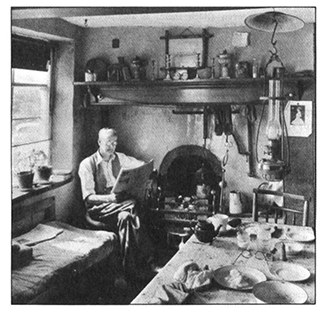
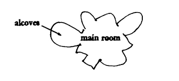

<section class="pattern-plate" aria-labelledby="t-house-for-one-person">
<a href="/patterns">A Pattern Language</a> · <a href="/patterns#towns">Towns</a> · Pattern 78 · p. 389 · *
<h1 class="pattern-title" id="t-house-for-one-person">House For One Person</h1><figure class="pattern-figure pl-figure"></figure><nav class="pattern-links" aria-label="Connections"><h2>Links to</h2><ul><li><a href="/patterns/house-for-a-small-family">76 House For A Small Family</a></li><li><a href="/patterns/house-for-a-couple">77 House For A Couple</a></li><li><a href="/patterns/teenagers-cottage">154 Teenager’s Cottage</a></li><li><a href="/patterns/old-age-cottage">155 Old Age Cottage</a></li><li><a href="/patterns/window-place">180 Window Place</a></li><li><a href="/patterns/workspace-enclosure">183 Workspace Enclosure</a></li><li><a href="/patterns/bed-alcove">188 Bed Alcove</a></li></ul><h2>Linked from</h2><ul><li><a href="/patterns/household-mix">35 Household Mix</a></li><li><a href="/patterns/row-houses">38 Row Houses</a></li><li><a href="/patterns/animals">74 Animals</a></li><li><a href="/patterns/the-family">75 The Family</a></li><li><a href="/patterns/your-own-home">79 Your Own Home</a></li><li><a href="/patterns/wings-of-light">107 Wings Of Light</a></li><li><a href="/patterns/old-age-cottage">155 Old Age Cottage</a></li><li><a href="/patterns/open-stairs">158 Open Stairs</a></li></ul></nav></section><article class="pattern-text" aria-label="The text of House For One Person">
390… the households with one person in them, more than any other, need to be a part of some kind of larger household—the family (75). Either build them to fit into some larger group household, or even attach them, as ancillary cottages to other, ordinary family households like <a class="pl-ref" href="/patterns/house-for-a-small-family">house for a small family (76)</a> or <a class="pl-ref" href="/patterns/house-for-a-couple">house for a couple (77)</a>.

◆ ◆ ◆

<strong>Once a household for one person is part of some larger group, the most critical problem which arises is the need for simplicity.</strong>

The housing market contains few houses or apartments specifically built for one person. Most often men and women who choose to live alone, live in larger houses and apartments, originally built for two people or families. And yet for one person these larger places are most often uncompact, unwieldy, hard to live in, hard to look after. Most important of all, they do not allow a person to develop a sense of self-sufficiency, simplicity, compactness, and economy in his or her own life.

The kind of place which is most closely suited to one person’s needs, and most nearly overcomes this problem, is a place of the utmost simplicity, in which only the bare bones of necessity are there: a place, built like a ploughshare, where every corner, every table, every shelf, each flower pot, each chair, each log, is placed according to the simplest necessity, and supports the person’s life directly, plainly, with the harmony of nothing that is not needed, and everything that is.

The plan of such a house will be characteristically different from other houses, primarily because it requires almost no differentiation of its spaces: it need only be one room. It can be a cottage or a studio, built on the ground or in a larger building, part of a group household or a detached structure. In essence, it is simply a central space, with nooks around it. The nooks replace the rooms in a larger house; they are for bed, bath, kitchen, workshop and entrance.

It is important to realize that very many of the patterns in this book can be built into a small house; small size does not preclude 391richness of form. The trick is to intensify and to overlay; to compress the patterns; to reduce them to simple expressions; to make every inch count double. When it is well done, a small house feels wonderfully continuous—cooking a bowl of soup fills the house; there is no rattling around. This cannot happen if the place is divided into rooms.

We have found it necessary to call special attention to this pattern because it is nearly impossible to build a house this small in cities—there is no way to get hold of a very small lot. Zoning codes and banking practices prohibit such tiny lots; they prohibit “normal” lots from splitting down to the kind of scale that a house for one person requires. The correct development of this pattern will require a change in these ordinances.

Therefore:

<strong>Conceive a boose for one person as a place of the utmost simplicity: essentially a one-room cottage or studio, with large and small alcoves around it When it is most intense, the entire house may be no more than 300 to 400 square feet</strong>

<figure class="pl-figure"></figure>
◆ ◆ ◆

And again, make the house an individual piece of territory, with its own garden, no matter how small—your own home (79); make the main room essentially a kind of farmhouse kitchen—farmhouse kitchen (139), with alcoves opening off it for sitting, working, bathing, sleeping, dressing—bathing room (144), <a class="pl-ref" href="/patterns/window-place">window place (180)</a>, <a class="pl-ref" href="/patterns/workspace-enclosure">workspace enclosure (183)</a>, <a class="pl-ref" href="/patterns/bed-alcove">bed alcove (188)</a>, dressing room (189); if the house is meant for an old person, or for someone very young, shape it also according to the pattern for <a class="pl-ref" href="/patterns/old-age-cottage">old age cottage (155)</a> or <a class="pl-ref" href="/patterns/teenagers-cottage">teenager’s COTTAGE (154)</a>….
</article>

Christopher Alexander, Sara Ishikawa and Murray Silverstein, with Max Jacobson, Ingrid Fiksdahl-King and Shlomo Angel, <cite>A Pattern Language</cite> (Oxford University Press, 1977), pattern 78, pp. 389–391. Text and illustrations from the <a href="https://github.com/natureoforder/sources">Nature of Order sources</a> reading edition, transcribed from the 1977 printing; report errors on <a href="https://github.com/natureoforder/alexander-wiki/issues">GitHub</a>.

<a href="/patterns/house-for-a-couple">← 77 House For A Couple</a> · <a href="/patterns">All 253 patterns</a> · <a href="/patterns/your-own-home">79 Your Own Home →</a>

