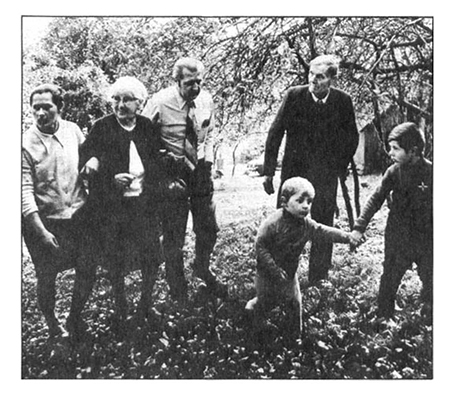
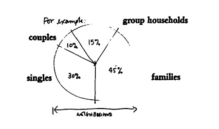

<section class="pattern-plate" aria-labelledby="t-household-mix">
<a href="/patterns">A Pattern Language</a> · <a href="/patterns#towns">Towns</a> · Pattern 35 · p. 188 · *
<h1 class="pattern-title" id="t-household-mix">Household Mix</h1><figure class="pattern-figure pl-figure"></figure><nav class="pattern-links" aria-label="Connections"><h2>Links to</h2><ul><li><a href="/patterns/identifiable-neighborhood">14 Identifiable Neighborhood</a></li><li><a href="/patterns/life-cycle">26 Life Cycle</a></li><li><a href="/patterns/house-cluster">37 House Cluster</a></li><li><a href="/patterns/old-people-everywhere">40 Old People Everywhere</a></li><li><a href="/patterns/work-community">41 Work Community</a></li><li><a href="/patterns/connected-play">68 Connected Play</a></li><li><a href="/patterns/the-family">75 The Family</a></li><li><a href="/patterns/house-for-a-small-family">76 House For A Small Family</a></li><li><a href="/patterns/house-for-a-couple">77 House For A Couple</a></li><li><a href="/patterns/house-for-one-person">78 House For One Person</a></li></ul><h2>Linked from</h2><ul><li><a href="/patterns/life-cycle">26 Life Cycle</a></li><li><a href="/patterns/house-cluster">37 House Cluster</a></li><li><a href="/patterns/old-people-everywhere">40 Old People Everywhere</a></li><li><a href="/patterns/the-family">75 The Family</a></li></ul></nav></section><article class="pattern-text" aria-label="The text of Household Mix">
189… the mix of households in an area does almost more than anything else to generate, or destroy, the character of an <a class="pl-ref" href="/patterns/identifiable-neighborhood">IDENTIFIABLE NEIGHBORHOOD (14)</a>, of a <a class="pl-ref" href="/patterns/house-cluster">HOUSE CLUSTER (37)</a>, of a <a class="pl-ref" href="/patterns/work-community">WORK COMMUNITY (41)</a>, or, most generally of all, of a <a class="pl-ref" href="/patterns/life-cycle">LIFE CYCLE (26)</a>. The question is, what kind of mix should a wellbalanced neighborhood contain?

◆ ◆ ◆

<strong>No one stage in the life cycle is self-sufficient.</strong>

People need support and confirmation from people who have reached a different stage in the life cycle, at the same time that they also need support from people who are at the same stage as they are themselves.

However, the needs which generate separation, tend to overwhelm the need for mixture. Present housing patterns tend to keep different types of households segregated from each other. There are vast areas of two-bedroom houses, other areas of studio and one-bedroom apartments, other areas of three- and four-bedroom houses. This means that we have corresponding areas of single people, couples, and small families with children, segregated by type.

The effects of household segregation are profound. In the pattern <a class="pl-ref" href="/patterns/life-cycle">LIFE CYCLE (26)</a>, we have suggested that normal growth through the stages of life requires contact, at each stage, with people and institutions from <em>all</em> the other ages of man. Such contact is completely foiled if the housing mix in one’s neighborhood is skewed toward one or two stages only. On the other hand, when the balance of life cycles is well related to the kinds of housing that are available in a neighborhood, the possibilities for contact become concrete. Each person can find in the face-to-face life of his neighborhood at least passing contact with people from every stage of life. Teenagers see young couples, old people watch the very young, people living alone draw sustenance from large families, youngsters look to the middle-aged for models, and so on: it is all a medium through which people feel their way through life.

190This need for a mix of housing must be offset against the need to be near people similar in age and way of life to oneself. Taking these two needs together, what is the right balance for the housing mix?

The right balance can be derived straightforwardly from the statistics of the region. First, determine the percentage of each household type for the region as a whole; second, use the same percentages to guide the gradual growth of the housing mix within the neighborhood. For example, if 40 per cent of a metropolitan region’s households are families, 25 per cent are couples, 20 per cent are individuals, and 10 per cent group households, then we would expect the houses in each neighborhood to have roughly the same balance.

Let us ask, finally, how large a group should the mix be applied to1 We might try to create a mix in every house (obviously absurd), or in every cluster of a dozen houses, or in every neighborhood, or merely in every town (this last has almost no significant effect). We believe that the mix will only work if it exists in a human group small enough to have some internal political and human intercourse—this could be a cluster of a dozen families, or a neighborhood of 500 people.

Therefore:

<strong>Encourage growth toward a mix of household types in every neighborhood, and every cluster, so that one-person households, couples, families with children, and group households are side by side.</strong>

<figure class="pl-figure"></figure>
191

◆ ◆ ◆

Make especially sure there are provisions for old people in every neighborhood—<a class="pl-ref" href="/patterns/old-people-everywhere">OLD PEOPLE EVERYWHERE (40)</a>, and that even with this mix, young children will have enough playmates—<a class="pl-ref" href="/patterns/connected-play">CONNECTED PLAY (68)</a>; and build the details of the different kinds of households, according to the appropriate more detailed patterns to reinforce the mix—<a class="pl-ref" href="/patterns/the-family">THE FAMILY (75)</a>, <a class="pl-ref" href="/patterns/house-for-a-small-family">HOUSE FOR A SMALL FAMILY (76)</a>, <a class="pl-ref" href="/patterns/house-for-a-couple">HOUSE FOR A COUPLE (77)</a>, <a class="pl-ref" href="/patterns/house-for-one-person">HOUSE FOR ONE PERSON (78)</a>….
</article>

Christopher Alexander, Sara Ishikawa and Murray Silverstein, with Max Jacobson, Ingrid Fiksdahl-King and Shlomo Angel, <cite>A Pattern Language</cite> (Oxford University Press, 1977), pattern 35, pp. 188–191. Text and illustrations from the <a href="https://github.com/natureoforder/sources">Nature of Order sources</a> reading edition, transcribed from the 1977 printing; report errors on <a href="https://github.com/natureoforder/alexander-wiki/issues">GitHub</a>.

<a href="/patterns/interchange">← 34 Interchange</a> · <a href="/patterns">All 253 patterns</a> · <a href="/patterns/degrees-of-publicness">36 Degrees Of Publicness →</a>

