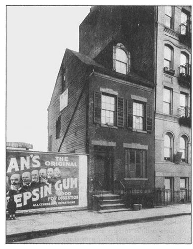
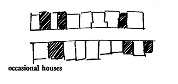

<section class="pattern-plate" aria-labelledby="t-housing-in-between">
<a href="/patterns">A Pattern Language</a> · <a href="/patterns#towns">Towns</a> · Pattern 48 · p. 256 · **
<h1 class="pattern-title" id="t-housing-in-between">Housing In Between</h1><figure class="pattern-figure pl-figure"></figure><nav class="pattern-links" aria-label="Connections"><h2>Links to</h2><ul><li><a href="/patterns/neighborhood-boundary">15 Neighborhood Boundary</a></li><li><a href="/patterns/house-cluster">37 House Cluster</a></li><li><a href="/patterns/row-houses">38 Row Houses</a></li><li><a href="/patterns/work-community">41 Work Community</a></li><li><a href="/patterns/looped-local-roads">49 Looped Local Roads</a></li><li><a href="/patterns/t-junctions">50 T Junctions</a></li><li><a href="/patterns/green-streets">51 Green Streets</a></li><li><a href="/patterns/network-of-paths-and-cars">52 Network Of Paths And Cars</a></li><li><a href="/patterns/main-gateways">53 Main Gateways</a></li><li><a href="/patterns/road-crossing">54 Road Crossing</a></li><li><a href="/patterns/raised-walk">55 Raised Walk</a></li><li><a href="/patterns/bike-paths-and-racks">56 Bike Paths And Racks</a></li><li><a href="/patterns/children-in-the-city">57 Children In The City</a></li></ul><h2>Linked from</h2><ul><li><a href="/patterns/shopping-street">32 Shopping Street</a></li><li><a href="/patterns/old-people-everywhere">40 Old People Everywhere</a></li><li><a href="/patterns/shielded-parking">97 Shielded Parking</a></li></ul></nav></section><article class="pattern-text" aria-label="The text of Housing In Between">
257… most housing is in residential neighborhoods, and in the clusters within neighborhoods—identifiable neighborhood (14), <a class="pl-ref" href="/patterns/house-cluster">house cluster (37)</a>; and according to our patterns these housing areas need to be separated by boundaries which contain public land and work communities—subculture boundary (13), <a class="pl-ref" href="/patterns/neighborhood-boundary">neighborhood boundary (15)</a>, <a class="pl-ref" href="/patterns/work-community">work community (41)</a>. But even these work communities, and boundaries, and shopping streets, must contain houses which have people living in them.

◆ ◆ ◆

<strong>Wherever there is a sharp separation between residential and nonresidential parts of town, the nonresidential areas will quickly turn to slums.</strong>

The personal rhythms of maintenance and repair are central to the well being of any part of a community, because it is only these rhythms which keep up a steady sequence of adaptations and corrections in the organization of the whole. Slums happen when these rhythms break down.

Now in a town, the processes of maintenance and repair hinge on the fact of user ownership. In other words, the places where people are user-owners are kept up nicely; the places where they are not, tend to run down. When people have their own homes among shops, workplaces, schools, services, the university, these places are enhanced by the vitality that is natural to their homes. They extend themselves to make it personal and comfortable. A person will put more of himself into his home than into any of the other places where he spends his time. And it is unlikely that a person can put this kind of feeling into two places, two parts of his life. We conclude that many parts of the environment have the arid quality of not being cared for personally, for the simple reason that indeed nobody lives there.

It is only where houses are mixed in between the other functions, in twos and threes, in rows and tiny clusters, that the personal quality of the households and house-building activities gives energy to the workshops and offices and services.

258Therefore:

<strong>Build houses into the fabric of shops, small industry, schools, public services, universities—all those parts of cities which draw people in during the day, but which tend to be “nonresidential.” The houses may be in rows or “hills” with shops beneath, or they may be free-standing, so long as they mix with the other functions, and make the entire area “lived-in.”</strong>

<figure class="pl-figure"></figure>
◆ ◆ ◆

Make sure that, in spite of its position in a public area, each house still has enough private territory for people to feel at home in it—your own home (79). If there are several houses in one area, treat them as a cluster or as a row—house cluster (37), <a class="pl-ref" href="/patterns/row-houses">row houses (38)</a>….

259<em>between the house clusters and work communities, allow the local road and path network to grow informally, piecemeal:</em>

<a class="pl-ref" href="/patterns/looped-local-roads">49. LOOPED LOCAL ROADS</a>

<a class="pl-ref" href="/patterns/t-junctions">50. T JUNCTIONS</a>

<a class="pl-ref" href="/patterns/green-streets">51. GREEN STREETS</a>

<a class="pl-ref" href="/patterns/network-of-paths-and-cars">52. NETWORK OF PATHS AND CARS</a>

<a class="pl-ref" href="/patterns/main-gateways">53. MAIN GATEWAYS</a>

<a class="pl-ref" href="/patterns/road-crossing">54. ROAD CROSSING</a>

<a class="pl-ref" href="/patterns/raised-walk">55. RAISED WALK</a>

<a class="pl-ref" href="/patterns/bike-paths-and-racks">56. BIKE PATHS AND RACKS</a>

<a class="pl-ref" href="/patterns/children-in-the-city">57. CHILDREN IN THE CITY</a>
</article>

Christopher Alexander, Sara Ishikawa and Murray Silverstein, with Max Jacobson, Ingrid Fiksdahl-King and Shlomo Angel, <cite>A Pattern Language</cite> (Oxford University Press, 1977), pattern 48, pp. 256–259. Text and illustrations from the <a href="https://github.com/natureoforder/sources">Nature of Order sources</a> reading edition, transcribed from the 1977 printing; report errors on <a href="https://github.com/natureoforder/alexander-wiki/issues">GitHub</a>.

<a href="/patterns/health-center">← 47 Health Center</a> · <a href="/patterns">All 253 patterns</a> · <a href="/patterns/looped-local-roads">49 Looped Local Roads →</a>

