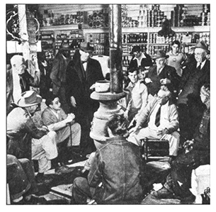
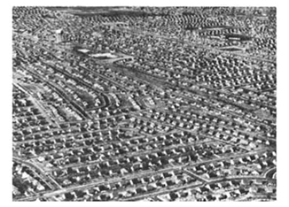
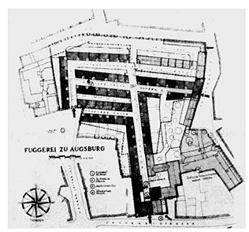
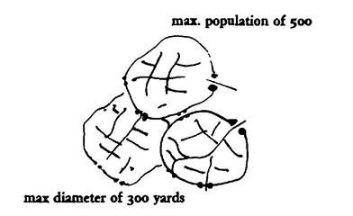

<section class="pattern-plate" aria-labelledby="t-identifiable-neighborhood">
<a href="/patterns">A Pattern Language</a> · <a href="/patterns#towns">Towns</a> · Pattern 14 · p. 80 · **
<h1 class="pattern-title" id="t-identifiable-neighborhood">Identifiable Neighborhood</h1><figure class="pattern-figure pl-figure"></figure><nav class="pattern-links" aria-label="Connections"><h2>Links to</h2><ul><li><a href="/patterns/mosaic-of-subcultures">8 Mosaic Of Subcultures</a></li><li><a href="/patterns/community-of-7000">12 Community Of 7000</a></li><li><a href="/patterns/neighborhood-boundary">15 Neighborhood Boundary</a></li><li><a href="/patterns/parallel-roads">23 Parallel Roads</a></li><li><a href="/patterns/house-cluster">37 House Cluster</a></li><li><a href="/patterns/work-community">41 Work Community</a></li><li><a href="/patterns/main-gateways">53 Main Gateways</a></li><li><a href="/patterns/accessible-green">60 Accessible Green</a></li><li><a href="/patterns/small-public-squares">61 Small Public Squares</a></li></ul><h2>Linked from</h2><ul><li><a href="/patterns/lace-of-country-streets">5 Lace Of Country Streets</a></li><li><a href="/patterns/mosaic-of-subcultures">8 Mosaic Of Subcultures</a></li><li><a href="/patterns/local-transport-areas">11 Local Transport Areas</a></li><li><a href="/patterns/community-of-7000">12 Community Of 7000</a></li><li><a href="/patterns/subculture-boundary">13 Subculture Boundary</a></li><li><a href="/patterns/neighborhood-boundary">15 Neighborhood Boundary</a></li><li><a href="/patterns/nine-per-cent-parking">22 Nine Per Cent Parking</a></li><li><a href="/patterns/life-cycle">26 Life Cycle</a></li><li><a href="/patterns/men-and-women">27 Men And Women</a></li><li><a href="/patterns/activity-nodes">30 Activity Nodes</a></li><li><a href="/patterns/household-mix">35 Household Mix</a></li><li><a href="/patterns/degrees-of-publicness">36 Degrees Of Publicness</a></li><li><a href="/patterns/house-cluster">37 House Cluster</a></li><li><a href="/patterns/local-town-hall">44 Local Town Hall</a></li><li><a href="/patterns/looped-local-roads">49 Looped Local Roads</a></li><li><a href="/patterns/small-public-squares">61 Small Public Squares</a></li><li><a href="/patterns/birth-places">65 Birth Places</a></li><li><a href="/patterns/street-cafe">88 Street Cafe</a></li><li><a href="/patterns/corner-grocery">89 Corner Grocery</a></li></ul></nav></section><article class="pattern-text" aria-label="The text of Identifiable Neighborhood">
81… the <a class="pl-ref" href="/patterns/mosaic-of-subcultures">MOSAIC OF SUBCULTURES (8)</a> and the <a class="pl-ref" href="/patterns/community-of-7000">COMMUNITY OF 7000 (12)</a> are made up of neighborhoods. This pattern defines the neighborhoods. It defines those small human groups which create the energy and character which can bring the larger <a class="pl-ref" href="/patterns/community-of-7000">COMMUNITY OF 7000 (12)</a> and the <a class="pl-ref" href="/patterns/mosaic-of-subcultures">MOSAIC OF SUBCULTURES (8)</a> to life.

◆ ◆ ◆

<strong>People need an identifiable spatial unit to belong to.</strong>

<figure class="pl-figure"><figcaption><em>Today’s pattern of development destroys neighborhoods</em>.</figcaption></figure>

They want to be able to identify the part of the city where they live as distinct from all others. Available evidence suggests, first, that the neighborhoods which people identify with have extremely small populations; second, that they are small in area; and third, that a major road through a neighborhood destroys it.

1. What is the right population for a neighborhood?

The neighborhood inhabitants should be able to look after their own interests by organizing themselves to bring pressure on city hall or local governments. This means the families in a neighborhood must be able to reach agreement on basic decisions about public services, community land, and so forth. Anthropological evidence suggests that a human group cannot coordinate itself to reach such decisions if its population is above 1500, and many people set the figure as low as 500. (See, for example, Anthony Wallace, <em>Housing and Social Structure</em>, Philadelphia Housing Authority, 1952, available from University Microfilms, Inc., Ann Arbor, Michigan, pp. 21–24,) The experience of organizing community meetings at the local level suggests that 500 is the more realistic figure.

<figure class="pl-figure"></figure>
82<em>A famous neighborhood: the Fuggerei in Augsburg</em>.

2. As far as the physical diameter is concerned, in Philadelphia, people who were asked which area they really knew usually limi_ted themselves to a small area, seldom exceeding the two to three blocks around their own house. (Mary W. Herman, “Comparative Studies of Identification Areas in Philadelphia,” City of Philadelphia Community Renewal Program, Technical Report No. 9, April 1964.) One-quarter of the inhabitants of an area in Milwaukee considered a neighborhood to be an area no larger than a block (300 feet). One-half considered it to be no more than seven blocks. (Svend Riemer, “Villagers in Metropolis,” <em>Britisk Journal of Sociology</em>, 2, No. 1, March 1951, pp. 31–43.)

3. The first two features, by themselves, are not enough. A neighborhood can only have a strong identity if it is protected from heavy traffic. Donald Appleyard and Mark Lintell have found that the heavier the traffic in an area, the less people think of it as home territory. Not only do residents view the streets with heavy traffic as less personal, but they feel the same about 83the houses along the street. (“Environmental Quality of City Streets,” by Donald Appleyard and Mark Lintell, Center for Planning and Development Research, University of California, Berkeley, 1971.)

neighborhood with light traffic 2000 vehicles/ day

200 vehicles/peak hour 15-20 mph Two-way

Residents speaking on “neighboring and visiting”

<em>I feel it’s home. There are warm people on this street. I don’t feel alone</em>.

<em>Everbody knows each other. Definitely a friendly street</em>.

Residents speaking on “home tcnitoi·y”

<em>Tlte street life doesn’t intrude into tlte home</em> ….<em>only happiness comes in from the street</em>.

<em>I feel my home extends to the whole block</em>,

neighborhood with moderate traffic 6000 vehicles/ day

<em>550</em> vehicles/peak hour 25 mph Two-way

Residents speaking on “neighboring and visiting”

<em>You see the neighbors but they aren’t close friends</em>.

<em>Don’t feel there is any community any more, but people say hello</em>.

Residents speaking on “home territory”

<em>It’s a medium place—doesn’t require any thought</em>.

neighborhood with heavy traffic 16,ooo vehicles/ day

1900 vehicles/peak hour 35-40 mph One-way

Residents speaking on “neighboring and visiting”

<em>It’s not a friendly street-no one offers help</em>.

<em>People are afraid to go into the street because of the traffic</em>.

Residents speaking on “home territory”

<em>It is impersonal and public</em>.

<em>Noise from the street intrudes into my home</em>.

84How shall we define a major road ? The Appleyard-Lintell study found that with more than 200 cars per hour, the quality of the neighborhood begins to deteriorate. On the streets with <em>550</em> cars per hour people visit their neighbors less and never gather in the street to meet and talk. Research by Colin Buchanan indicates that major roads become a barrier to free pedestrian movement when “most people (more than 50%) … have to adapt their movement to give way to vehicles.” This is based on “an average delay to all crossing pedestrians of 2 seconds … as a very rough guide to the borderline between acceptable and unacceptable conditions,” which happens when the traffic reaches some I 50 to 2 50 cars per hour. (Colin D. Buchanan, <em>Traffic in Towns</em>, London: Her Majesty’s Stationery Office, 1963, p. 204.) Thus any street with greater than 200 cars per hour, at any time, will probably seem “major,” and start to destroy the neighborhood identity.

A final note on implementation. Several months ago the City of Berkeley began a transportation survey with the idea of deciding the location of all future major arteries within the city. Citizens were asked to make statements about areas which they wanted to protect from heavy traffic. This simple request has caused widespread grass roots political organizing to take place: at the time of this writing more than 30 small neighborhoods have identified themselves, simply in order to make sure that they succeed in keeping heavy traffic out. In short, the issue of traffic is so fundamental to the fact of neighborhoods, that neighborhoods emerge, and crystallize, as soon as people are asked to decide where they want nearby traffic to be. Perhaps this is a universal way of implementing this pattern in existing cities.

Therefore:

<strong>Help people to define the neighborhoods they live in, not more than 300 yards across, with no more than 400 or 500 inhabitants. In existing cities, encourage local groups to organize themselves to form such neighborhoods. Give the neighborhoods some degree of autonomy as far as taxes and land controls are concerned. Keep major roads outside these neighborhoods.</strong>

<figure class="pl-figure"></figure>
85

◆ ◆ ◆

Mark the neighborhood, above all, by gateways wherever main paths enter it—<a class="pl-ref" href="/patterns/main-gateways">MAIN GATEWAYS (53)</a>—and by modest boundaries of non-residential land between the neighborhoods—<a class="pl-ref" href="/patterns/neighborhood-boundary">NEIGHBORHOOD BOUNDARY (15)</a>. Keep major roads within these boundaries—<a class="pl-ref" href="/patterns/parallel-roads">PARALLEL ROADS (23)</a>; give the neighborhood a visible center, perhaps a common or a green—<a class="pl-ref" href="/patterns/accessible-green">ACCESSIBLE GREEN (60)</a>—or a <a class="pl-ref" href="/patterns/small-public-squares">SMALL PUBLIC SQUARE (61)</a>; and arrange houses and workshops within the neighborhood in clusters of about a dozen at a time—<a class="pl-ref" href="/patterns/house-cluster">HOUSE CLUSTER (37)</a>, <a class="pl-ref" href="/patterns/work-community">WORK COMMUNITY (41)</a> ….
</article>

Christopher Alexander, Sara Ishikawa and Murray Silverstein, with Max Jacobson, Ingrid Fiksdahl-King and Shlomo Angel, <cite>A Pattern Language</cite> (Oxford University Press, 1977), pattern 14, pp. 80–85. Text and illustrations from the <a href="https://github.com/natureoforder/sources">Nature of Order sources</a> reading edition, transcribed from the 1977 printing; report errors on <a href="https://github.com/natureoforder/alexander-wiki/issues">GitHub</a>.

<a href="/patterns/subculture-boundary">← 13 Subculture Boundary</a> · <a href="/patterns">All 253 patterns</a> · <a href="/patterns/neighborhood-boundary">15 Neighborhood Boundary →</a>

