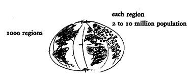

<section class="pattern-plate" aria-labelledby="t-independent-regions">
<a href="/patterns">A Pattern Language</a> · <a href="/patterns#towns">Towns</a> · Pattern 1 · p. 10 · **
<h1 class="pattern-title" id="t-independent-regions">Independent Regions</h1><figure class="pattern-figure pl-figure"></figure><nav class="pattern-links" aria-label="Connections"><h2>Links to</h2><ul><li><a href="/patterns/the-distribution-of-towns">2 The Distribution Of Towns</a></li><li><a href="/patterns/city-country-fingers">3 City Country Fingers</a></li><li><a href="/patterns/agricultural-valleys">4 Agricultural Valleys</a></li><li><a href="/patterns/lace-of-country-streets">5 Lace Of Country Streets</a></li><li><a href="/patterns/country-towns">6 Country Towns</a></li><li><a href="/patterns/the-countryside">7 The Countryside</a></li><li><a href="/patterns/mosaic-of-subcultures">8 Mosaic Of Subcultures</a></li></ul><h2>Linked from</h2><ul><li><a href="/patterns/the-distribution-of-towns">2 The Distribution Of Towns</a></li><li><a href="/patterns/agricultural-valleys">4 Agricultural Valleys</a></li></ul></nav></section><article class="pattern-text" aria-label="The text of Independent Regions">
11<strong>Metropolitan regions will not come to balance until each one is small and autonomous enough to be an independent sphere of culture.</strong>

There are four separate arguments which have led us to this conclusion: I. The nature and limits of human government. 2. Equity among regions in a world community. 3. Regional planning considerations. 4. Support for the intensity and diversity of human cultures.

1. There are natural limits to the size of groups that can govern themselves in a human way. The biologist J. <strong>B.</strong> S. Haldane has remarked on this in his paper, “On Being the Right Size”:

… just as there is a best size for every animal, so the same is true for every human institution. In the Greek type of democracy all the citizens could listen to a series of orators and vote directly on question of legislation. Hence their philosophers held that a small city was the largest possible democratic state…. (J. B. S Haldane, “On Being the Right Size,” <em>The World of Mathematics, Vol, II</em>, J. R. Newman, ed. New York : Simon and Schuster, 1956, pp. 962–67).

It is not hard to see why the government of a region becomes less and less manageable with size. In a population of N persons, there are of the order of N² person-to-person links needed to keep channels of communication open. Naturally, when N goes beyond a certain limit, the channels of communication needed for democracy and justice and information are simply too clogged, and too complex; bureaucracy overwhelms human processes.

And, of course, as N grows the number of levels in the hierarchy of government increases too. In small countries like Denmark there are so few levels, that any private citizen can have access to the Minister of Education. But this kind of direct access is quite impossible in larger countries like England or the United States.

We believe the limits are reached when the population of a region reaches some 2 to 10 million. Beyond this size, people become remote from the large-scale processes of government. Our estimate may seem extraordinary in the light of modern history: the nation-states have grown mightily and their governments hold power over tens of millions, sometimes hundreds of millions, of people. But these huge powers cannot claim to have a natural size. 12They cannot claim to have struck the balance between the needs of towns and communities, and the needs of the world community as a whole. Indeed, their tendency has been to override local needs and repress local culture, and at the same time aggrandize themselves to the point where they are out of reach, their power barely conceivable to the average citizen.

2. Unless a region has at least several million people in it, it will not be large enough to have a seat in a world government, and will therefore not be able to supplant the power and authority of present nation-states.

We found this point expressed by Lord Weymouth of War-minster, England, in a letter to the <em>New York Times</em>, March 15, 1973:

WORLD FEDERATION: A THOUSAND STATES

… the essential foundation stone for world federation on a democratic basis consists of regionalization within centralized government…. This argument rests on the idea that world government is lacking in moral authority unless each delegate represents an approximately equal portion of the world’s population. Working backward from an estimate of the global population in the year 2000, which is anticipated to rise to the 10,000 million mark, I suggest that we should be thinking in terms of an ideal regional state at something around ten million, or between five and fifteen million, to give greater flexibility. This would furnish the U.N. with an assembly of equals of 1000 regional representatives: a body that would be justified in claiming to be truly representative of the world’s population.

Weymouth believes that Western Europe could take some of the initiative for triggering this conception of world government. He looks for the movement for regional autonomy to take hold in the European Parliament at Strasbourg; and hopes that power can gradually be transferred from West-minister, Paris, Bonn, etc., to regional councils, federated in Strasbourg.

I am suggesting that in the Europe of the future we shall see England split down into Kent, Wessex, Mercia, Anglia and Northumbria, with an independent Scotland, Wales and Ireland, of course. Other European examples will include Brittany, Bavaria and Calabria. The national identities of our contemporary Europe will have lost their political significance.

3. Unless the regions have the power to be self-governing, they 13will not be able to solve their own environmental problems. The arbitrary lines of states and countries, which often cut across natural regional boundaries, make it all but impossible for people to solve regional problems in a direct and humanly efficient way.

An extensive and detailed analysis of this idea has been given by the French economist Gravier, who has proposed, in a series of books and papers, the concept of a Europe of the Regions, a Europe decentralized and reorganized around regions which cross present national and subnational boundaries. (For example, the Basel-Strasbourg Region includes parts of France, Germany, and Switzerland; the Liverpool Region includes parts of England and parts of Wales). See Jean-Franois Gravier, “L’Europe des regions,” in 1965 Internationale Regio Planertagung, Schriften der Regio 3, Regio, Basel, 1965, pp. 211–22; and In the same volume see also Emrys Jones, “The Conflict of City Regions and Administrative Units in Britain,” pp. 223–35.

4. Finally, unless the present-day great nations have their power greatly decentralized, the beautiful and differentiated languages, cultures, customs, and ways of life of the earth’s people, vital to the health of the planet, will vanish. In short, we believe that independent regions are the natural receptacles for language, culture, customs, economy, and laws and that each region should be separate and independent enough to maintain the strength and vigor of its culture.

The fact that human cultures within a city can only flourish when they are at least partly separated from neighboring cultures is discussed in great detail in <a class="pl-ref" href="/patterns/mosaic-of-subcultures">MOSAIC OF SUBCULTURES (8)</a>. We are suggesting here that the same argument also applies to regions—that the regions of the earth must also keep their distance and their dignity in order to survive as cultures.

In the best of medieval times, the cities performed this function. They provided permanent and intense spheres of cultural influence, variety, and economic exchange; they were great communes, whose citizens were co-members, each with some say in the city’s destiny. We believe that the independent region can become the modern polis—the new commune—that human entity which provides the sphere of culture, language, laws, services, economic exchange, variety, which the old walled city or the polis provided for its members.

Therefore:

<strong>14Wherever possible, work toward the evolution of independent regions in the world; each with a population between 2 and 10 million; each with its own natural and geographic boundaries; each with its own economy; each one autonomous and self-governing; each with a seat in a world government, without the intervening power of larger states or countries.</strong>

<figure class="pl-figure"></figure>
◆ ◆ ◆

15Within each region encourage the population to distribute itself as widely as possible across the region-<a class="pl-ref" href="/patterns/the-distribution-of-towns">THE DISTRIBUTION OF TOWNS (2)</a>….

<em>within each region work toward those regional policies which will protect the land and mark the limits of the cities:</em>

2.    THE DISTIRBUTION OF TOWNS

<a class="pl-ref" href="/patterns/city-country-fingers">3. CITY COUNTRY FINGERS</a>

<a class="pl-ref" href="/patterns/agricultural-valleys">4. AGRICULTURAL VALLEYS</a>

<a class="pl-ref" href="/patterns/lace-of-country-streets">5. LACE OF COUNTRY STREETS</a>

<a class="pl-ref" href="/patterns/country-towns">6. COUNTRY TOWNS</a>

<a class="pl-ref" href="/patterns/the-countryside">7. THE COUNTRYSIDE</a>
</article>

Christopher Alexander, Sara Ishikawa and Murray Silverstein, with Max Jacobson, Ingrid Fiksdahl-King and Shlomo Angel, <cite>A Pattern Language</cite> (Oxford University Press, 1977), pattern 1, pp. 10–15. Text and illustrations from the <a href="https://github.com/natureoforder/sources">Nature of Order sources</a> reading edition, transcribed from the 1977 printing; report errors on <a href="https://github.com/natureoforder/alexander-wiki/issues">GitHub</a>.

<a href="/patterns">All 253 patterns</a> · <a href="/patterns/the-distribution-of-towns">2 The Distribution Of Towns →</a>

