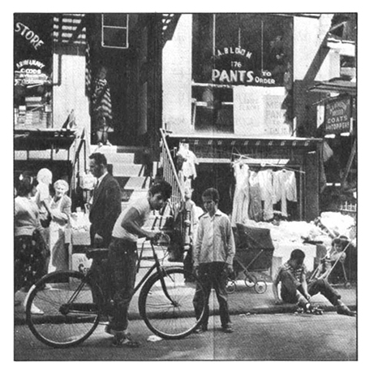
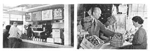
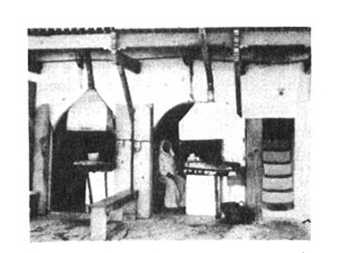
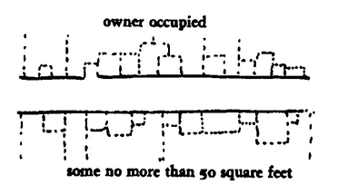

<section class="pattern-plate" aria-labelledby="t-individually-owned-shops">
<a href="/patterns">A Pattern Language</a> · <a href="/patterns#towns">Towns</a> · Pattern 87 · p. 432 · **
<h1 class="pattern-title" id="t-individually-owned-shops">Individually Owned Shops</h1><figure class="pattern-figure pl-figure"></figure><nav class="pattern-links" aria-label="Connections"><h2>Links to</h2><ul><li><a href="/patterns/shopping-street">32 Shopping Street</a></li><li><a href="/patterns/market-of-many-shops">46 Market Of Many Shops</a></li><li><a href="/patterns/street-cafe">88 Street Cafe</a></li><li><a href="/patterns/corner-grocery">89 Corner Grocery</a></li><li><a href="/patterns/building-complex">95 Building Complex</a></li><li><a href="/patterns/opening-to-the-street">165 Opening To The Street</a></li><li><a href="/patterns/the-shape-of-indoor-space">191 The Shape Of Indoor Space</a></li><li><a href="/patterns/thick-walls">197 Thick Walls</a></li><li><a href="/patterns/open-shelves">200 Open Shelves</a></li></ul><h2>Linked from</h2><ul><li><a href="/patterns/activity-nodes">30 Activity Nodes</a></li><li><a href="/patterns/shopping-street">32 Shopping Street</a></li><li><a href="/patterns/necklace-of-community-projects">45 Necklace Of Community Projects</a></li><li><a href="/patterns/childrens-home">86 Children’s Home</a></li><li><a href="/patterns/corner-grocery">89 Corner Grocery</a></li><li><a href="/patterns/food-stands">93 Food Stands</a></li><li><a href="/patterns/shielded-parking">97 Shielded Parking</a></li><li><a href="/patterns/wings-of-light">107 Wings Of Light</a></li><li><a href="/patterns/bulk-storage">145 Bulk Storage</a></li></ul></nav></section><article class="pattern-text" aria-label="The text of Individually Owned Shops">
433… the <a class="pl-ref" href="/patterns/street-cafe">STREET CAFE (88)</a> and <a class="pl-ref" href="/patterns/corner-grocery">CORNER GROCERY (89)</a> and all the individual shops and stalls in <a class="pl-ref" href="/patterns/shopping-street">SHOPPING STREETS (32)</a> and <a class="pl-ref" href="/patterns/market-of-many-shops">MARKETS OF MANY SHOPS (46)</a> must be supported by an ordinance which guarantees that they will stay in local private hands, and not be owned by absentee landlords, or chain stores, or giant franchise operations.

◆ ◆ ◆

<strong>When shops are too large, or controlled by absentee owners, they become plastic, bland, and abstract.</strong>

The profit motive creates a tendency for shops to become larger. But the larger they become, the less personal their service is, and the harder it is for other small shops to survive. Soon, the shops in the economy are almost entirely controlled by chain stores and franchises.

The franchises are doubly vicious. They create the image of individual ownership; they give a man who doesn’t have enough capital to start his own store the chance to run a store that seems like his; and they spread like wildfire. But they create even more plastic, bland, and abstract services. The individual managers have almost no control over the goods they sell, the food they serve; policies are tightly controlled; the personal quality of individually owned shops is altogether broken down.

<figure class="pl-figure"><figcaption><em>Shop run for money alone. Shop run as a way of life</em>.</figcaption></figure>

Communities can only get this personal quality back if they prohibit all forms of franchise and chain stores, place limits on 434the actual size of stores in a community, and prohibit absentee owners from owning shops. In short, they must do what they can to keep the wealth generated by the local community in the hands of that community.

Even then, it will not be possible to maintain this pattern unless the size of the shop spaces available for rent is small. One of the biggest reasons for the rise of large, nationally owned franchises is that the financial risks of starting a business are so enormous for the average individual. The failure of a single owner’s business can be catastrophic for him personally; and it happens, in large part because he can’t afford the rent. Many hundreds of tiny shops, with low rents, will keep the initial risk for a shop keeper who is starting, to a minimum.

Shops in Morocco, India, Peru, and the oldest parts of older towns, are often no more than 50 square feet in area. Just room for a person and some merchandise—but plenty big enough.

<figure class="pl-figure"><figcaption><em>Fifty square feet</em>.</figcaption></figure>

Therefore:

<strong>Do what you can to encourage the development of individually owned shops. Approve applications for business licenses only if the business is owned by those people who actually work and manage the store. Approve new commercial building permits only if the proposed structure includes many very very small rental spaces.</strong>

435

<figure class="pl-figure"></figure>
◆ ◆ ◆

Treat each individual shop as an identifiable unit of a larger <a class="pl-ref" href="/patterns/building-complex">BUILDING COMPLEX (95)</a>; make at least some part of the shop part of the sidewalk, so that people walk through the shop as they are going down the street—<a class="pl-ref" href="/patterns/opening-to-the-street">OPENING TO THE STREET (165)</a>; and build the inside of the shop with all the goods as open and available as possible—<a class="pl-ref" href="/patterns/the-shape-of-indoor-space">THE SHAPE OF INDOOR SPACE (191)</a>, <a class="pl-ref" href="/patterns/thick-walls">THICK WALLS (197)</a>, <a class="pl-ref" href="/patterns/open-shelves">OPEN SHELVES (200)</a>….
</article>

Christopher Alexander, Sara Ishikawa and Murray Silverstein, with Max Jacobson, Ingrid Fiksdahl-King and Shlomo Angel, <cite>A Pattern Language</cite> (Oxford University Press, 1977), pattern 87, pp. 432–435. Text and illustrations from the <a href="https://github.com/natureoforder/sources">Nature of Order sources</a> reading edition, transcribed from the 1977 printing; report errors on <a href="https://github.com/natureoforder/alexander-wiki/issues">GitHub</a>.

<a href="/patterns/childrens-home">← 86 Children’s Home</a> · <a href="/patterns">All 253 patterns</a> · <a href="/patterns/street-cafe">88 Street Cafe →</a>

