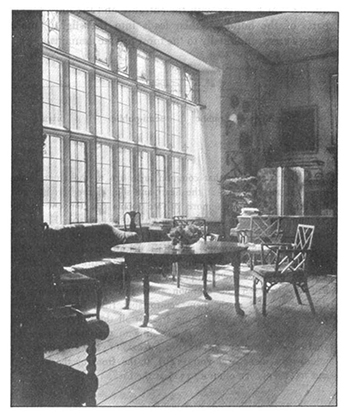
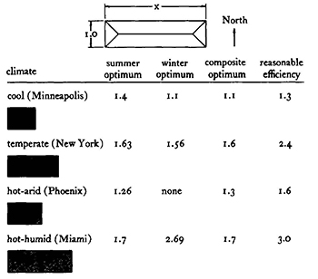
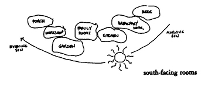

<section class="pattern-plate" aria-labelledby="t-indoor-sunlight">
<a href="/patterns">A Pattern Language</a> · <a href="/patterns#buildings">Buildings</a> · Pattern 128 · p. 614 · *
<h1 class="pattern-title" id="t-indoor-sunlight">Indoor Sunlight</h1><figure class="pattern-figure pl-figure"></figure><nav class="pattern-links" aria-label="Connections"><h2>Links to</h2><ul><li><a href="/patterns/south-facing-outdoors">105 South Facing Outdoors</a></li><li><a href="/patterns/intimacy-gradient">127 Intimacy Gradient</a></li><li><a href="/patterns/sleeping-to-the-east">138 Sleeping To The East</a></li><li><a href="/patterns/home-workshop">157 Home Workshop</a></li><li><a href="/patterns/north-face">162 North Face</a></li><li><a href="/patterns/outdoor-room">163 Outdoor Room</a></li><li><a href="/patterns/workspace-enclosure">183 Workspace Enclosure</a></li><li><a href="/patterns/sunny-counter">199 Sunny Counter</a></li><li><a href="/patterns/windows-which-open-wide">236 Windows Which Open Wide</a></li></ul><h2>Linked from</h2><ul><li><a href="/patterns/south-facing-outdoors">105 South Facing Outdoors</a></li><li><a href="/patterns/something-roughly-in-the-middle">126 Something Roughly In The Middle</a></li><li><a href="/patterns/common-areas-at-the-heart">129 Common Areas At The Heart</a></li><li><a href="/patterns/sleeping-to-the-east">138 Sleeping To The East</a></li><li><a href="/patterns/north-face">162 North Face</a></li><li><a href="/patterns/sunny-counter">199 Sunny Counter</a></li></ul></nav></section><article class="pattern-text" aria-label="The text of Indoor Sunlight">
615… according to <a class="pl-ref" href="/patterns/south-facing-outdoors">SOUTH FACING OUTDOORS (105)</a>, the building is placed in such a way as to allow the sun to shine directly into it, across its gardens. From <a class="pl-ref" href="/patterns/intimacy-gradient">INTIMACY CRADIENT (127)</a>, you have some idea of the overall distribution of public and private rooms within the building. This pattern marks those rooms and areas along the intimacy gradient which need the sunlight most, and helps to place them so that the indoor sunlight can be made to coincide with the rooms in the INTIMACY GRADIENT which are most used.

◆ ◆ ◆

<strong>If the right rooms are facing south, a house is bright and sunny and cheerful; if the wrong rooms are facing south, the house is dark and gloomy.</strong>

Everyone knows this. But people may forget about it, and get confused by other considerations. The fact is that very few things have so much effect on the feeling inside a room as the sun shining into it. If you want to be sure that your house, or building, and the rooms in it are wonderful, comfortable places, give this pattern its due. Treat it seriously; cling to it tenaciously; insist upon it. Think of the rooms you know which do have sunshine in them, and compare them with the many rooms you know that don’t.

From the pattern <a class="pl-ref" href="/patterns/south-facing-outdoors">SOUTH FACING OUTDOORS (105)</a>, the building gets an orientation toward the south. Now the issue is the particular arrangement of rooms along this south edge. Here are some examples: (1) a porch that gets the evening sun late in the day; (2) a breakfast nook that looks directly into a garden which is sunny in the morning; (3) a bathing room arranged to get full morning sun; (4) a workshop that gets full southern exposure during the middle of the day; (5) an edge of a living room where the sun falls on an outside wall and warms a flowering plant.

The key diagram for this pattern summarizes the relations between parts of the house and the morning, the afternoon and 616the late afternoon sun. To get the sun right in your design, first decide upon your requirements for sun: make a diagram for yourself, like the key diagram, but with your own special needs. Then arrange spaces along the south, southeast, and southwest of the building to capture the sun. Take special care to detail the south edge properly, so that the sun is working indoors throughout the day. This will most often need a building which is long along the east-west axis.

If we approach the problem of indoor sunlight from the point of view of thermal considerations, we come to a similar conclusion. A long east-west axis sets up a building to keep the heat in during winter, and to keep the heat out during the summer. This makes buildings more pleasant, and cheaper to run. The “optimum shape” of an east-west building is given by the following table, adapted from Victor Olgyay, <em>Design with Climate</em> (New Jersey: Princeton University Press, 1963, p. 89). Note that it is always best to orient the long axis east-west.

<figure class="pl-figure"><figcaption><em>Rough shape for different climates</em>.</figcaption></figure>

617Therefore:

<strong>Place the most important rooms along the south edge of the building, and spread the building out along the east- west axis.</strong>

<strong>Fine tune the arrangement so that the proper rooms are exposed to the south-east and the south-west sun. For example: give the common area a full southern exposure, bedrooms south-east, porch south-west For most climates, this means the shape of the building is elongated east-west.</strong>

<figure class="pl-figure"></figure>
◆ ◆ ◆

When you can, open up these indoor sunny rooms to the outdoors, and build a sunny place and outdoor rooms directly outside SUNNY PLACE (l6l), <a class="pl-ref" href="/patterns/outdoor-room">OUTDOOR ROOM (163)</a>, <a class="pl-ref" href="/patterns/windows-which-open-wide">WINDOWS WHICH OPEN WIDE (236)</a>. Give the bedrooms eastern exposure—<a class="pl-ref" href="/patterns/sleeping-to-the-east">SLEEPING TO THE EAST (138)</a>, and put storage and garages to the north—<a class="pl-ref" href="/patterns/north-face">NORTH FACE (162)</a>. Where there is a kitchen, try to put its work counter toward the sun—<a class="pl-ref" href="/patterns/sunny-counter">SUNNY COUNTER (199)</a>; perhaps do the same for any work bench or desk in a <a class="pl-ref" href="/patterns/home-workshop">HOME WORKSHOP (157)</a>, <a class="pl-ref" href="/patterns/workspace-enclosure">WORKSPACE ENCLOSURE (183)</a>….
</article>

Christopher Alexander, Sara Ishikawa and Murray Silverstein, with Max Jacobson, Ingrid Fiksdahl-King and Shlomo Angel, <cite>A Pattern Language</cite> (Oxford University Press, 1977), pattern 128, pp. 614–617. Text and illustrations from the <a href="https://github.com/natureoforder/sources">Nature of Order sources</a> reading edition, transcribed from the 1977 printing; report errors on <a href="https://github.com/natureoforder/alexander-wiki/issues">GitHub</a>.

<a href="/patterns/intimacy-gradient">← 127 Intimacy Gradient</a> · <a href="/patterns">All 253 patterns</a> · <a href="/patterns/common-areas-at-the-heart">129 Common Areas At The Heart →</a>

