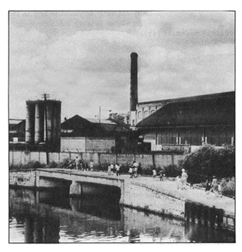
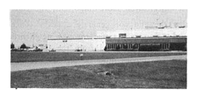
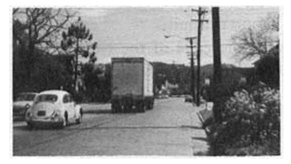
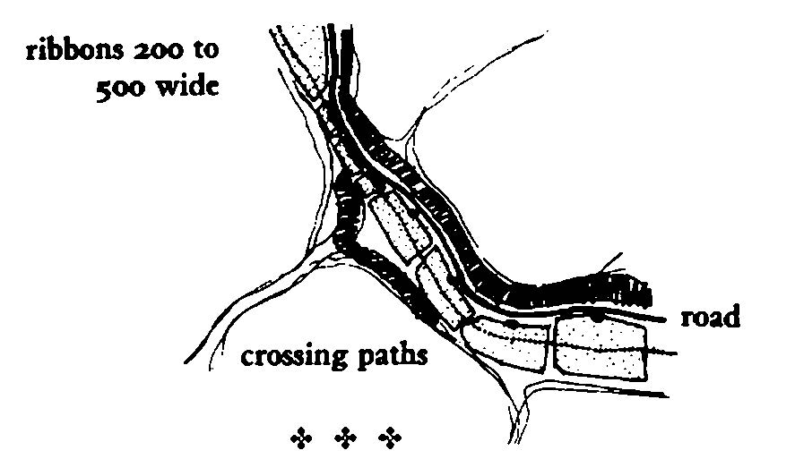

<section class="pattern-plate" aria-labelledby="t-industrial-ribbon">
<a href="/patterns">A Pattern Language</a> · <a href="/patterns#towns">Towns</a> · Pattern 42 · p. 227 · *
<h1 class="pattern-title" id="t-industrial-ribbon">Industrial Ribbon</h1><figure class="pattern-figure pl-figure"></figure><nav class="pattern-links" aria-label="Connections"><h2>Links to</h2><ul><li><a href="/patterns/scattered-work">9 Scattered Work</a></li><li><a href="/patterns/subculture-boundary">13 Subculture Boundary</a></li><li><a href="/patterns/neighborhood-boundary">15 Neighborhood Boundary</a></li><li><a href="/patterns/ring-roads">17 Ring Roads</a></li><li><a href="/patterns/building-fronts">122 Building Fronts</a></li></ul><h2>Linked from</h2><ul><li><a href="/patterns/scattered-work">9 Scattered Work</a></li><li><a href="/patterns/subculture-boundary">13 Subculture Boundary</a></li><li><a href="/patterns/ring-roads">17 Ring Roads</a></li><li><a href="/patterns/old-people-everywhere">40 Old People Everywhere</a></li></ul></nav></section><article class="pattern-text" aria-label="The text of Industrial Ribbon">
228… in a city where work is decentralized by <a class="pl-ref" href="/patterns/scattered-work">scattered work (9)</a>, the placing of industry is of particular importance since it usually needs a certain amount of concentration. Like work communities (41), the industry can easily be placed to help in the formation of the larger boundaries between subcultures—subculture BOUNDARY (13).

◆ ◆ ◆

<strong>Exaggerated zoning laws separate industry from the rest of urban life completely, and contribute to the plastic unreality of sheltered residential neighborhoods.</strong>

It is true, obviously, that industry creates smoke, smells, noise, and heavy truck traffic; and it is therefore necessary to prevent the heaviest industry, especially, from interfering with the calm and safety of the places where people live.

But it is also true that in the modern city industry gets treated like a disease. The areas where it exists are assumed to be dirty and derelict. They are kept to the “other side of the tracks,” swept under the rug. And people forget altogether that the things which surround them in their daily lives—bread, chemicals, cars, oil, gaskets, radios, chairs—are all made in these forbidden industrial zones. Under these conditions it is not surprising that people treat life as an unreal charade, and forget the simplest realities and facts of their existence.

Since the 1930*8 various efforts have been made, on behalf of the workers, to make factories green and pleasant. This social welfare approach to the nature of industries is once again unreal, in the opposite direction. A workshop, where things are being made, is not a garden or a hospital. The gardens which surround the new industrial “parks” are more for show than for the workers anyway since a few small inner courts or gardens would be far more useful to the workers themselves. And the contribution of an industrial park to the social and emotional life of the surrounding city is almost nil.

What is needed is a form of industry which is small enough so that it does not need to be so sharply segregated; genuine, so that it seems like a workshop, because it is a workshop; placed 229in such a way that the truck traffic which it generates does not endanger nearby neighborhoods; and formed along the edge of neighborhoods so that it is not a dangerous, forgotten zone, but so that it is a real part of life, accessible to children from the surrounding houses, woven into the fabric of city life, in a way that properly reflects its huge importance in the scheme of things.

<figure class="pl-figure"><figcaption><em>The social welfare “green” industrial fork</em>.</figcaption></figure>

But many industries are not small. They need large areas to function properly. A survey of planned industrial districts shows that 71.2 per cent of the industries require o to 5.0 acres, 13.6 per cent require 5 to to acres, and 9.9 per cent require 10 to 25 acres. (Robert E. Boley, <em>Industrial Districts Restudied: An Analysis of Characteristics</em>, Urban Land Institute, Technical Bulletin No. 41, 1961.) These industries can only fit into a <a class="pl-ref" href="/patterns/neighborhood-boundary">neighborhood BOUNDARY (15)</a> or <a class="pl-ref" href="/patterns/subculture-boundary">SUBCULTURE BOUNDARY (13)</a> if the boundary is wide enough. Ribbons whose width varies between 200 and 500 feet, with sites varying in length between 200 and 2000 feet, will be able to provide the necessary range of one to 25-acre sites in compact blocks, and are still narrow enough to keep communities on opposite sides of the ribbon reasonably connected.

The industrial ribbons require truck access and some rail transport. Truck roads and rail spurs should always be located in the center of ’he ribbon, so that the edges of the ribbon remain open to the community. Even more important, the ribbons must be placed so that they do not generate a heavy concentration of dangerous and noisy truck traffic <em>through</em> neighborhoods. Since most truck traffic comes to and from the freeways, this means that the industrial ribbons must be placed fairly near to <a class="pl-ref" href="/patterns/ring-roads">ring roads (17)</a>.

<figure class="pl-figure"><figcaption><em>Truck traffic from an industrial area to a nearby freeway destroys a neighborhood</em>.</figcaption></figure>

230Therefore:

<strong>Place industry in ribbons, between 200 and 500 feet wide, which form the boundaries between communities. Break these ribbons into long blocks, varying in area between 1 and 25 acres; and treat the edge of every ribbon as a place where people from nearby communities can benefit from the offshoots of the industrial activity.</strong>

<figure class="pl-figure"></figure>
◆ ◆ ◆

Place the ribbons near enough to <a class="pl-ref" href="/patterns/ring-roads">ring roads (17)</a> so that trucks can pass directly from the ribbons to the ring road, without having to pass through any other intermediate areas. Develop the internal layout of the industrial ribbon like any other work community, though slightly more spread out—work community (41). Place the important buildings of each industry, the “heart” of the plant, toward the edge of the ribbon to form usable streets and outdoor spaces—positive outdoor space (106), <a class="pl-ref" href="/patterns/building-fronts">building FRONTS (122)</a>.
</article>

Christopher Alexander, Sara Ishikawa and Murray Silverstein, with Max Jacobson, Ingrid Fiksdahl-King and Shlomo Angel, <cite>A Pattern Language</cite> (Oxford University Press, 1977), pattern 42, pp. 227–230. Text and illustrations from the <a href="https://github.com/natureoforder/sources">Nature of Order sources</a> reading edition, transcribed from the 1977 printing; report errors on <a href="https://github.com/natureoforder/alexander-wiki/issues">GitHub</a>.

<a href="/patterns/work-community">← 41 Work Community</a> · <a href="/patterns">All 253 patterns</a> · <a href="/patterns/university-as-a-marketplace">43 University As A Marketplace →</a>

