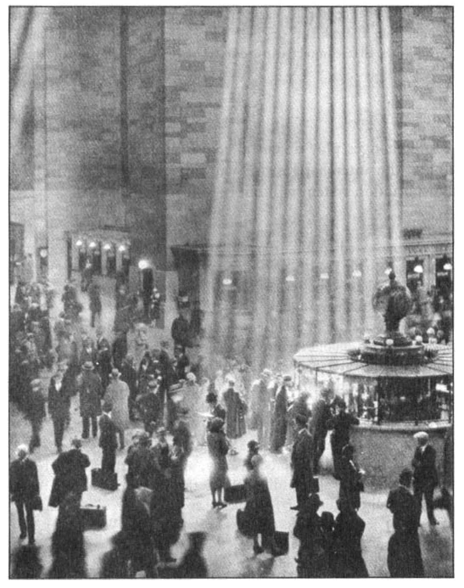
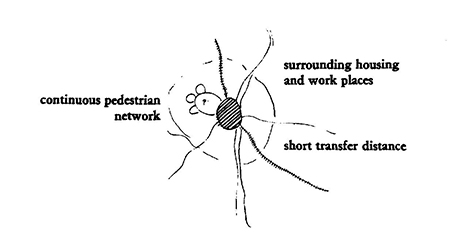

<section class="pattern-plate" aria-labelledby="t-interchange">
<a href="/patterns">A Pattern Language</a> · <a href="/patterns#towns">Towns</a> · Pattern 34 · p. 183
<h1 class="pattern-title" id="t-interchange">Interchange</h1><figure class="pattern-figure pl-figure"></figure><nav class="pattern-links" aria-label="Connections"><h2>Links to</h2><ul><li><a href="/patterns/scattered-work">9 Scattered Work</a></li><li><a href="/patterns/local-transport-areas">11 Local Transport Areas</a></li><li><a href="/patterns/web-of-public-transportation">16 Web Of Public Transportation</a></li><li><a href="/patterns/mini-buses">20 Mini-Buses</a></li><li><a href="/patterns/activity-nodes">30 Activity Nodes</a></li><li><a href="/patterns/degrees-of-publicness">36 Degrees Of Publicness</a></li><li><a href="/patterns/house-cluster">37 House Cluster</a></li><li><a href="/patterns/row-houses">38 Row Houses</a></li><li><a href="/patterns/housing-hill">39 Housing Hill</a></li><li><a href="/patterns/old-people-everywhere">40 Old People Everywhere</a></li><li><a href="/patterns/work-community">41 Work Community</a></li><li><a href="/patterns/bus-stop">92 Bus Stop</a></li><li><a href="/patterns/arcades">119 Arcades</a></li></ul><h2>Linked from</h2><ul><li><a href="/patterns/local-transport-areas">11 Local Transport Areas</a></li><li><a href="/patterns/ring-roads">17 Ring Roads</a></li><li><a href="/patterns/mini-buses">20 Mini-Buses</a></li><li><a href="/patterns/men-and-women">27 Men And Women</a></li><li><a href="/patterns/sleeping-in-public">94 Sleeping In Public</a></li><li><a href="/patterns/a-place-to-wait">150 A Place To Wait</a></li></ul></nav></section><article class="pattern-text" aria-label="The text of Interchange">
184… this pattern defines the points which generate the <a class="pl-ref" href="/patterns/web-of-public-transportation">WEB OF PUBLIC TRANSPORTATION (16)</a>. It also helps to complete <a class="pl-ref" href="/patterns/local-transport-areas">LOCAL TRANSPORT AREAS (11)</a> by guaranteeing the possibility of interchanges at the center of each transport area, where people can change from their bikes, or local mini-buses, to the long distance transit lines that connect different transport areas to one another.

◆ ◆ ◆

<strong>Interchanges play a central role in public transportation. Unless the interchanges are working properly, the public transportation system will not be able to sustain itself.</strong>

Everyone needs public transportation sometimes. But it is the steady users who keep it going. If the steady users do not keep it going, then there is no system for the occasional user. To maintain a steady flow of users, interchanges must be extremely convenient and easy to use: I. Workplaces and the housing for people who especially need public transportation must be distributed rather evenly around interchanges. 2. The interchanges must connect up with the surrounding flow of pedestrian street life. 3. It must be easy to change from one mode of travel to another.

In more detail:

1. Workers are the bread and butter of the transportation system. If the system is to be healthy, all the workplaces in town must be within walking distance of the interchanges. Furthermore, the distribution of workplaces around interchanges should be more or less even—see <a class="pl-ref" href="/patterns/scattered-work">SCATTERED WORK (9)</a>. When they are concentrated around one or two, the rush hour flow crowds the trains, and creates inefficiencies in the system as a whole.

Furthermore, some of the area around interchanges should be given over to houses for those people who rely entirely on public transportation—especially old people. Old people depend on public transportation; they make up a large proportion of the system’s regular users. To meet their needs, the area around interchanges must be zoned so that the kind of housing that suits them will develop there—<a class="pl-ref" href="/patterns/old-people-everywhere">OLD PEOPLE EVERYWHERE (40)</a>.

185

<ol start="2" type="1">
<li>The interchange must be convenient for people walking from their homes and jobs, and it must be safe. People will not use an interchange if it is dingy, derelict, and deserted. This means that the interchange must be continuous with local pedestrian life. Parking lots must be kept to one side, so that people do not have to walk across them to get to the station. And there must be enough shops and kiosks in the interchange, to keep a steady flow of people moving in and out of it and through it.</li>
</ol>

3. If the system is going to be successful, there must be no more than a few minutes’ walk—600 feet at the most-between points of transfer. And the distance should decrease as the trips become more local: from bus to bus, 100 feet maximum; from rapid transit to bus, 200 feet maximum; from train to rapid transit, 300 feet maximum. In rainy climates the connecting paths should be almost entirely covered—<a class="pl-ref" href="/patterns/arcades">ARCADES (119)</a>. What’s more, the most important transfer connections should not involve crossing streets: if necessary sink the roads or build bridges to make the transfer smooth.

For details on the organization of interchanges, see “390 Requirements for Rapid Transit Stations,” Center for Environmental Structure, 1964, partly published in “Relational Complexes in Architecture” (Christopher Alexander, Van Maren King, Sara Ishikawa, Michael Baker, <em>Architectural Record</em>, September 1966, PP· 185–90).

Therefore:

<strong>At every interchange in the web of transportation follow these principles:</strong>

<strong>1.  Surround the interchange with workplaces and housing types which specially need public transportation.</strong>

<strong>2.  Keep the interior of the interchange continuous with the exterior pedestrian network, and maintain this continuity by building in small shops and kiosks and by keeping parking to one side.</strong>

<strong>3.  Keep the transfer distance between different modes of transport down to 300 feet wherever possible, with an absolute maximum of 600 feet.</strong>

186

<figure class="pl-figure"></figure>
◆ ◆ ◆

Recognize that the creation of workplaces around every interchange contributes to the development of <a class="pl-ref" href="/patterns/scattered-work">SCATTERED WORK (9)</a>. Place <a class="pl-ref" href="/patterns/housing-hill">HOUSING HILLS (39)</a>, <a class="pl-ref" href="/patterns/old-people-everywhere">OLD PEOPLE EVERYWHERE (40)</a>, and <a class="pl-ref" href="/patterns/work-community">WORK COMMUNITIES (41)</a> round the interchange; treat the outside of the intercliange as an <a class="pl-ref" href="/patterns/activity-nodes">ACTIVITY NODE (30)</a> to assure its continuity with the pedestrian network; treat the transfers as <a class="pl-ref" href="/patterns/arcades">ARCADES (119)</a> where necessary to keep them under cover; give every interchange a <a class="pl-ref" href="/patterns/bus-stop">BUS STOP (92)</a> on the <a class="pl-ref" href="/patterns/mini-buses">MINI-BUS (20)</a> network….

187<strong><em>around these centers, provide for the growth of housing in the form of clusters, based on face to face human groups:</em></strong>

35.    HOUSEHOLD MlX

<a class="pl-ref" href="/patterns/degrees-of-publicness">36. DEGREES OF PUBLICNESS</a>

<a class="pl-ref" href="/patterns/house-cluster">37. HOUSE CLUSTER</a>

<a class="pl-ref" href="/patterns/row-houses">38. ROW HOUSES</a>

<a class="pl-ref" href="/patterns/housing-hill">39. HOUSING HILL</a>

<a class="pl-ref" href="/patterns/old-people-everywhere">40. OLD PEOPLE EVERYWHERE</a>
</article>

Christopher Alexander, Sara Ishikawa and Murray Silverstein, with Max Jacobson, Ingrid Fiksdahl-King and Shlomo Angel, <cite>A Pattern Language</cite> (Oxford University Press, 1977), pattern 34, pp. 183–187. Text and illustrations from the <a href="https://github.com/natureoforder/sources">Nature of Order sources</a> reading edition, transcribed from the 1977 printing; report errors on <a href="https://github.com/natureoforder/alexander-wiki/issues">GitHub</a>.

<a href="/patterns/night-life">← 33 Night Life</a> · <a href="/patterns">All 253 patterns</a> · <a href="/patterns/household-mix">35 Household Mix →</a>

