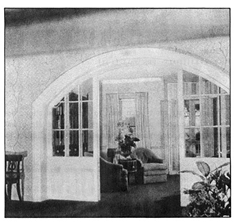
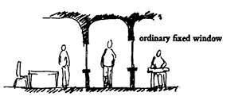

<section class="pattern-plate" aria-labelledby="t-interior-windows">
<a href="/patterns">A Pattern Language</a> · <a href="/patterns#buildings">Buildings</a> · Pattern 194 · p. 897
<h1 class="pattern-title" id="t-interior-windows">Interior Windows</h1><figure class="pattern-figure pl-figure"></figure><nav class="pattern-links" aria-label="Connections"><h2>Links to</h2><ul><li><a href="/patterns/building-thoroughfare">101 Building Thoroughfare</a></li><li><a href="/patterns/entrance-room">130 Entrance Room</a></li><li><a href="/patterns/the-flow-through-rooms">131 The Flow Through Rooms</a></li><li><a href="/patterns/tapestry-of-light-and-dark">135 Tapestry Of Light And Dark</a></li><li><a href="/patterns/sequence-of-sitting-spaces">142 Sequence Of Sitting Spaces</a></li><li><a href="/patterns/half-open-wall">193 Half-Open Wall</a></li><li><a href="/patterns/small-panes">239 Small Panes</a></li></ul><h2>Linked from</h2><ul><li><a href="/patterns/building-thoroughfare">101 Building Thoroughfare</a></li><li><a href="/patterns/short-passages">132 Short Passages</a></li><li><a href="/patterns/dressing-rooms">189 Dressing Rooms</a></li><li><a href="/patterns/half-open-wall">193 Half-Open Wall</a></li><li><a href="/patterns/solid-doors-with-glass">237 Solid Doors With Glass</a></li><li><a href="/patterns/small-panes">239 Small Panes</a></li></ul></nav></section><article class="pattern-text" aria-label="The text of Interior Windows">
898… at various places in the building, there are walls between rooms where windows would help the rooms to be more alive by creating more views of people and by letting extra light into the darkest corners. For instance, between passages and rooms or between adjacent living rooms, or between adjacent work rooms—<a class="pl-ref" href="/patterns/building-thoroughfare">BUILDING THOROUGHFARE (101)</a>, <a class="pl-ref" href="/patterns/entrance-room">ENTRANCE ROOM (130)</a>, <a class="pl-ref" href="/patterns/the-flow-through-rooms">THE FLOW THROUGH ROOMS (131)</a>, SHORT PASSAGES (13 2), <a class="pl-ref" href="/patterns/tapestry-of-light-and-dark">TAPESTRY OF LIGHT AND DARK (135)</a>, <a class="pl-ref" href="/patterns/sequence-of-sitting-spaces">SEQUENCE OF SITTING SPACES (142)</a>, <a class="pl-ref" href="/patterns/half-open-wall">HALF-OPEN WALL (193)</a>.

◆ ◆ ◆

<strong>Windows arc most often used to create connections between the indoor and the outdoors. But there are many cases when an indoor space needs a connecting window to another indoor space.</strong>

This is most often true for corridors and passages. These places can easily seem deserted. People feel more connected to one another by interior windows, and the passages in the building become less deserted.

The same may hold for certain rooms, especially small rooms. Three bare walls and a window can seem like a prison. Windows placed between rooms, or between a passage and a room, will help to solve these problems and will make both the passages and the rooms more lively.

Furthermore, when rooms and passages are visibly connected to one another, it is possible to grasp the overall arrangement of a building far more clearly than in a building with blank walls between all the rooms.

It is enough if these windows allow people to see through them; they do not need to be open nor the kind which can be opened. Ordinary, cheap, fixed glazing will do all that is required.

Therefore:

<strong>Put in fully glazed fixed windows between rooms which 899tend to be dead because they have too little action in them or where inside rooms are unusually dark.</strong>

<figure class="pl-figure"></figure>
◆ ◆ ◆

Make the windows the same as any other windows, with small panes of glass—<a class="pl-ref" href="/patterns/small-panes">SMALL PANES (239)</a>. In some case it may be right to build interior windows in the doors—solid doors with glass (237)….
</article>

Christopher Alexander, Sara Ishikawa and Murray Silverstein, with Max Jacobson, Ingrid Fiksdahl-King and Shlomo Angel, <cite>A Pattern Language</cite> (Oxford University Press, 1977), pattern 194, pp. 897–899. Text and illustrations from the <a href="https://github.com/natureoforder/sources">Nature of Order sources</a> reading edition, transcribed from the 1977 printing; report errors on <a href="https://github.com/natureoforder/alexander-wiki/issues">GitHub</a>.

<a href="/patterns/half-open-wall">← 193 Half-Open Wall</a> · <a href="/patterns">All 253 patterns</a> · <a href="/patterns/staircase-volume">195 Staircase Volume →</a>

