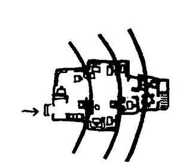
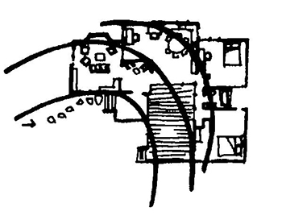
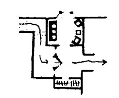
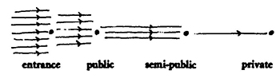

<section class="pattern-plate" aria-labelledby="t-intimacy-gradient">
<a href="/patterns">A Pattern Language</a> · <a href="/patterns#buildings">Buildings</a> · Pattern 127 · p. 610 · **
<h1 class="pattern-title" id="t-intimacy-gradient">Intimacy Gradient</h1><nav class="pattern-links" aria-label="Connections"><h2>Links to</h2><ul><li><a href="/patterns/number-of-stories">96 Number Of Stories</a></li><li><a href="/patterns/wings-of-light">107 Wings Of Light</a></li><li><a href="/patterns/main-entrance">110 Main Entrance</a></li><li><a href="/patterns/common-areas-at-the-heart">129 Common Areas At The Heart</a></li><li><a href="/patterns/entrance-room">130 Entrance Room</a></li><li><a href="/patterns/a-room-of-ones-own">141 A Room Of One’s Own</a></li><li><a href="/patterns/sequence-of-sitting-spaces">142 Sequence Of Sitting Spaces</a></li><li><a href="/patterns/bathing-room">144 Bathing Room</a></li><li><a href="/patterns/reception-welcomes-you">149 Reception Welcomes You</a></li><li><a href="/patterns/half-private-office">152 Half-Private Office</a></li></ul><h2>Linked from</h2><ul><li><a href="/patterns/long-thin-house">109 Long Thin House</a></li><li><a href="/patterns/entrance-transition">112 Entrance Transition</a></li><li><a href="/patterns/car-connection">113 Car Connection</a></li><li><a href="/patterns/something-roughly-in-the-middle">126 Something Roughly In The Middle</a></li><li><a href="/patterns/indoor-sunlight">128 Indoor Sunlight</a></li><li><a href="/patterns/common-areas-at-the-heart">129 Common Areas At The Heart</a></li><li><a href="/patterns/the-flow-through-rooms">131 The Flow Through Rooms</a></li><li><a href="/patterns/couples-realm">136 Couple’s Realm</a></li><li><a href="/patterns/sleeping-to-the-east">138 Sleeping To The East</a></li><li><a href="/patterns/a-room-of-ones-own">141 A Room Of One’s Own</a></li><li><a href="/patterns/sequence-of-sitting-spaces">142 Sequence Of Sitting Spaces</a></li><li><a href="/patterns/bathing-room">144 Bathing Room</a></li><li><a href="/patterns/flexible-office-space">146 Flexible Office Space</a></li><li><a href="/patterns/half-private-office">152 Half-Private Office</a></li><li><a href="/patterns/sitting-circle">185 Sitting Circle</a></li><li><a href="/patterns/floor-surface">233 Floor Surface</a></li></ul></nav></section><article class="pattern-text" aria-label="The text of Intimacy Gradient">
. . . if you know roughly where you intend to place the building wings—<a class="pl-ref" href="/patterns/wings-of-light">WINGS OF LIGHT (107)</a>, and how many stories they will have—<a class="pl-ref" href="/patterns/number-of-stories">NUMBER OF STORIES (96)</a>, and where the <a class="pl-ref" href="/patterns/main-entrance">MAIN ENTRANCE (110)</a> is, it is time to work out the rough disposition of the major areas on every floor. In every building the relationship between the public areas and private areas is most important.

◆ ◆ ◆

<strong>Unless the spaces in a building are arranged in a sequence which corresponds to their degrees of privateness, the visits made by strangers, friends, guests, clients, family, will always be a little awkward.</strong>

In any building—house, office, public building, summer cottage—people need a gradient of settings, which have different degrees of intimacy. A bedroom or boudoir is most intimate; a back sitting room or study less so; a common area or kitchen more public still; a front porch or entrance room most public of all. When there is a gradient of this kind, people can give each encounter different shades of meaning, by choosing its position on the gradient very carefully. In a building which has its rooms so interlaced that there is no clearly defined gradient of intimacy, it is not possible to choose the spot for any particular encounter so carefully; and it is therefore impossible to give the encounter this dimension of added meaning by the choice of space. This homogeneity of space, where every room has a similar degree of intimacy, rubs out all possible subtlety of social interaction in the building.

We illustrate this general fact by giving an example from Peru—a case which we have studied in detail. In Peru, friendship is taken very seriously and exists at a number of levels. Casual neighborhood friends will probably never enter the house at all. 611Formal friends, such as the priest, the daughter’s boyfriend, and friends from work may be invited in, but tend to be limited to a well-furnished and maintained part of the house, the <em>tala</em>. This room is sheltered from the clutter and more obvious informality of the rest of the house. Relatives and intimate friends may be made to feel at home in the family room (<em>comedor-estar</em>), where the family is likely to spend much of its time. A few relatives and friends, particularly women, will be allowed into the kitchen, other workspaces, and, perhaps, the bedrooms of the house. In this way, the family maintains both privacy and pride.

The phenomenon of the intimacy gradient is particularly evident at the time of a <em>fiesta</em>. Even though the house is full of people, some people never get beyond the <em>sola;</em> some do not even get beyond the threshold of the front door. Others go all the way into the kitchen, where the cooking is going on, and stay there throughout the evening. Each person has a very accurate sense of his degree of intimacy with the family and knows exactly how far into the house he may penetrate, according to this established level of intimacy.

Even extremely poor people try to have a <em>tala</em> if they can: we saw many in the <em>barriadas</em>. Yet modem houses and apartments in Peru combine <em>tala</em> and family room in order to save space. Almost everyone we talked to complained about this situation. As far as we can tell, a Peruvian house must not, under any circumstances, violate the principle of the intimacy gradient.

The intimacy gradient is unusually crucial in a Peruvian house. But in some form the pattern seems to exist in almost all cultures. We see it in widely different cultures—compare the plan of an African compound, a traditional Japanese house, and early American colonial homes—and it also applies to almost every building type—compare a house, a small shop, a large office building, and even a church. It is almost an archetypal ordering principle for all man’s buildings. All buildings, and all parts of buildings which house well-defined human groups, need a definite gradient from “front” to “back,” from the most formal spaces at the front to the most intimate spaces at the back.

In an office the sequence might be: entry lobby, coffee and reception areas, offices and workspaces, private lounge.

612

<figure class="pl-figure"><figcaption><em>Office intimacy gradient</em>.</figcaption></figure>

<strong>In a small shop the sequence might be: shop entrance, customer milling space, browsing area, sales counter, behind the counter, private place for workers.</strong>

<strong>In a house: gate, outdoor porch, entrance, sitting wall, common space and kitchen, private garden, bed alcoves.</strong>

<figure class="pl-figure"><figcaption><em>Intimacy gradient in a house</em>.</figcaption></figure>

And in a more formal house, the sequence might begin with something like the Peruvian <em>sola</em>—a parlor or sitting room for guests.

<figure class="pl-figure"><figcaption><em>Formal version of the front of the gradient</em>.</figcaption></figure>

613Therefore:

<strong>Lay out the (paces of a building so that they create a sequence which begins with the entrance and the moat public parts of the building, then leads into the slightly more private areas, and finally to the most private domains.</strong>

<figure class="pl-figure"></figure>
◆ ◆ ◆

At the tame time that common areas are to the front, make tore that they are alto at the heart and sou] of the activity, and that all paths between more private rooms pass tangent to the common ones—<a class="pl-ref" href="/patterns/common-areas-at-the-heart">COMMON AREAS AT THE HEART (129)</a>. In private houses make the <a class="pl-ref" href="/patterns/entrance-room">ENTRANCE ROOM (130)</a> the most formal and public place and arrange the most private areas so that each person has a room of his own, where he can retire to be alone—<a class="pl-ref" href="/patterns/a-room-of-ones-own">A ROOM OF ONE’S OWN (141)</a>. Place bathing rooms and toilets half-way between the common areas and the private • ones, so that people can reach them comfortably from both—<a class="pl-ref" href="/patterns/bathing-room">BATHING ROOM (144)</a>; and place sitting areas at all the different degrees of intimacy, and shape them according to their position in the gradient—<a class="pl-ref" href="/patterns/sequence-of-sitting-spaces">SEQUENCE OF SITTING SPACES (142)</a>. In offices put <a class="pl-ref" href="/patterns/reception-welcomes-you">RECEPTION WELCOMES YOU (149)</a> at the front of the gradient and <a class="pl-ref" href="/patterns/half-private-office">HALF-PRIVATE OFFICE (152)</a> at the back….
</article>

Christopher Alexander, Sara Ishikawa and Murray Silverstein, with Max Jacobson, Ingrid Fiksdahl-King and Shlomo Angel, <cite>A Pattern Language</cite> (Oxford University Press, 1977), pattern 127, pp. 610–613. Text and illustrations from the <a href="https://github.com/natureoforder/sources">Nature of Order sources</a> reading edition, transcribed from the 1977 printing; report errors on <a href="https://github.com/natureoforder/alexander-wiki/issues">GitHub</a>.

<a href="/patterns/something-roughly-in-the-middle">← 126 Something Roughly In The Middle</a> · <a href="/patterns">All 253 patterns</a> · <a href="/patterns/indoor-sunlight">128 Indoor Sunlight →</a>

