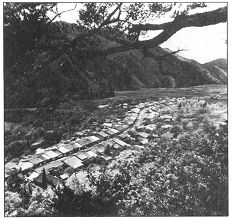
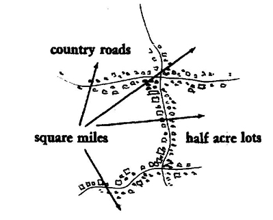

<section class="pattern-plate" aria-labelledby="t-lace-of-country-streets">
<a href="/patterns">A Pattern Language</a> · <a href="/patterns#towns">Towns</a> · Pattern 5 · p. 29
<h1 class="pattern-title" id="t-lace-of-country-streets">Lace Of Country Streets</h1><figure class="pattern-figure pl-figure"></figure><nav class="pattern-links" aria-label="Connections"><h2>Links to</h2><ul><li><a href="/patterns/city-country-fingers">3 City Country Fingers</a></li><li><a href="/patterns/the-countryside">7 The Countryside</a></li><li><a href="/patterns/identifiable-neighborhood">14 Identifiable Neighborhood</a></li><li><a href="/patterns/house-cluster">37 House Cluster</a></li></ul><h2>Linked from</h2><ul><li><a href="/patterns/independent-regions">1 Independent Regions</a></li><li><a href="/patterns/the-countryside">7 The Countryside</a></li><li><a href="/patterns/four-story-limit">21 Four-Story Limit</a></li></ul></nav></section><article class="pattern-text" aria-label="The text of Lace Of Country Streets">
30… according to the pattern <a class="pl-ref" href="/patterns/city-country-fingers">CITY COUNTRY FINGERS (3)</a>, there is a rather sharp division between city land and rural land. But at the ends of city fingers, where the country fingers open out, there is a need for an additional kind of structure. This structure has traditionally been the suburbs. But…

◆ ◆ ◆

<strong>The suburb is an obsolete and contradictory form of human settlement.</strong>

Many people want to live in the country; and they also want to be close to a large city. But it is geometrically impossible to have thousands of small farms, within a few minutes of a major city center.

To live well in the country, you must have a reasonable piece of land of your own—large enough for horses, cows, chickens, an orchard—and you must have immediate access to continuous open countryside, as far as the eye can see. To have quick access to the city, you must live on a road, within a few minutes’ drive from city centers, and with a bus line outside your door.

It is possible to have both, by arranging country roads around large open squares of countryside or farmland, with houses closely packed along the road, but only one house deep. Lionel March lends support to this pattern in his paper, “Homes beyond the Fringe” (Land Use and Built Form Studies, Cambridge, England, 1968). March shows that such a pattern, fully developed, could work for millions of people even in a country as small and densely populated as England.

A “lace of country streets” contains square miles of open countryside, fast roads from the city at the edge of these square miles, houses clustered along the roads, and footpaths stretching out from the city, crisscrossing the countryside.

1. Square miles of open countryside., We believe that one square mile is the smallest piece of open land which still maintains the integrity of the countryside. This figure is derived from the requirements of small farms, presented in the argument for <a class="pl-ref" href="/patterns/city-country-fingers">CITY COUNTRY FINGERS (3)</a>.

31

<ol start="2" type="1">
<li>Roads. To protect the countryside from suburban encroachment, the roads running out into the countryside must be vastly reduced in number. A loose network of interconnected roads, at one-mile intervals with little encouragement for through traffic to pass through them, is quite enough.</li>
</ol>

3. Lots. Situate homesteads, houses, and cottages along these country roads one or two lots deep, always setting them off the road with the open land behind them. The <em>minimum</em> land for a homestead must be approximately one-half acre to allow for basic farming. However, some of the housing could be in rows or clusters, with people working the land behind collectively. Assuming one-half acre lots around a one mile square of open land, we can have 400 households to the square mile. With four people per household, that is 1600 people per square mile; not very different from an ordinary low density suburb.

4. Footpaths. The countryside can be made accessible to city people by means of footpaths and trails running from the edge of the city and from the country roads into the countryside, across the squares of open land.

Therefore:

<strong>In the zone where city and country meet, place country roads at least a mile apart, so that they enclose squares of countryside and farmland at least one square mile in area. Build homesteads along these roads, one lot deep, on lots of at least half an acre, with the square mile of open countryside or farmland behind the houses.</strong>

<figure class="pl-figure"></figure>
◆ ◆ ◆

32Make each square mile of countryside, both farm and park, open to the public—<a class="pl-ref" href="/patterns/the-countryside">THE COUNTRYSDE (7)</a>; arrange the half acre lots to form clusters of houses and neighborhoods, even when they are rather spread out—<a class="pl-ref" href="/patterns/identifiable-neighborhood">IDENTIFIABLE NEIGHBORHOOD (14)</a>, <a class="pl-ref" href="/patterns/house-cluster">HOUSE CLUSTER (37)</a>….
</article>

Christopher Alexander, Sara Ishikawa and Murray Silverstein, with Max Jacobson, Ingrid Fiksdahl-King and Shlomo Angel, <cite>A Pattern Language</cite> (Oxford University Press, 1977), pattern 5, pp. 29–32. Text and illustrations from the <a href="https://github.com/natureoforder/sources">Nature of Order sources</a> reading edition, transcribed from the 1977 printing; report errors on <a href="https://github.com/natureoforder/alexander-wiki/issues">GitHub</a>.

<a href="/patterns/agricultural-valleys">← 4 Agricultural Valleys</a> · <a href="/patterns">All 253 patterns</a> · <a href="/patterns/country-towns">6 Country Towns →</a>

