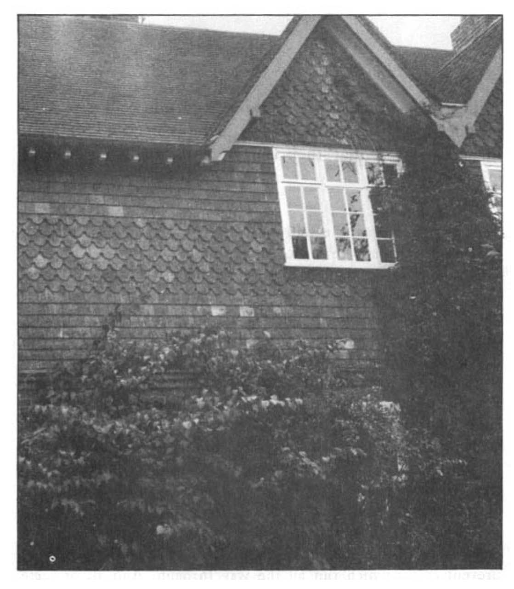
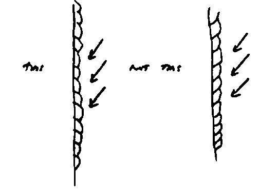
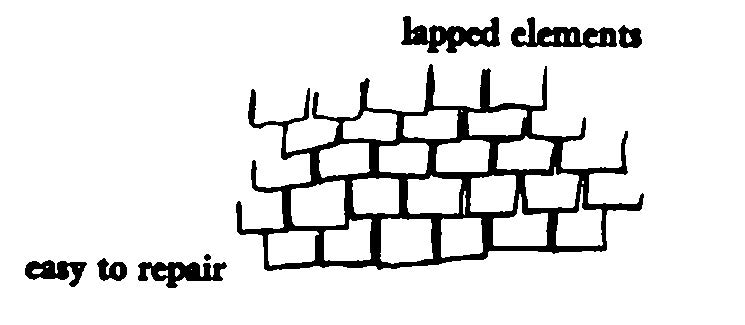

<section class="pattern-plate" aria-labelledby="t-lapped-outside-walls">
<a href="/patterns">A Pattern Language</a> · <a href="/patterns#construction">Construction</a> · Pattern 234 · p. 1093
<h1 class="pattern-title" id="t-lapped-outside-walls">Lapped Outside Walls</h1><figure class="pattern-figure pl-figure"></figure><nav class="pattern-links" aria-label="Connections"><h2>Links to</h2><ul><li><a href="/patterns/wall-membrane">218 Wall Membrane</a></li><li><a href="/patterns/roof-vaults">220 Roof Vaults</a></li></ul><h2>Linked from</h2><ul><li><a href="/patterns/good-materials">207 Good Materials</a></li><li><a href="/patterns/wall-membrane">218 Wall Membrane</a></li><li><a href="/patterns/roof-vaults">220 Roof Vaults</a></li><li><a href="/patterns/roof-caps">232 Roof Caps</a></li><li><a href="/patterns/half-inch-trim">240 Half-Inch Trim</a></li><li><a href="/patterns/ornament">249 Ornament</a></li></ul></nav></section><article class="pattern-text" aria-label="The text of Lapped Outside Walls">
1094… this pattern finishes the <a class="pl-ref" href="/patterns/wall-membrane">WALL MEMBRANES (218)</a>, and <a class="pl-ref" href="/patterns/roof-vaults">ROOF VAULTS (220)</a>. It defines the character of their outside surfaces.

◆ ◆ ◆

<strong>The main function of a building’s outside wall is to keep weather out It can only do this if the materials are joined in such a way that they cooperate to make impervious joints.</strong>

At the same time, the wall must be easy to maintain; and give the people outside some chance of relating to it.

None of these functions can be very well managed by great sheets of impervious material. These sheets, always in the same plane, have tremendous problems at the joints. They require highly complex, sophisticated gaskets and seals, and, in the end, it is these seals and joints which fail.

Consider a variety of natural organisms: trees, fish, animals. Broadly speaking, their outside coats are rough, and made of large numbers of similar but not identical elements. And these elements are placed so that they often overlap: the scales of a fish, the fur of an animal, the crinkling of natural skin, the bark of a tree. All these coats are made to be impervious and easy to repair.

In simple technologies, buildings follow suit. Lapped boards, shingles, hung tiles, thatch, are all examples. Even stone and brick though in one plane, are still in a sense lapped internally to prevent cracks which run all the way through. And all of these walls are made of many small elements, so that individual pieces can be replaced as they are damaged or wear out.

Bear in mind then, as you choose an exterior wall finish, that it should be a material which can be easily lapped against the weather, which is made of elements that are easy to repair locally, and which therefore can be maintained piecemeal, indefinitely. And of course, whatever you choose, make it a surface which invites you to touch it and lean up against it.

In making our filled lightweight concrete structures, we have used lapped boards as the exterior formwork for the lightweight concrete fill. And it is, of course, possible to use many other kinds of external cladding if they are available and if one can afford them. Slate, corrugated iron, ceramic tiles will produce excellent shingled wall claddings, and can all be placed in such a way as to provide exterior formwork for the pouring of a wall. It is also conceivable (though we have no evidence for it), that scientists might be able to create an oriented material whose internal crystal or fiber structure is in effect “lapped,” because all the split lines run diagonally outward and downward.

1095

<figure class="pl-figure"><figcaption><em>The interned structure of an imaginary lapped material</em>.</figcaption></figure>

Therefore:

<strong>Build up the exterior wall surface with materials that are lapped against the weather: either “internally lapped,” like exterior plaster, or more literally lapped, like shingles and boards and tiles. In either case, choose a material that is easy to repair in little patches, inexpensively, so that little by little, the wall can be maintained in good condition indefinitely.</strong>

<figure class="pl-figure"></figure>
◆ ◆ ◆
</article>

Christopher Alexander, Sara Ishikawa and Murray Silverstein, with Max Jacobson, Ingrid Fiksdahl-King and Shlomo Angel, <cite>A Pattern Language</cite> (Oxford University Press, 1977), pattern 234, pp. 1093–1095. Text and illustrations from the <a href="https://github.com/natureoforder/sources">Nature of Order sources</a> reading edition, transcribed from the 1977 printing; report errors on <a href="https://github.com/natureoforder/alexander-wiki/issues">GitHub</a>.

<a href="/patterns/floor-surface">← 233 Floor Surface</a> · <a href="/patterns">All 253 patterns</a> · <a href="/patterns/soft-inside-walls">235 Soft Inside Walls →</a>

