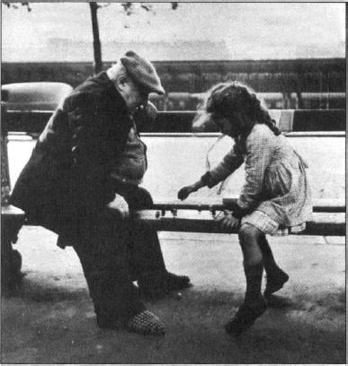
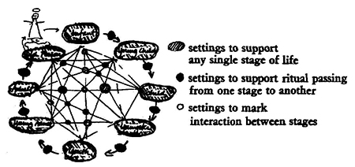

<section class="pattern-plate" aria-labelledby="t-life-cycle">
<a href="/patterns">A Pattern Language</a> · <a href="/patterns#towns">Towns</a> · Pattern 26 · p. 139 · *
<h1 class="pattern-title" id="t-life-cycle">Life Cycle</h1><figure class="pattern-figure pl-figure"></figure><nav class="pattern-links" aria-label="Connections"><h2>Links to</h2><ul><li><a href="/patterns/community-of-7000">12 Community Of 7000</a></li><li><a href="/patterns/identifiable-neighborhood">14 Identifiable Neighborhood</a></li><li><a href="/patterns/household-mix">35 Household Mix</a></li><li><a href="/patterns/old-people-everywhere">40 Old People Everywhere</a></li><li><a href="/patterns/work-community">41 Work Community</a></li><li><a href="/patterns/local-town-hall">44 Local Town Hall</a></li><li><a href="/patterns/children-in-the-city">57 Children In The City</a></li><li><a href="/patterns/birth-places">65 Birth Places</a></li><li><a href="/patterns/holy-ground">66 Holy Ground</a></li><li><a href="/patterns/grave-sites">70 Grave Sites</a></li><li><a href="/patterns/the-family">75 The Family</a></li><li><a href="/patterns/your-own-home">79 Your Own Home</a></li><li><a href="/patterns/master-and-apprentices">83 Master And Apprentices</a></li><li><a href="/patterns/teen-age-society">84 Teen-Age Society</a></li><li><a href="/patterns/shopfront-schools">85 Shopfront Schools</a></li><li><a href="/patterns/childrens-home">86 Children’s Home</a></li><li><a href="/patterns/rooms-to-rent">153 Rooms To Rent</a></li><li><a href="/patterns/teenagers-cottage">154 Teenager’s Cottage</a></li><li><a href="/patterns/old-age-cottage">155 Old Age Cottage</a></li><li><a href="/patterns/settled-work">156 Settled Work</a></li><li><a href="/patterns/marriage-bed">187 Marriage Bed</a></li></ul><h2>Linked from</h2><ul><li><a href="/patterns/country-towns">6 Country Towns</a></li><li><a href="/patterns/mini-buses">20 Mini-Buses</a></li><li><a href="/patterns/men-and-women">27 Men And Women</a></li><li><a href="/patterns/household-mix">35 Household Mix</a></li><li><a href="/patterns/old-people-everywhere">40 Old People Everywhere</a></li><li><a href="/patterns/birth-places">65 Birth Places</a></li><li><a href="/patterns/grave-sites">70 Grave Sites</a></li><li><a href="/patterns/the-family">75 The Family</a></li><li><a href="/patterns/teen-age-society">84 Teen-Age Society</a></li><li><a href="/patterns/settled-work">156 Settled Work</a></li></ul></nav></section><article class="pattern-text" aria-label="The text of Life Cycle">
140… a real community provides, in full, for the balance of human experience and human life—<a class="pl-ref" href="/patterns/community-of-7000">COMMUNITY OF 7000 (12)</a>. To a lesser extent, a good neighborhood will do the same—<a class="pl-ref" href="/patterns/identifiable-neighborhood">IDENTIFIABLE NEIGHBORHOOD (14)</a>. To fulfill this promise, communities and neighborhoods must have the range of things which life can need, so that a person can experience the full breadth and depth of life in his community.

◆ ◆ ◆

<strong>All the world’s a stage, And all the men and women merely players: They have their exits and their entrances; And one man in his time plays many parts, His acts being seven ages.</strong>

As, first the infant, Mewling and puking in the nurse’s arms. And then the whining schoolboy, with his satchel And shining morning face, creeping like snail Unwillingly to school. And then the lover, Sighing like furnace, with a woeful ballad Made to his mistress’ eyebrow. Then the soldier, Full of strange oaths, and bearded like the pard, Jealous ill honour, sudden and quick in quarrel, Seeking the bubble reputation Even in the cannon’s mouth. And then the justice, In fair round belly with good capon lined, With eyes severe and beard of formal cut, Full of wise saws and modern instances; And so he plays his part. The sixth age shifts Into the lean and slipper’d pantaloon, With spectacles on nose and pouch on side; His youthful hose, well saved, a world too wide For his shrunk shank; and his big manly voice, Turning again toward childish treble, pipes And whistles in his sound. Last scene of all, That ends this strange eventful history, Is second childishness and mere oblivion, Sans teeth, sans eyes, sans taste, sans every thing. (Shakespeare, <em>.As You Like It</em>, II.viii,)

To live life to the fullest, in each of the seven ages, each age must be clearly marked, by the community, as a distinct wellmarked time. And the ages will only seem clearly marked if the 141ceremonies which mark the passage from one age to the next are firmly marked by celebrations and distinctions.

By contrast, in a Hat suburban culture the seven ages are not at all clearly marked; they are not celebrated; the passages from one age to the next have almost been forgotten. Under these conditions, people distort themselves. They can neither fulfill themselves in any one age nor pass successfully on to the next. Like the sixty-year-old woman wearing bright red lipstick on her wrinkles, they cling ferociously to what they never fully had.

This proposition hinges on two arguments.

A. The cycle of life is a definite psychological reality. It consists of discrete stages, each one fraught with its own difficulties, each one with its own special advantages.

B. Growth from one stage to another is not inevitable, and, in fact, it will not happen unless the community contains a balanced life cycle.

<em>A. The Reality of the Life Cycle</em>.

Everyone can recognize the fact that a person’s life traverses several stages-infancy to old age. What is perhaps not so well understood is the idea that each stage is a discrete reality, with its own special compensations and difficulties; that each stage has certain characteristic experiences that go with it.

The most inspired work along these lines has come from Erik Erikson: “Identity and the Life Cycle,” in <em>Psyckological Issues</em>, Vol. 1, No. 1, New York: International Universities Press, 1959; and <em>Ckildkood and Society</em>, New York: W. W. Norton, 1950.

Erikson describes the sequence of phases a person must pass through as he matures and suggests that each phase is characterized by a specific developmental task-a successful resolution of some life conflict-and that this task must be solved by a person before he can move wholeheartedly forward to the next phase. Here is a summary of the stages in Erikson’s scheme, adapted from his charts:

1. <em>Trust vs. mistrust:</em> the infant; relationship between the infant and mother; the struggle for confidence that the environment will nourish.

2. <em>Autonomy vs. shame and doubt:</em> the very young child; relationship between the child and parents; the struggle to stand on 142one’s own two feet, to find autonomy in the face of experiences of shame and doubt as to one’s capacity for self-control.

3. <em>lnitiatioe vs. guilt:</em> the child; relationship to the family, the ring of friends; the search for action, and the integrity of one’s acts; to make and eagerly lea rn, checked by the fear and guilt of one’s own aggressions.

4. <em>Industry vs. inferiority:</em> the youngster; relationship to the neighborhood, the school; adaptation to the society’s tools; the sense that one can make things well, alone, and with others, against the experience of failure, inadequacy.

5. <em>Identity vs. identity diffusion:</em> youth, adolescence; relationship to peers and “outgroups” and the search for models of adult life; the search for continuity in one’s own character against confusion and doubt; a moratorium; a time to find and ally oneself with creeds and programs of the world.

6. <em>Intimacy vs. isolation:</em> young adults; partners in friendship, sex, work; the struggle to commit oneself concretely in relations with others; to lose and find oneself in another, against isolation and the avoidance of others.

7. <em>Generativity vs. stagnation:</em> adults; the relationship between a person and the division of labor, and the creation of a shared household; the struggle to establish and guide, to create, against the failure to do so, and the feelings of stagnation.

8. <em>Integrity vs despair:</em> old age; the relationship between a person and his world, his kind, mankind; the achievement of wisdom; love for oneself and one’s kind; to face death openly, with the forces of one’s life integrated; vs. the despair that life has been useless.

<em>B. But growth through the life cycle is not inevitable</em>.

It depends on the presence of a balanced community, a community that can sustain the give and take of growth. Persons at each stage of life have something irreplaceable to give and to take from the community, and it is just these transactions which help a person to solve the problems that beset each stage. Consider the case of a young couple and their new child. The connection between them is entirely mutual. Of course, the child “depends” on the parents to give the care and love that is required to resolve the conflict of trust that goes with infancy. But simultaneously, 143the child gives the parents the experience of raising and bearing, which helps them to meet their conflict of generativity, unique to adulthood.

We distort the situation if we abstract it in such a way that we consider the parent as “having” such and such a personality when the child is born and then, remaining static, impinging upon a poor little thing. For this weak and changing little being moves the whole family along. Babies control and bring up their families as much as they are controlled by them; in fact, we may say that the family brings up a baby by being brought up by him. Whatever reaction patterns are given biologically and whatever schedule is predetermined developmentally must be considered to be a series of potentialities for changing patterns of mutual regulation. , ibid. p. [69.]

Similar patterns of mutual regulation occur between the very old and the very young; between adolescents and young adults, children and infants, teenagers and younger teenagers, young men and old women, young women and old men, and so on. And these patterns must be made viable by prevailing social institutions and those parts of the environment which help to maintain them—the schools, nurseries, homes, cafes, bedrooms, sports fields, workshops, studios, gardens, graveyards….

We believe, however, that the balance of settings which allow normal growth through the life cycle has been breaking down. Contact with the entire cycle of life is less and less available to each person, at each moment in time. In place of natural communities with a balanced life cycle we have retirement villages, bedrooms suburbs, teenage culture, ghettos of unemployed, college towns, mass cemeteries, industrial parks. Under such conditions, one’s chances for solving the conflict that comes with each stage in the life cycle are slim indeed.

To re-create a community of balanced life cycles requires, first of all, that the idea take its place as a principal guide in the development of communities. <em>Eack building project, wketker the addition to a kouse, a new road, a clinic, can be viewed as eitker kelping or hindering the rigkt balance for local communities</em>. We suspect that the community repair maps, discussed in <em>the Oregon Experiment</em>, Chapter V (Volume 3 in this series), can play an especially useful role in helping to encourage the growth of a balanced life cycle.

But this pattern can be no more than an indication of work 144that needs to be done. Each community must find ways of taking stock of its own relative “balance” in this respect, and then define a growth process which will move it in the right direction. This is a tremendously interesting and vital problem; it needs a great deal of development, experiment, and theory. If Erikson is right, and if this kind of work does not come, it seems possible that the development of trust, autonomy, initiative, industry, identity, intimacy, generativity, integrity may disappear entirely.

<table>
<tbody>
<tr>
<td style="text-align: left;">STAGE</td>
<td style="text-align: left;">IMPORTANT SETTINGS</td>
<td style="text-align: left;">RITES OF PASSAGE</td>
</tr>
<tr>
<td style="text-align: left;">1.  INFANT <em>Trust</em></td>
<td style="text-align: left;">Home, crib, nursery, garden</td>
<td style="text-align: left;">Birth place, setting up the home…. out of the crib, making a place</td>
</tr>
<tr>
<td style="text-align: left;">2.  YOUNG CHILD <em>Autonomy</em></td>
<td style="text-align: left;">Own place, couple’s realm, children’s realm, commons, connected play</td>
<td style="text-align: left;">Walking, making a place, special birthday</td>
</tr>
<tr>
<td style="text-align: left;">3.  CHILD <em>Initiative</em></td>
<td style="text-align: left;">Play space, own place, common land, neighborhood, animals</td>
<td style="text-align: left;">First ventures in town…. joining</td>
</tr>
<tr>
<td style="text-align: left;">4.  YOUNGSTER <em>Industry</em></td>
<td style="text-align: left;">Children’s home, school, own place, adventure play, club, community</td>
<td style="text-align: left;">Puberty rites, private entrance paying your way</td>
</tr>
<tr>
<td style="text-align: left;">5.  YOUTH <em>Identity</em></td>
<td style="text-align: left;">Cottage, teenage society, hostels, apprentice, town and region</td>
<td style="text-align: left;">Commencement, marriage, work, building</td>
</tr>
<tr>
<td style="text-align: left;">6.  YOUNG ADULT <em>Intimacy</em></td>
<td style="text-align: left;">Household, couple’s realm, small work group, the family, network of learning</td>
<td style="text-align: left;">Birth of a child, creating social wealth.. building</td>
</tr>
<tr>
<td style="text-align: left;">7.  ADULT <em>Generativity</em></td>
<td style="text-align: left;">Work community, the family town hall, a room of one’s own</td>
<td style="text-align: left;">Special birthday, gathering, change in work</td>
</tr>
<tr>
<td style="text-align: left;">8.  OLD PERSON <em>Integrity</em></td>
<td style="text-align: left;">Settled work, cottage, the family, independent regions</td>
<td style="text-align: left;">Death, funeral, grave sites</td>
</tr>
</tbody>
</table>

145Therefore:

<strong>Make certain that the full cycle of life is represented and balanced in each community. Set the ideal of a balanced life cycle as a principal guide for the evolution of communities. This means:</strong>

<strong>1.  That each community include a balance of people at every stage of the life cycle, from infants to the very old; and include the full slate of settings needed for all these stages of life;</strong>

<strong>2.  That the community contain the full slate of settings which best mark the ritual crossing of life from one stage to the next.</strong>

<figure class="pl-figure"></figure>
◆ ◆ ◆

The rites of passage are provided for, most concretely, by <a class="pl-ref" href="/patterns/holy-ground">HOLY GROUND (66)</a>. Other specific patterns which especially support the seven ages of man and the ceremonies of transition are <a class="pl-ref" href="/patterns/household-mix">HOUSEHOLD MIX (35)</a>, <a class="pl-ref" href="/patterns/old-people-everywhere">OLD PEOPLE EVERYWHERE (40)</a>, <a class="pl-ref" href="/patterns/work-community">WORK COMMUNITY (41)</a>, <a class="pl-ref" href="/patterns/local-town-hall">LOCAL TOWN HALL (44)</a>, <a class="pl-ref" href="/patterns/children-in-the-city">CHILDREN IN THE CITY (57)</a>, <a class="pl-ref" href="/patterns/birth-places">BIRTH PLACES (65)</a>, <a class="pl-ref" href="/patterns/grave-sites">GRAVE SITES (70)</a>, <a class="pl-ref" href="/patterns/the-family">THE FAMILY (75)</a>, <a class="pl-ref" href="/patterns/your-own-home">YOUR OWN HOME (79)</a>, <a class="pl-ref" href="/patterns/master-and-apprentices">MASTER AND APPRENTICES (83)</a>, <a class="pl-ref" href="/patterns/teen-age-society">TEENAGE SOCIETY (84)</a>, <a class="pl-ref" href="/patterns/shopfront-schools">SHOPFRONT SCHOOLS (85)</a>, <a class="pl-ref" href="/patterns/childrens-home">CHILDREN’S HOME (86)</a>, <a class="pl-ref" href="/patterns/rooms-to-rent">ROOMS TO RENT (153)</a>, <a class="pl-ref" href="/patterns/teenagers-cottage">TEENAGER’S COTTAGE (154)</a>, <a class="pl-ref" href="/patterns/old-age-cottage">OLD AGE COTTAGE (155)</a>, <a class="pl-ref" href="/patterns/settled-work">SETTLED WORK (156)</a>, <a class="pl-ref" href="/patterns/marriage-bed">MARRIAGE BED (187)</a>.
</article>

Christopher Alexander, Sara Ishikawa and Murray Silverstein, with Max Jacobson, Ingrid Fiksdahl-King and Shlomo Angel, <cite>A Pattern Language</cite> (Oxford University Press, 1977), pattern 26, pp. 139–145. Text and illustrations from the <a href="https://github.com/natureoforder/sources">Nature of Order sources</a> reading edition, transcribed from the 1977 printing; report errors on <a href="https://github.com/natureoforder/alexander-wiki/issues">GitHub</a>.

<a href="/patterns/access-to-water">← 25 Access To Water</a> · <a href="/patterns">All 253 patterns</a> · <a href="/patterns/men-and-women">27 Men And Women →</a>

