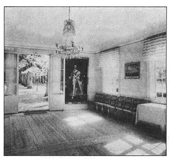
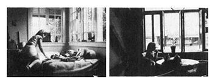
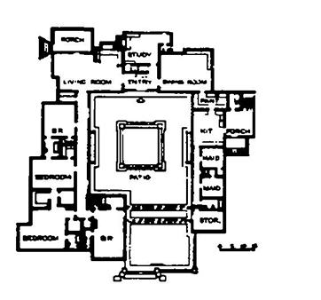
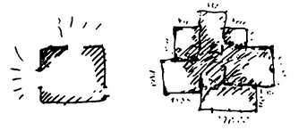

<section class="pattern-plate" aria-labelledby="t-light-on-two-sides-of-every-room">
<a href="/patterns">A Pattern Language</a> · <a href="/patterns#buildings">Buildings</a> · Pattern 159 · p. 746 · **
<h1 class="pattern-title" id="t-light-on-two-sides-of-every-room">Light On Two Sides Of Every Room</h1><figure class="pattern-figure pl-figure"></figure><nav class="pattern-links" aria-label="Connections"><h2>Links to</h2><ul><li><a href="/patterns/positive-outdoor-space">106 Positive Outdoor Space</a></li><li><a href="/patterns/wings-of-light">107 Wings Of Light</a></li><li><a href="/patterns/long-thin-house">109 Long Thin House</a></li><li><a href="/patterns/cascade-of-roofs">116 Cascade Of Roofs</a></li><li><a href="/patterns/window-place">180 Window Place</a></li><li><a href="/patterns/windows-overlooking-life">192 Windows Overlooking Life</a></li><li><a href="/patterns/roof-layout">209 Roof Layout</a></li><li><a href="/patterns/natural-doors-and-windows">221 Natural Doors And Windows</a></li><li><a href="/patterns/deep-reveals">223 Deep Reveals</a></li><li><a href="/patterns/filtered-light">238 Filtered Light</a></li></ul><h2>Linked from</h2><ul><li><a href="/patterns/wings-of-light">107 Wings Of Light</a></li><li><a href="/patterns/common-areas-at-the-heart">129 Common Areas At The Heart</a></li><li><a href="/patterns/entrance-room">130 Entrance Room</a></li><li><a href="/patterns/the-flow-through-rooms">131 The Flow Through Rooms</a></li><li><a href="/patterns/short-passages">132 Short Passages</a></li><li><a href="/patterns/couples-realm">136 Couple’s Realm</a></li><li><a href="/patterns/farmhouse-kitchen">139 Farmhouse Kitchen</a></li><li><a href="/patterns/a-room-of-ones-own">141 A Room Of One’s Own</a></li><li><a href="/patterns/bed-cluster">143 Bed Cluster</a></li><li><a href="/patterns/bathing-room">144 Bathing Room</a></li><li><a href="/patterns/flexible-office-space">146 Flexible Office Space</a></li><li><a href="/patterns/reception-welcomes-you">149 Reception Welcomes You</a></li><li><a href="/patterns/a-place-to-wait">150 A Place To Wait</a></li><li><a href="/patterns/small-meeting-rooms">151 Small Meeting Rooms</a></li><li><a href="/patterns/half-private-office">152 Half-Private Office</a></li><li><a href="/patterns/home-workshop">157 Home Workshop</a></li><li><a href="/patterns/open-stairs">158 Open Stairs</a></li><li><a href="/patterns/building-edge">160 Building Edge</a></li><li><a href="/patterns/north-face">162 North Face</a></li><li><a href="/patterns/window-place">180 Window Place</a></li><li><a href="/patterns/dressing-rooms">189 Dressing Rooms</a></li><li><a href="/patterns/windows-overlooking-life">192 Windows Overlooking Life</a></li><li><a href="/patterns/structure-follows-social-spaces">205 Structure Follows Social Spaces</a></li><li><a href="/patterns/deep-reveals">223 Deep Reveals</a></li></ul></nav></section><article class="pattern-text" aria-label="The text of Light On Two Sides Of Every Room">
747… once the building’s major rooms are in position, we have to fix its actual shape: and this we do essentially with the position of the edge. The edge has got its rough position already from the overall form of the building—<a class="pl-ref" href="/patterns/wings-of-light">WINGS OF LIGHT (107)</a>, POSITIVE OUTDOOR SPACE (l06), <a class="pl-ref" href="/patterns/long-thin-house">LONG THIN HOUSE (109)</a>, <a class="pl-ref" href="/patterns/cascade-of-roofs">CASCADE OF ROOFS (116)</a>. This pattern now completes the work of <a class="pl-ref" href="/patterns/wings-of-light">WINGS OF LIGHT (107)</a>, by placing each individual room exactly where it needs to be to get the light. It forms the exact line of the building edge, according to the position of these individual rooms. The next pattern starts to shape the edge.

◆ ◆ ◆

<strong>When they have a choice, people will always gravitate to those rooms which have light on two sides, and leave the rooms which are lit only from one side unused and empty.</strong>

This pattern, perhaps more than any other single pattern, determines the success or failure of a room. The arrangement of daylight in a room, and the presence of windows on two sides, is fundamental. If you build a room with light on one side only, you can be almost certain that you are wasting your money. People will stay out of that room if they can possibly avoid it. Of course, if all the rooms are lit from one side only, people will have to use them. But we can be fairly sure that they are subtly uncomfortable there, always wishing they weren’t there, wanting to leave—just because we are so sure of what people do when they do have the choice.

Our experiments on this matter have been rather informal and drawn out over several years. We have been aware of the idea for some time—as have many builders. (We have even heard that “light on two sides” was a tenet of the old Beaux Arts design tradition.) In any case, our experiments were simple: over and over again, in one building after another, wherever we happened to find ourselves, we would check to see if the pattern held. Were people in fact avoiding rooms lit only on one side, preferring the two-sided rooms—what did they think about it?

748We have gone through this with our friends, in offices, in many homes—and overwhelmingly the two-sided pattern seems significant. People are aware, or half-aware of the pattern—they understand exactly what we mean.

<figure class="pl-figure"><figcaption><em>With light on two sides …. and without</em></figcaption></figure>

If this evidence seems too haphazard, please try these observations yourself. Bear the pattern in mind, and examine all the buildings you come across in your daily life. We believe that you will find, as we have done, that those rooms you intuitively recognize as pleasant, friendly rooms have the pattern; and those you intuitively reject as unfriendly, unpleasant, are the ones which do not have the pattern. In short, this one pattern alone, is able to distinguish good rooms from unpleasant ones.

The importance of this pattern lies partly in the social atmosphere it creates in the room. Rooms lit on two sides, with natural light, create less glare around people and objects; this lets us see things more intricately; and most important, it allows us to read in detail the minute expressions that flash across people’s faces, the motion of their hands … and thereby understand, more clearly, the meaning they are after. <em>The light on two sides allows peofle to understand each other</em>.

In a room lit on only one side, the light gradient on the walls and floors inside the room is very steep, so that the part furthest from the window is uncomfortably dark, compared with the part near the window. Even worse, since there is little reflected light on the room’s inner surfaces, the interior wall immediately next to the window is usually dark, creating discomfort and glare against this light. <em>In rooms lit on one side, the glare which surrounds people’s faces prevents people from understanding one another</em>.

749Although this glare may be somewhat reduced by supplementary artificial lighting, and by well-designed window reveals, the most simple and most basic way of overcoming glare, is to give every room two windows. The light from each window illuminates the wall surfaces just inside the other window, thus reducing the contrast between those walls and the sky outside. For details and illustrations, see R. G. Hopkinson, <em>Architectural Physics: Lighting</em>, London: Building Research Station, 1963, pp. 29–103.

A supreme example of the complete neglect of this pattern is Le Corbusier’s Marseilles Block apartments. Each apartment unit is very long and relatively narrow, and gets all its light from one end, the narrow end. The rooms are very bright just at the windows and dark everywhere else. And, as a result, the glare created by the light-dark contrast around the windows is very disturbing.

In a small building, it is easy to give every room light on two sides: one room in each of the four corners of a house does it automatically.

In a slightly larger building, it is necessary to wrinkle the edge, turn corners, to get the same effect. Juxtaposition of large rooms and small, helps also.

<figure class="pl-figure"><figcaption><em>Wrinkle the edge</em>.</figcaption></figure>

In an even larger building, it may be necessary to build in some sort of systematic widening- in the plan or to convolute the edge still further, to get light on two sides for every room.

750But of course, no matter how clever we are with the plan, no matter how carefully we convolute the building edge, sometimes it is just impossible. In these cases, the rooms can get the effect of light on two sides under two conditions. They can get it, if the room is very shallow—not more than about eight feet deep—with at least two windows side by side. The light bounces off the back wall, and bounces sideways between the two windows, so that the light still has the glare-free character of light on two sides.

And finally, if a room simply has to be more than eight feet deep, but cannot have light from two sides—then the problem can be solved by making the ceiling very high, by painting the walls very white, and by putting great high windows in the wall, set into very deep reveals, deep enough to offset the glare. Elizabethan dining halls and living rooms in Georgian mansions were often built like this. Remember, though, that it is very hard to make it work.

Therefore:

<strong>Locate each room so that it has outdoor space outside it on at least two sides, and then place windows in these outdoor walls so that natural light falls into every room from more than one direction.</strong>

<figure class="pl-figure"></figure>
◆ ◆ ◆

Don’t let this pattern make your plans too wild—otherwise you will destroy the simplicity of <a class="pl-ref" href="/patterns/positive-outdoor-space">POSITIVE OUTDOOR SPACE (106)</a>, and you will have a terrible time roofing the building—<a class="pl-ref" href="/patterns/roof-layout">ROOF LAYOUT (209)</a>. 751Remember that it is possible to keep the essence of the pattern with windows on one side, if the room is unusually high, if it is shallow compared with the length of the window wall, the windows large, the walls of the room white, and massive deep reveals on the windows to make quite certain that the big windows, bright against the sky, do not create glare.

Place the individual windows to look onto something beautiful <a class="pl-ref" href="/patterns/windows-overlooking-life">WINDOWS OVERLOOKING LIFE (192)</a>, <a class="pl-ref" href="/patterns/natural-doors-and-windows">NATURAL DOORS AND WINDOWS (221)</a>; and make one of the windows in the room a special one, so that a place gathers itself around it—<a class="pl-ref" href="/patterns/window-place">WINDOW PLACE (180)</a>. Use <a class="pl-ref" href="/patterns/deep-reveals">DEEP REVEALS (223)</a> and <a class="pl-ref" href="/patterns/filtered-light">FILTERED LIGHT (238)</a>….
</article>

Christopher Alexander, Sara Ishikawa and Murray Silverstein, with Max Jacobson, Ingrid Fiksdahl-King and Shlomo Angel, <cite>A Pattern Language</cite> (Oxford University Press, 1977), pattern 159, pp. 746–751. Text and illustrations from the <a href="https://github.com/natureoforder/sources">Nature of Order sources</a> reading edition, transcribed from the 1977 printing; report errors on <a href="https://github.com/natureoforder/alexander-wiki/issues">GitHub</a>.

<a href="/patterns/open-stairs">← 158 Open Stairs</a> · <a href="/patterns">All 253 patterns</a> · <a href="/patterns/building-edge">160 Building Edge →</a>

