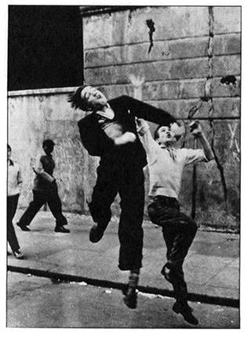
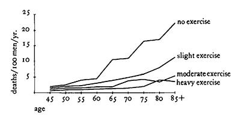
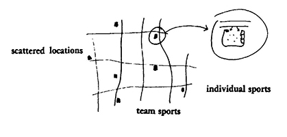

<section class="pattern-plate" aria-labelledby="t-local-sports">
<a href="/patterns">A Pattern Language</a> · <a href="/patterns#towns">Towns</a> · Pattern 72 · p. 363 · *
<h1 class="pattern-title" id="t-local-sports">Local Sports</h1><figure class="pattern-figure pl-figure"></figure><nav class="pattern-links" aria-label="Connections"><h2>Links to</h2><ul><li><a href="/patterns/health-center">47 Health Center</a></li><li><a href="/patterns/bathing-room">144 Bathing Room</a></li><li><a href="/patterns/opening-to-the-street">165 Opening To The Street</a></li><li><a href="/patterns/sitting-wall">243 Sitting Wall</a></li></ul><h2>Linked from</h2><ul><li><a href="/patterns/neighborhood-boundary">15 Neighborhood Boundary</a></li><li><a href="/patterns/health-center">47 Health Center</a></li><li><a href="/patterns/children-in-the-city">57 Children In The City</a></li><li><a href="/patterns/accessible-green">60 Accessible Green</a></li><li><a href="/patterns/holy-ground">66 Holy Ground</a></li><li><a href="/patterns/common-land">67 Common Land</a></li><li><a href="/patterns/still-water">71 Still Water</a></li><li><a href="/patterns/teen-age-society">84 Teen-Age Society</a></li></ul></nav></section><article class="pattern-text" aria-label="The text of Local Sports">
364… all the areas where people live and work—especially the work communities (41) and the areas looked after by the preventive programs of the <a class="pl-ref" href="/patterns/health-center">health center (47)</a>—need to be completed by provisions for sports and exercise. This pattern defines the nature and distribution of this exercise.

◆ ◆ ◆

<strong>The human body does not wear out with use. On the contrary, it wears down when it is not used.</strong>

In agricultural society, people use their bodies every day in many different ways. In urban society, most people use their minds, but not their bodies; or they use their bodies only in a routine way. This is devastating. There is ample empirical evidence that physical health depends on daily physical activity.

Perhaps the most striking evidence for the unbalance in our way of life comes from a comparison of the death rates between groups that have been able to live lives that include daily physical activity with those that have not. For example, in the age group 60 to 64, I per cent of the men in the heavy exercise category died during the follow-up year, whereas 5 per cent of those in the no-exercise group died. (See P. B. Johnson et al., <em>Physical Education, A Problem Solving Affroach to Health and Fitness</em>, University of Toledo, Holt, Rinehart and Winston, 1966.)

There are very few modern societies where these facts are taken seriously. China and Cuba come to mind. In these societies, people work both with their hands and with their minds. Workdays embrace both kinds of skills. Doctors are as apt to be building houses as practicing medicine; and builders are often sitting in administrative sessions.

In any society which has reached this stage, the gross physical atrophy of human bodies will not occur. But in any society which has not learned this wisdom, it is necessary, as a kind of interim solution, to scatter opportunities for physical activity, so that they are close at hand, indeed next door, to every house and place of work. Small fields, swimming pools, gyms, game courts, must be as frequent as corner groceries and restaurants. Ideally, 365local sports would form a natural part of every neighborhood and work community. We imagine these facilities as nonprofit centers, supported by the people who use them, perhaps coordinated with a program of health prevention like the swimming and dancing at the Pioneer Health Center in Peckham—see <a class="pl-ref" href="/patterns/health-center">health center (47)</a>.

<figure class="pl-figure"></figure>
<em>You will probably live longer if you exercise regularly</em>. (<em>Graph adapted from E. G. Hammond, “Some Preliminary Findings on Physical Complaints from a Prospective Study of 1,064,004 Men and Women,” American Journal of Public Health, 54:11, 1964)</em>.

Sports also have a special life of their own, which cannot be duplicated. Throwing the ball around, shouting out, winning a crushing victory, losing a long drawn out match, getting a wild ball back on the net somehow, anyhow—these are moments that cannot be captured by a job of work. They are entirely different; perhaps they cater especially to what E. Hart calls the psychoemotional component of muscular activity. (“The Need for Physical Activity,” in S. Maltz, ed., <em>Health Readings</em>, Wm. Brown Book Company, Iowa, 1968, p. 240.) In any case, it is a kind of vitality that cannot be replaced.

Therefore:

<strong>Scatter places for team and individual sports through every work community and neighborhood: tennis, squash, 366table tennis, swimming, billiards, basketball, dancing, gymnasium … and make the action visible to passers-by, as an invitation to participate.</strong>

<figure class="pl-figure"></figure>
◆ ◆ ◆

Treat the sports places as a special class of recognizable simple buildings, which are open, easy to get into, with changing rooms and showers—building complex (95), <a class="pl-ref" href="/patterns/bathing-room">bathing room (144)</a>; combine them with community swimming pools, where they exist—still water (71); keep them open to people passing—building THOROUGHFARE(101), <a class="pl-ref" href="/patterns/opening-to-the-street">opening to the street (165)</a>, and provide places where people can stop and watch—seat spots (241), <a class="pl-ref" href="/patterns/sitting-wall">sitting wall (243)</a>….
</article>

Christopher Alexander, Sara Ishikawa and Murray Silverstein, with Max Jacobson, Ingrid Fiksdahl-King and Shlomo Angel, <cite>A Pattern Language</cite> (Oxford University Press, 1977), pattern 72, pp. 363–366. Text and illustrations from the <a href="https://github.com/natureoforder/sources">Nature of Order sources</a> reading edition, transcribed from the 1977 printing; report errors on <a href="https://github.com/natureoforder/alexander-wiki/issues">GitHub</a>.

<a href="/patterns/still-water">← 71 Still Water</a> · <a href="/patterns">All 253 patterns</a> · <a href="/patterns/adventure-playground">73 Adventure Playground →</a>

