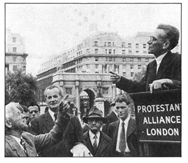
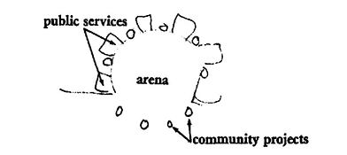

<section class="pattern-plate" aria-labelledby="t-local-town-hall">
<a href="/patterns">A Pattern Language</a> · <a href="/patterns#towns">Towns</a> · Pattern 44 · p. 236 · *
<h1 class="pattern-title" id="t-local-town-hall">Local Town Hall</h1><figure class="pattern-figure pl-figure"></figure><nav class="pattern-links" aria-label="Connections"><h2>Links to</h2><ul><li><a href="/patterns/mosaic-of-subcultures">8 Mosaic Of Subcultures</a></li><li><a href="/patterns/identifiable-neighborhood">14 Identifiable Neighborhood</a></li><li><a href="/patterns/necklace-of-community-projects">45 Necklace Of Community Projects</a></li><li><a href="/patterns/small-public-squares">61 Small Public Squares</a></li><li><a href="/patterns/pedestrian-density">123 Pedestrian Density</a></li></ul><h2>Linked from</h2><ul><li><a href="/patterns/community-of-7000">12 Community Of 7000</a></li><li><a href="/patterns/life-cycle">26 Life Cycle</a></li><li><a href="/patterns/activity-nodes">30 Activity Nodes</a></li><li><a href="/patterns/night-life">33 Night Life</a></li><li><a href="/patterns/old-people-everywhere">40 Old People Everywhere</a></li><li><a href="/patterns/necklace-of-community-projects">45 Necklace Of Community Projects</a></li><li><a href="/patterns/small-services-without-red-tape">81 Small Services Without Red Tape</a></li><li><a href="/patterns/small-meeting-rooms">151 Small Meeting Rooms</a></li><li><a href="/patterns/opening-to-the-street">165 Opening To The Street</a></li></ul></nav></section><article class="pattern-text" aria-label="The text of Local Town Hall">
… according to community of 7000 (12), the political and 237economic life of the city breaks down into small, self-governing communities. In this case, the process of local government needs a physical place of work; and the design and placing of this physical place of work can help to create and to sustain the community of 7000 by acting as its physical and social focus.

◆ ◆ ◆

<strong>Local government of communities and local control by the inhabitants, will only happen if each community has its own physical town hall which forms the nucleus of its political activity.</strong>

We have argued, in <a class="pl-ref" href="/patterns/mosaic-of-subcultures">mosaic of subcultures (8)</a>, community of 7000 (12), and <a class="pl-ref" href="/patterns/identifiable-neighborhood">IDENTIFIABLE NEIGHBORHOOD (14)</a>, that every city needs to be made of self-governing groups, which exist at two different levels, the communities with populations of $000 to 10,000 and the neighborhoods with populations of 200 to 1000.

These groups will only have the political force to carry out their own, locally determined plans, if they have a share of the taxes which their inhabitants generate, and if the people in the groups have a genuine, daily possibility of access to the local government which represents them. Both require that each group has its own seat of government, no matter how modest, where the people of the neighborhood feel comfortable, and where they know that they can get results.

This calls up a physical image of city government which is quite the opposite of the huge city halls that have been built in the last 75 years. A <em>local</em> town hall would contain two basic features:

1. It is community territory for the group it serves; it is made in a way which invites people in for service, spontaneously, to debate policy, and the open space around the building is shaped to sustain people gathering and lingering.

238

<ol start="2" type="1">
<li>It is located at the heart of the local community and is within walking distance of everyone it serves.</li>
</ol>

<em>i.The town hall as community territory</em>.

The weakness of community government is due in part to the kinds of policies created and maintained by the city hall bureaucracy. And we believe this situation is largely supported and bolstered by the physical nature of city hall. In other words, the physical existence of a city hall undermines local community government, even where the city hall staff is sympathetic to “neighborhood participation.”

The key to the problem lies in the experience of powerlessness at the community level. When a man goes to city hall to take action on a neighborhood or community issue, he is at once on the defensive: the building and the staff of city hall serve the entire city; his problem is very small beside the problems of the city as a whole. And besides, everyone is busy-busy and unfamiliar. He is asked to fill out paper forms and make appointments, though perhaps the connection between these forms and appointments and his problem are not very clear. Soon the people in the neighborhoods feel more and more remote from city hall, from the center of decision-making and from the decisions themselves which influence their lives. Quickly the syndrome of powerlessness grows.

In an earlier publication, we presented a body of evidence to substantiate the growth of this syndrome (<em>A Pattern Language Which Generates Multi-Service Centers</em>, Center for Environmental Structure, Berkeley, 1968, pp. 80–87). There we discovered that centralized service programs reached very few of the people in their target areas; the staff of these centers quickly took on the red tape mentality, even where they were chosen specifically to support neighborhood programs; and, most damaging of all, the centers themselves were seen as alien places, and the experience of using them was, on the whole, debilitating to the people.

Like all syndromes, this one can only be broken if it is attacked on its several fronts simultaneously. This means, for example, organizing neighborhoods and communities to take control of the functions that concern them; revising city charters to grant 239power to local groups; <em>and making places, in communities and neighborhoods, that act as home bases for the consolidation of this footer—the local town halls</em>.

What might these local town halls be like if they are to be effective in breaking down the syndrome of powerlessness?

The evidence shows that people can and will articulate their needs if given the proper setting and means. Creating this setting goes hand in hand with community organization. If the local town hall is gradually to become a source of real neighborhood power, it must help the process of community organization. This means, essentially, that the building be built around the <em>-process</em> of community organization, and that the place be clearly recognizable <em>as community territory</em>.

When we translate the idea of community organization and community territory into physical terms, they yield two components: an arena and a zone of community projects.

The community needs a public forum, equipped with sound system, benches, walls to put up notices, where people are free to gather; a place which belongs to the community where people would naturally come whenever they think something should be done about something. <em>We call this public forum the arena</em>.

And the community needs a place where people can have access to storefronts, work space, meeting rooms, office equipment. Once a group is ready to move, it takes typewriters, duplicating machines, telephones, etc., to carry through with a project and develop broad based community support—and this in turn needs cheap and readily accessible office space. We call this space the community projects zone—see <a class="pl-ref" href="/patterns/necklace-of-community-projects">necklace of community projects (45)</a> for details.

<em>2. The location of local town halls</em>.

If these local town halls are to be successful in drawing people in, the question of their location must be taken seriously. From earlier work on the location of multi-service centers, we are convinced that town halls can die if they are badly located: <em>twenty times as many people drop into community centers when they are located near major intersections</em> as when they are buried in the middle of residential blocks.

Here, for example, is a table which shows the number of 240people who dropped in at a service center while it was located on a residential street, versus the number of people who dropped in after it was relocated on a major commercial street, close to a main pedestrian intersection.

<table style="width:97%;">
<colgroup>
<col style="width: 32%" />
<col style="width: 32%" />
<col style="width: 32%" />
</colgroup>
<tbody>
<tr>
<td></td>
<td style="text-align: left;">Number of people 
dropping in, 
per day</td>
<td style="text-align: left;">Number of people 
with appointments, 
per day</td>
</tr>
<tr>
<td>Before the move</td>
<td style="text-align: left;">1-2</td>
<td style="text-align: left;">15-20</td>
</tr>
<tr>
<td>Two months after the move</td>
<td style="text-align: left;">15-20</td>
<td style="text-align: left;">about 50</td>
</tr>
<tr>
<td>Six months after the move</td>
<td style="text-align: left;">about 40</td>
<td style="text-align: left;">about 50</td>
</tr>
</tbody>
</table>

The details of this investigation are given in <em>A Pattern Language Which Generates Multi-Service Centers</em> (pp. 70–73). The conclusion reached there, is that community centers can afford to be within a block of the major pedestrian intersections, but if they are farther away, they are virtually dead as centers of local service.

This information must be interpreted to suit the different scales of neighborhood and community. We imagine, in a neighborhood of 500, the neighborhood town hall would be quite small and informal; perhaps not even a separate building at all, but a room with an adjoining outdoor room, on an important corner of the neighborhood. In a community of 7000, something more is required: a building the size of a large house, with an outdoor area developed as a forum and meeting place, located on the community’s main promenade.

Therefore:

<strong>To make the political control of local functions real, establish a small town hall for each community of 7000, and even for each neighborhood; locate it near the busiest intersection in the community. Give the building three parts: an arena for public discussion, public services around the arena, and space to rent out to ad hoc community projects.</strong>

241

<figure class="pl-figure"></figure>
◆ ◆ ◆

Arrange the arena so that it forms the heart of a community crossroads; and make it small, so that a crowd can easily gather there—activity nodes (30), <a class="pl-ref" href="/patterns/small-public-squares">small public squares (61)</a>, <a class="pl-ref" href="/patterns/pedestrian-density">pedestrian density (123)</a>. Keep all the public services around this square as small as possible—small services without red tape (81); and provide ample space for the community projects, in a ring around the building, so that they form the outer face of the town hall—necklace of community projects (45)….
</article>

Christopher Alexander, Sara Ishikawa and Murray Silverstein, with Max Jacobson, Ingrid Fiksdahl-King and Shlomo Angel, <cite>A Pattern Language</cite> (Oxford University Press, 1977), pattern 44, pp. 236–241. Text and illustrations from the <a href="https://github.com/natureoforder/sources">Nature of Order sources</a> reading edition, transcribed from the 1977 printing; report errors on <a href="https://github.com/natureoforder/alexander-wiki/issues">GitHub</a>.

<a href="/patterns/university-as-a-marketplace">← 43 University As A Marketplace</a> · <a href="/patterns">All 253 patterns</a> · <a href="/patterns/necklace-of-community-projects">45 Necklace Of Community Projects →</a>

