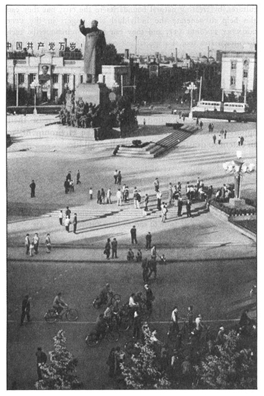
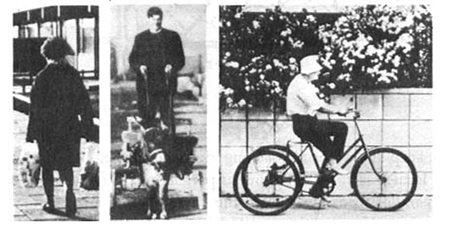
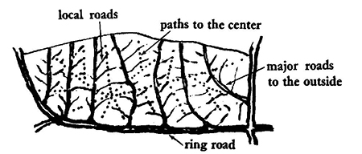

<section class="pattern-plate" aria-labelledby="t-local-transport-areas">
<a href="/patterns">A Pattern Language</a> · <a href="/patterns#towns">Towns</a> · Pattern 11 · p. 63 · **
<h1 class="pattern-title" id="t-local-transport-areas">Local Transport Areas</h1><figure class="pattern-figure pl-figure"></figure><nav class="pattern-links" aria-label="Connections"><h2>Links to</h2><ul><li><a href="/patterns/city-country-fingers">3 City Country Fingers</a></li><li><a href="/patterns/mosaic-of-subcultures">8 Mosaic Of Subcultures</a></li><li><a href="/patterns/magic-of-the-city">10 Magic Of The City</a></li><li><a href="/patterns/community-of-7000">12 Community Of 7000</a></li><li><a href="/patterns/subculture-boundary">13 Subculture Boundary</a></li><li><a href="/patterns/identifiable-neighborhood">14 Identifiable Neighborhood</a></li><li><a href="/patterns/neighborhood-boundary">15 Neighborhood Boundary</a></li><li><a href="/patterns/ring-roads">17 Ring Roads</a></li><li><a href="/patterns/nine-per-cent-parking">22 Nine Per Cent Parking</a></li><li><a href="/patterns/parallel-roads">23 Parallel Roads</a></li><li><a href="/patterns/interchange">34 Interchange</a></li><li><a href="/patterns/green-streets">51 Green Streets</a></li><li><a href="/patterns/network-of-paths-and-cars">52 Network Of Paths And Cars</a></li><li><a href="/patterns/bike-paths-and-racks">56 Bike Paths And Racks</a></li><li><a href="/patterns/shielded-parking">97 Shielded Parking</a></li></ul><h2>Linked from</h2><ul><li><a href="/patterns/the-countryside">7 The Countryside</a></li><li><a href="/patterns/magic-of-the-city">10 Magic Of The City</a></li><li><a href="/patterns/web-of-public-transportation">16 Web Of Public Transportation</a></li><li><a href="/patterns/ring-roads">17 Ring Roads</a></li><li><a href="/patterns/web-of-shopping">19 Web Of Shopping</a></li><li><a href="/patterns/mini-buses">20 Mini-Buses</a></li><li><a href="/patterns/nine-per-cent-parking">22 Nine Per Cent Parking</a></li><li><a href="/patterns/parallel-roads">23 Parallel Roads</a></li><li><a href="/patterns/interchange">34 Interchange</a></li><li><a href="/patterns/shielded-parking">97 Shielded Parking</a></li></ul></nav></section><article class="pattern-text" aria-label="The text of Local Transport Areas">
64… superimposed over the <a class="pl-ref" href="/patterns/mosaic-of-subcultures">MOSAIC OF SUBCULTURES (8)</a>, there is a need for a still larger cellular structure: the local transport areas. These areas, 1—2 mi les across, not only help to form subcultures, by creating natural boundaries in the city, but they can also help to generate the individual city fingers in the <a class="pl-ref" href="/patterns/city-country-fingers">CITY COUNTRY FINGERS (3)</a>, and they can help to circumscribe each downtown area too, as a special self-contained area of local transportation—<a class="pl-ref" href="/patterns/magic-of-the-city">MAGIC OF THE CITY (10)</a>.

◆ ◆ ◆

<strong>Cars give people wonderful freedom and increase their opportunities. But they also destroy the environment, to an extent so drastic that they kill all social life.</strong>

The value and power of the car have proved so great that it seems impossible to imagine a future without some form of private, high-speed vehicle. Who will willingly give up the degree of freedom provided by cars? At the same time, it is undeniably true that cars turn towns to mincemeat. Somehow local areas must be saved from the pressure of cars or their future equivalents.

It is possible to solve the problem as soon as we make a distinction between short trips and long trips. Cars are not very good for short trips inside a town, and it is on these trips that they do their greatest damage. But they are good for fairly long trips, where they cause less damage. The problem will be solved if towns are divided up into areas about one mile across, with the idea that cars may be used for trips which leave these areas, but that other, slower forms of transportation will be used for all trips inside these areas-foot, bike, horse, taxi. All it needs, physically, is a street pattern that discourages people from using private cars for trips within these areas, and encourages the use of walking, bikes, horses, and taxis instead-but allows the use of cars for trips which leave the area.

Let us start with a list of the obvious social problems created by the car:

Air pollution

65Noise

Danger

Ill health

Congestion

Parking problem

Eyesore

The first two are very serious, but are not inherent in the car; they could both be solved, for instance, by an electric car. They are, in that sense, temporary problems. Danger will be a persistent feature of the car so long as we go on using high-speed vehicles for local trips. The widespread lack of exercise and consequent ill health created by the use of motor-driven vehicles will persist unless offset by an amount of daily exercise at least equal to a 20 minute walk per day. And finally, the problems of congestion and loss of speed, difficulty and cost of parking, and eyesore are all direct results of the fact that the car is a very large vehicle which consumes a great deal of space.

<em>The fact that car are large is, in the end, the most serious aspect of a transportation system based on the use of cars, since it is inherent in the oery nature of cars</em>. Let us state this problem in its most pungent form. A man occupies about <em>5</em> square feet of space when he is standing still, and perhaps 10 square feet when he is walking. A car occupies about 350 square feet when it is standing still (if we include access), and at 30 miles an hour, when cars are 3 car lengths apart, it occupies about 1000 square feet. As we know, most of the time cars have a single occupant. This means that when people use cars, each person occupies almost 100 times as much space as he does when he is a pedestrian.

If each person driving occupies an area I oo times as large as he does when he is on his feet, this means that people are 10 times as far apart. <em>In other words, the use of cars has the overall effect of spreading people out, and keeping them apart</em>.

The effect of this particular feature of cars on the social fabric is clear. People are drawn away from each other; densities and corresponding frequencies of interaction decrease substantially. Contacts become fragmented and specialized, since they are localized by the nature of the interaction into well-defined indoor places-the home, the workplace, and maybe the homes of a few isolated friends.

66It is quite possible that the collective cohesion people need to form a viable society just cannot develop when the vehicles which people use force them to he 10 times farther apart, on the average, than they have to he. This states the possible social cost of cars in its strongest form. <em>I t may be that cars cause the breakdown of society, simply because of their geometry</em>.

At the same time that cars cause all these difficulties, they also have certain unprecedented virtues, which have in fact led to their enormous success. These virtues are:

Flexibility

Privacy

Door-to-door trips, without transfer

Immediacy

These virtues are particularly important in a metropolitan region which is essentially two-dimensional. Public transportation can provide very fast, frequent, door-to-door service, along certain arteries. But in the widely spread out, two-dimensional character of a modern urban region, public transportation by itself cannot compete successfully with cars. Even in cities like London and Paris, with the finest urban public transportation in the world, the trains and buses have fewer riders every year because people are switching to cars. They are willing to put up with all the delays, congestion, and parking costs, because apparently the convenience and privacy of the car are more valuable.

Under <em>theoretical</em> analysis of this situation, the only kind of transportation system which meets all the needs is a system of individual vehicles, which can use certain high-speed lines for long cross-city trips and which can use their own power when they leave the public lines in local areas. The systems which come closest to this theoretical model are the various Private Rapid Transit proposals; one example is the Westinghouse Starrcar—a system in which tiny two-man vehicles drive on streets locally and onto high-speed public rails for long trips.

However, the Starrcar-type systems have a number of disadvantages. They make relatively little contribution to the problem of space. The small cars, though smaller than a conventional car, still take up vastly more space than a person. Since the private cars will not be capable of long cross-country trips, they must be 67treated as a “second vehicle”-and are rather expensive. They make no contribution to the health problem, since people are still sitting motionless while they travel. The system is relatively antisocial, since people are still encapsulated in “bubbles” while they travel. It is highly idealistic, since it works if everyone has a Starrcar, but makes no allowance for the great variety of movement which people actually desire, i.e., bikes, horses, jalopies, old classic cars, family buses.

We propose a system which has the advantages of the Starrcar system but which is more realistic, easier to implement, and, we believe, better adapted to people’s needs. The essence of the system lies in the following two propositions:

1. For local trips, people use a variety of low-speed, low-cost vehicles (bicycles, tricycles, scooters, golf carts, bicycle buggies, horses, etc.), which take up less room than cars and which all leave their passengers in closer touch with their environment and with one another.

<figure class="pl-figure"><figcaption><em>Many ways of getting around on local trips</em>.</figcaption></figure>

2. People still own, and use, cars and trucks-but mainly for long trips. We assume that these cars can be made to be quiet, nonpolluting, and simple to repair, and that people simply consider them best suited for long distance travel. It will still be possible for people to use a car or a truck for a local trip, either in a case of emergency, or for some special convenience. However, the town is constructed in such a way that it is actually expensive and inconvenient to use cars for local trips—so that people only do it when they are willing to pay for the very great social costs of doing so.

Therefore:

<strong>68Break the urban area down into local transport areas, each one between 1 and 2 miles across, surrounded by a ring road. Within the local transport area, build minor local roads and paths for internal movements on foot, by bike, on horseback, and in local vehicles; build major roads which make it easy for cars and trucks to get to and from the ring roads, but place them to make internal local trips slow and inconvenient.</strong>

<figure class="pl-figure"></figure>
◆ ◆ ◆

To keep main roads for long distance traffic, but not for internal local traffic, lay them out as parallel one way roads, and keep these parallel roads away from the center of the area, so that they are very good for getting to the ring roads, but inconvenient for short local trips—<a class="pl-ref" href="/patterns/parallel-roads">PARALLEL ROADS (23)</a>. Lay out abundant footpaths and bike paths and green streets, at right angles to the main roads, and make these paths for local traffic go directly through the center—<a class="pl-ref" href="/patterns/green-streets">GREEN STREETS (51)</a>, <a class="pl-ref" href="/patterns/network-of-paths-and-cars">NETWORK OF PATHS AND CARS (52)</a>, <a class="pl-ref" href="/patterns/bike-paths-and-racks">BIKE PATHS AND RACKS (56)</a>; sink the ring roads around the outside of each area, or shield the noise they make some other way—<a class="pl-ref" href="/patterns/ring-roads">RING ROADS (17)</a>; keep parking to a minimum within the area, and keep all major parking garages near the ring roads—<a class="pl-ref" href="/patterns/nine-per-cent-parking">NINE PER CENT PARKING (22)</a>,—<a class="pl-ref" href="/patterns/shielded-parking">SHIELDED PARKING (97)</a>; and build a major interchange within the center of the area—<a class="pl-ref" href="/patterns/interchange">INTERCHANGE (34)</a> ….

<strong><em>69build up these larger city patterns from the grass roots, through action essentially controlled by two levels of self-governing communities, which exist as physically identifiable places;</em></strong>

<a class="pl-ref" href="/patterns/community-of-7000">12. COMMUNITY OF 7000</a>

<a class="pl-ref" href="/patterns/subculture-boundary">13. SUBCULTURE BOUNDARY</a>

<a class="pl-ref" href="/patterns/identifiable-neighborhood">14. IDENTIFIABLE NEIGHBORHOOD</a>

<a class="pl-ref" href="/patterns/neighborhood-boundary">15. NEIGHBORHOOD BOUNDARY</a>
</article>

Christopher Alexander, Sara Ishikawa and Murray Silverstein, with Max Jacobson, Ingrid Fiksdahl-King and Shlomo Angel, <cite>A Pattern Language</cite> (Oxford University Press, 1977), pattern 11, pp. 63–69. Text and illustrations from the <a href="https://github.com/natureoforder/sources">Nature of Order sources</a> reading edition, transcribed from the 1977 printing; report errors on <a href="https://github.com/natureoforder/alexander-wiki/issues">GitHub</a>.

<a href="/patterns/magic-of-the-city">← 10 Magic Of The City</a> · <a href="/patterns">All 253 patterns</a> · <a href="/patterns/community-of-7000">12 Community Of 7000 →</a>

