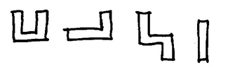
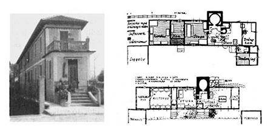
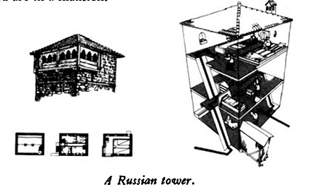
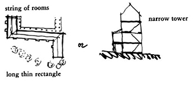

<section class="pattern-plate" aria-labelledby="t-long-thin-house">
<a href="/patterns">A Pattern Language</a> · <a href="/patterns#buildings">Buildings</a> · Pattern 109 · p. 535 · *
<h1 class="pattern-title" id="t-long-thin-house">Long Thin House</h1><nav class="pattern-links" aria-label="Connections"><h2>Links to</h2><ul><li><a href="/patterns/positive-outdoor-space">106 Positive Outdoor Space</a></li><li><a href="/patterns/wings-of-light">107 Wings Of Light</a></li><li><a href="/patterns/main-entrance">110 Main Entrance</a></li><li><a href="/patterns/half-hidden-garden">111 Half-Hidden Garden</a></li><li><a href="/patterns/entrance-transition">112 Entrance Transition</a></li><li><a href="/patterns/car-connection">113 Car Connection</a></li><li><a href="/patterns/hierarchy-of-open-space">114 Hierarchy Of Open Space</a></li><li><a href="/patterns/courtyards-which-live">115 Courtyards Which Live</a></li><li><a href="/patterns/cascade-of-roofs">116 Cascade Of Roofs</a></li><li><a href="/patterns/sheltering-roof">117 Sheltering Roof</a></li><li><a href="/patterns/roof-garden">118 Roof Garden</a></li><li><a href="/patterns/intimacy-gradient">127 Intimacy Gradient</a></li><li><a href="/patterns/common-areas-at-the-heart">129 Common Areas At The Heart</a></li></ul><h2>Linked from</h2><ul><li><a href="/patterns/building-complex">95 Building Complex</a></li><li><a href="/patterns/small-parking-lots">103 Small Parking Lots</a></li><li><a href="/patterns/site-repair">104 Site Repair</a></li><li><a href="/patterns/light-on-two-sides-of-every-room">159 Light On Two Sides Of Every Room</a></li></ul></nav></section><article class="pattern-text" aria-label="The text of Long Thin House">
… for a very small house or office the pattern of wings of light (106) is almost automatically solved—no one would imagine that the house should be more than 25 feet wide. But in such a house or office there are strong reasons to make the building even longer and thinner still. This pattern was originally formulated by Christie Coffin.

◆ ◆ ◆

<strong>The shape of a building has a great effect on the relative degrees of privacy and overcrowding in it, and this in turn has a critical effect on people’s comfort and well being.</strong>

There is widespread evidence to show that overcrowding in small dwellings causes psychological and social damage. (For example, Wiliam C. Loring, “Housing Characteristics and Social Disorganization,” <em>Social Problems</em>, January 1956; Chombart de Lauwe, <em>Famille et Habitation</em>, Editions du Ceptre National de la Recherche Scientifique, Paris, 1959; Bernard Lander, <em>Towards an Understanding of Juvenile Delinquency</em>, New York: Columbia University Press, 1954.) Everyone seems to be on top of everyone else. Everything seems to be too near everything else. Privacy for individuals or couples is almost impossible.

It would be simple to solve these problems by providing more space—but space is expensive, and it is usually impossible to buy more than a certain very limited amount of it. So the question is: <em>For a given fixed area, which shaft will create the greatest feeling of spaciousness?</em>

There is a mathematical answer to this question.

The feeling of overcrowding is largely created by the mean point-to-point distances inside a building. In a small house these distances are small—as a result it is not possible to walk far inside the house nor to get away from annoying disturbances; and it is hard to get away from noise sources, even when they are in other rooms.

536To reduce this effect the building should have a shape for which the mean point-to-point distance is high. (For any given shape, we may compute the mean or average distance between two randomly chosen points within the shape). The mean point-to-point distance is low in compact shapes like circles and squares, and high in those distended shapes like long thin rectangles, and branched shapes, and tall narrow towers. These shapes increase the separation between places inside the building and therefore increase the relative privacy which people are able to get within a given area.

<figure class="pl-figure"></figure>
<em>Buildings which increase the distance between points</em>….

Of course, in practice there are limits on the long-thinness of a building. If it is too long and thin, the cost of walls becomes prohibitive, the cost of heating is too high, and the plan is not useful. But this is still no reason to settle only for box-like forms.

A small building can actually be much narrower than people imagine. It can certainly be much narrower than the 25 foot width proposed in <a class="pl-ref" href="/patterns/wings-of-light">WINGS OF LIGHT (107)</a>. We have seen successful buildings as narrow as 12 feet wide—indeed, Richard Neutra’s own house in Los Angeles is even less.

<figure class="pl-figure"><figcaption><em>Long thin houses</em>.</figcaption></figure>

537And a long thin house can also be a tower, or a pair of towers, connected at ground level. Towers, like floors can be much narrower than people realize. A building which is 12 feet square, and three stories high, with an exterior stair, makes a wonderful house. The rooms are so far apart, psychologically, that you feel as if you are in a mansion.,

<figure class="pl-figure"><figcaption><em>A Russian tower</em>.</figcaption></figure>

Therefore:

<strong>In small buildings, don’t cluster all the rooms together around each other; instead string out the rooms one after another, so that distance between each room is as great as it can be. You can do this horizontally—so that the plan becomes a thin, long rectangle; or you can do it vertically—so that the building becomes a tall narrow tower. In either case, the building can be surprisingly narrow and still Work—8, io, and 12 feet are all quite possible.</strong>

<figure class="pl-figure"></figure>
538

◆ ◆ ◆

Use the long thin plan to help shape outdoor space on the site—<a class="pl-ref" href="/patterns/positive-outdoor-space">POSITIVE OUTDOOR SPACE (106)</a>; the long perimeter of the building sets the stage for <a class="pl-ref" href="/patterns/intimacy-gradient">INTIMACY GRADIENT (127)</a> and for the <a class="pl-ref" href="/patterns/cascade-of-roofs">CASCADE OF ROOFS (116)</a>. Make certain that the privacy which is achieved with the thinness of the building is balanced with the communality at the crossroads of the house—<a class="pl-ref" href="/patterns/common-areas-at-the-heart">COMMON AREAS AT THE HEART (129)</a>….

539<strong><em>within the buildings’ wings, lay out the entrances, the gardens, courtyards</em>, roofs <em>and terraces: shape both the volume of the buildings and the volume of the space between the buildings at the same time</em>—<em>remembering that indoor space and outdoor space, like yin and yang, must always get their shape together</em>.</strong>

<a class="pl-ref" href="/patterns/main-entrance">110. MAIN ENTRANCE</a>

<a class="pl-ref" href="/patterns/half-hidden-garden">111. HALF-HIDDEN GARDEN</a>

<a class="pl-ref" href="/patterns/entrance-transition">112. ENTRANCE TRANSITION</a>

<a class="pl-ref" href="/patterns/car-connection">113. CAR CONNECTION</a>

<a class="pl-ref" href="/patterns/hierarchy-of-open-space">114. HIERARCHY OF OPEN SPACE</a>

<a class="pl-ref" href="/patterns/courtyards-which-live">115. COURTYARDS WHICH LIVE</a>

<a class="pl-ref" href="/patterns/cascade-of-roofs">116. CASCADE OF ROOFS</a>

<a class="pl-ref" href="/patterns/sheltering-roof">117. SHELTERING ROOF</a>

<a class="pl-ref" href="/patterns/roof-garden">118. ROOF GARDEN</a>
</article>

Christopher Alexander, Sara Ishikawa and Murray Silverstein, with Max Jacobson, Ingrid Fiksdahl-King and Shlomo Angel, <cite>A Pattern Language</cite> (Oxford University Press, 1977), pattern 109, pp. 535–539. Text and illustrations from the <a href="https://github.com/natureoforder/sources">Nature of Order sources</a> reading edition, transcribed from the 1977 printing; report errors on <a href="https://github.com/natureoforder/alexander-wiki/issues">GitHub</a>.

<a href="/patterns/connected-buildings">← 108 Connected Buildings</a> · <a href="/patterns">All 253 patterns</a> · <a href="/patterns/main-entrance">110 Main Entrance →</a>

