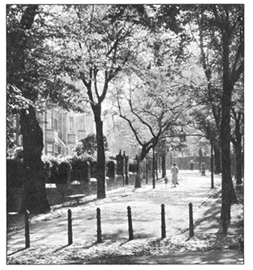
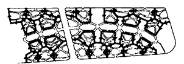
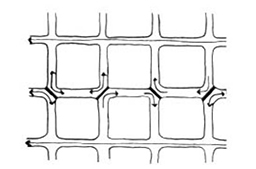
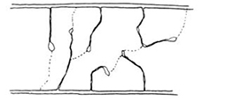
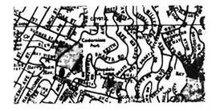
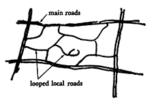

<section class="pattern-plate" aria-labelledby="t-looped-local-roads">
<a href="/patterns">A Pattern Language</a> · <a href="/patterns#towns">Towns</a> · Pattern 49 · p. 260 · **
<h1 class="pattern-title" id="t-looped-local-roads">Looped Local Roads</h1><figure class="pattern-figure pl-figure"></figure><nav class="pattern-links" aria-label="Connections"><h2>Links to</h2><ul><li><a href="/patterns/identifiable-neighborhood">14 Identifiable Neighborhood</a></li><li><a href="/patterns/parallel-roads">23 Parallel Roads</a></li><li><a href="/patterns/house-cluster">37 House Cluster</a></li><li><a href="/patterns/work-community">41 Work Community</a></li><li><a href="/patterns/car-connection">113 Car Connection</a></li></ul><h2>Linked from</h2><ul><li><a href="/patterns/parallel-roads">23 Parallel Roads</a></li><li><a href="/patterns/housing-in-between">48 Housing In Between</a></li><li><a href="/patterns/green-streets">51 Green Streets</a></li><li><a href="/patterns/network-of-paths-and-cars">52 Network Of Paths And Cars</a></li><li><a href="/patterns/bike-paths-and-racks">56 Bike Paths And Racks</a></li><li><a href="/patterns/children-in-the-city">57 Children In The City</a></li><li><a href="/patterns/hierarchy-of-open-space">114 Hierarchy Of Open Space</a></li></ul></nav></section><article class="pattern-text" aria-label="The text of Looped Local Roads">
261… assume that neighborhoods, house clusters, work communities, and major roads are more or less defined—local transport areas (ii), <a class="pl-ref" href="/patterns/identifiable-neighborhood">IDENTIFIABLE NEIGHBORHOOD (14)</a>, <a class="pl-ref" href="/patterns/parallel-roads">PARALLEL ROADS (23)</a>, <a class="pl-ref" href="/patterns/house-cluster">HOUSE CLUSTER (37)</a>, <a class="pl-ref" href="/patterns/work-community">WORK COMMUNITY (41)</a>. Now, for the layout of the local roads.

◆ ◆ ◆

<strong>Nobody wants fast through traffic going by their homes.</strong>

Through traffic is fast, noisy, and dangerous. At the same time can are important, and cannot be excluded altogether from the areas where people live. Local roads must provide access to houses but prevent traffic from coming through.

This problem can only be solved if all roads which have houses on them are laid out to be “loops.” We define a looped road as any road in a road network so placed that no path along other roads in the road network can be shortened by travel along the “loop.”

The loops themselves must be designed to discourage high volumes or high speeds: this depends on the total number of houses served by the loop, the road surface, the road width, and the number of curves and corners. Our observations suggest that a loop can be made safe so long as it serves less than 50 cars. At one and one-half cars per house, such a loop serves 30 houses; at one car per house, 50 houses; at one-half car per house, 100 houses.

Here is an example of an entire system of looped local roads designed for a community of 1500 houses in Peru.

<figure class="pl-figure"><figcaption><em>Looped local roads in Lima</em>.</figcaption></figure>

262Even a simple grid can be changed to have looped local roads.

<figure class="pl-figure"><figcaption><em>A way of closing streets to form loafed local roads</em>.</figcaption></figure>

Dead-end streets are also loops, according to the definition. However, cul-de-sacs are very bad from a social standpoint—they force interaction and they feel claustrophobic, because there is only one entrance. When auto traffic forms a dead end, make sure that the pedestrian path is a through path, leading into the cul-de-sac from one direction, and out of it in another direction.

<figure class="pl-figure"><figcaption><em>Pedestrian paths which go beyond a dead end</em>.</figcaption></figure>

Recognize also that many roads which appear looped are actually not. This map looks as though it has looped roads. Actually, only one or two of these roads are looped in the functional sense defined.

<figure class="pl-figure"><figcaption><em>These are not looped local roads</em>.</figcaption></figure>

263Therefore:

<strong>Lay out local roads so that they form loops. A loop is defined as any stretch of road which makes it impossible for cars that don’t have destinations on it to use it as a shortcut. Do not allow any one loop to serve more than 50 cars, and keep the road really narrow—17 to 20 feet is quite enough.</strong>

<figure class="pl-figure"></figure>
◆ ◆ ◆

Make all the junctions between local roads three-way T junctions, never four-way intersections—t junctions (50); wherever there is any possibility of life from buildings being oriented toward the road, give the road a very rough surface of grass and gravel, with paving stones for wheels of cars—green streets (51); keep parking off the road in driveways—small parking lots (103) and <a class="pl-ref" href="/patterns/car-connection">car connection (113)</a>; except where the roads are very quiet, run pedestrian paths at right angles to them, not along them, and make buildings open off these paths, not off the roads—network of paths and cars (52)….
</article>

Christopher Alexander, Sara Ishikawa and Murray Silverstein, with Max Jacobson, Ingrid Fiksdahl-King and Shlomo Angel, <cite>A Pattern Language</cite> (Oxford University Press, 1977), pattern 49, pp. 260–263. Text and illustrations from the <a href="https://github.com/natureoforder/sources">Nature of Order sources</a> reading edition, transcribed from the 1977 printing; report errors on <a href="https://github.com/natureoforder/alexander-wiki/issues">GitHub</a>.

<a href="/patterns/housing-in-between">← 48 Housing In Between</a> · <a href="/patterns">All 253 patterns</a> · <a href="/patterns/t-junctions">50 T Junctions →</a>

