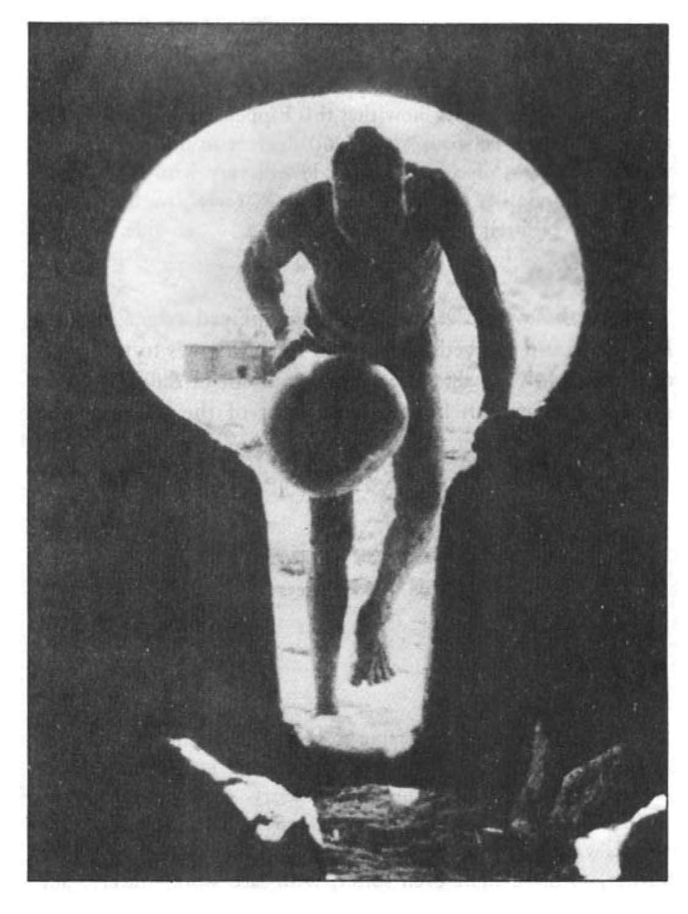
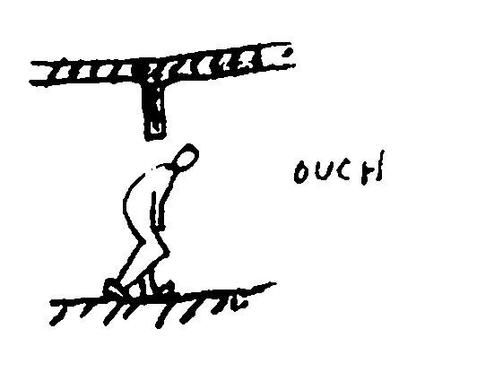

<section class="pattern-plate" aria-labelledby="t-low-doorway">
<a href="/patterns">A Pattern Language</a> · <a href="/patterns#construction">Construction</a> · Pattern 224 · p. 1056
<h1 class="pattern-title" id="t-low-doorway">Low Doorway</h1><figure class="pattern-figure pl-figure"></figure><nav class="pattern-links" aria-label="Connections"><h2>Links to</h2><ul><li><a href="/patterns/family-of-entrances">102 Family Of Entrances</a></li><li><a href="/patterns/main-entrance">110 Main Entrance</a></li><li><a href="/patterns/the-flow-through-rooms">131 The Flow Through Rooms</a></li><li><a href="/patterns/corner-doors">196 Corner Doors</a></li><li><a href="/patterns/natural-doors-and-windows">221 Natural Doors And Windows</a></li><li><a href="/patterns/frames-as-thickened-edges">225 Frames As Thickened Edges</a></li><li><a href="/patterns/solid-doors-with-glass">237 Solid Doors With Glass</a></li><li><a href="/patterns/ornament">249 Ornament</a></li></ul><h2>Linked from</h2><ul><li><a href="/patterns/arcades">119 Arcades</a></li><li><a href="/patterns/couples-realm">136 Couple’s Realm</a></li><li><a href="/patterns/corner-doors">196 Corner Doors</a></li><li><a href="/patterns/child-caves">203 Child Caves</a></li><li><a href="/patterns/solid-doors-with-glass">237 Solid Doors With Glass</a></li></ul></nav></section><article class="pattern-text" aria-label="The text of Low Doorway">
1057… some of the doors in a building play a special role in creating transitions and maintaining privacy: it may be any of the doors governed by <a class="pl-ref" href="/patterns/family-of-entrances">FAMILY OF ENTRANCES (102)</a>, or <a class="pl-ref" href="/patterns/main-entrance">MAIN ENTRANCE (110)</a>, Or <a class="pl-ref" href="/patterns/the-flow-through-rooms">THE FLOW THROUGH ROOMS (131)</a> or <a class="pl-ref" href="/patterns/corner-doors">CORNER DOORS (196)</a>, Or NATURAL DOORS AND WINDOWS (22l). This pattern helps to complete these doors by giving them a special height and shape.

◆ ◆ ◆

<strong>High doorways are simple and convenient. But a lower door is often more profound.</strong>

The <em>6’</em> 8” rectangular door is such a standard pattern, and is so taken for granted, that it is hard to imagine how strongly it dominates the experience of transition. There have been times, however, when people were more sensitive to the moment of passage, and made the shape of their doors convey the feeling of transition.

An extreme case is the Japanese tea house, where a person entering must literally kneel down and crawl in through a low hole in the wall. Once inside, shoes off, the guest is entirely a guest, in the world of his host.

Among architects, Frank Lloyd Wright used the pattern many times. There is a beautifully low trellised walk behind. Taliesin West, marking the transition out of the main house, along the path to the studios.

If you are going to try this pattern, test it first by pinning cardboard up to effectively lower the frame. Make the doorway low enough so that it appears “lower than usual”—then people will immediately adapt to it, and tall people will not hit their heads.

Therefore:

<strong>Instead of taking it for granted that your doors are simply </strong>*6<strong>’* 8” rectangular openings to pass through, make at least some of your doorways low enough so that the act of going through the door is a deliberate thoughtful passage 1058from one place to another. Especially at the entrance to a house, at the entrance to a private room, or a fire corner—make the doorway lower than usual, perhaps even as low as 5* 8”.</strong>

<figure class="pl-figure"></figure>
◆ ◆ ◆

Test the height before you build it, in place—<a class="pl-ref" href="/patterns/natural-doors-and-windows">NATURAL DOORS AND WINDOWS (221)</a>. Build the door frame as part of the structure—<a class="pl-ref" href="/patterns/frames-as-thickened-edges">FRAMES AS THICKENED EDCES (225)</a>, and make it beautiful with <a class="pl-ref" href="/patterns/ornament">ORNAMENT (249)</a> around the frame. If there is a door, glaze it, at least partially—<a class="pl-ref" href="/patterns/solid-doors-with-glass">SOLID DOORS WITH CLASS (237)</a>….
</article>

Christopher Alexander, Sara Ishikawa and Murray Silverstein, with Max Jacobson, Ingrid Fiksdahl-King and Shlomo Angel, <cite>A Pattern Language</cite> (Oxford University Press, 1977), pattern 224, pp. 1056–1058. Text and illustrations from the <a href="https://github.com/natureoforder/sources">Nature of Order sources</a> reading edition, transcribed from the 1977 printing; report errors on <a href="https://github.com/natureoforder/alexander-wiki/issues">GitHub</a>.

<a href="/patterns/deep-reveals">← 223 Deep Reveals</a> · <a href="/patterns">All 253 patterns</a> · <a href="/patterns/frames-as-thickened-edges">225 Frames As Thickened Edges →</a>

