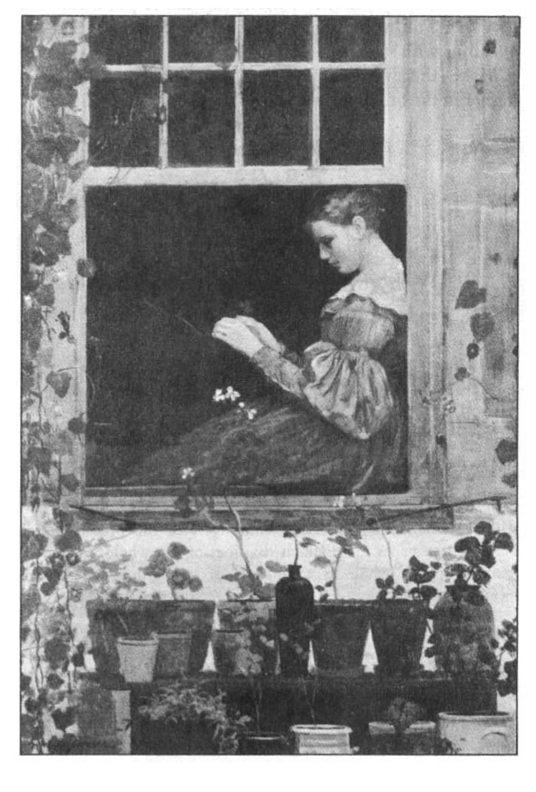
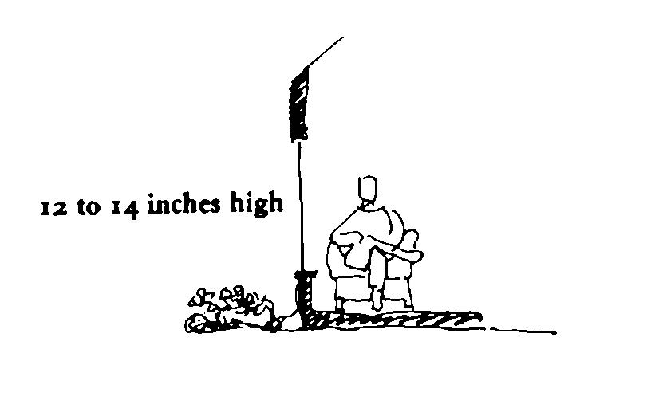

<section class="pattern-plate" aria-labelledby="t-low-sill">
<a href="/patterns">A Pattern Language</a> · <a href="/patterns#construction">Construction</a> · Pattern 222 · p. 1050
<h1 class="pattern-title" id="t-low-sill">Low Sill</h1><figure class="pattern-figure pl-figure"></figure><nav class="pattern-links" aria-label="Connections"><h2>Links to</h2><ul><li><a href="/patterns/zen-view">134 Zen View</a></li><li><a href="/patterns/window-place">180 Window Place</a></li><li><a href="/patterns/windows-overlooking-life">192 Windows Overlooking Life</a></li><li><a href="/patterns/waist-high-shelf">201 Waist-High Shelf</a></li><li><a href="/patterns/natural-doors-and-windows">221 Natural Doors And Windows</a></li><li><a href="/patterns/frames-as-thickened-edges">225 Frames As Thickened Edges</a></li><li><a href="/patterns/windows-which-open-wide">236 Windows Which Open Wide</a></li><li><a href="/patterns/raised-flowers">245 Raised Flowers</a></li></ul><h2>Linked from</h2><ul><li><a href="/patterns/short-passages">132 Short Passages</a></li><li><a href="/patterns/window-place">180 Window Place</a></li><li><a href="/patterns/windows-overlooking-life">192 Windows Overlooking Life</a></li><li><a href="/patterns/natural-doors-and-windows">221 Natural Doors And Windows</a></li></ul></nav></section><article class="pattern-text" aria-label="The text of Low Sill">
1051… this pattern helps to complete <a class="pl-ref" href="/patterns/natural-doors-and-windows">NATURAL DOORS AND WINDOWS (221)</a>, and the special love for the view, and for the earth outside, which <a class="pl-ref" href="/patterns/zen-view">ZEN VIEW (134)</a>, <a class="pl-ref" href="/patterns/window-place">WINDOW PLACE (180)</a> and <a class="pl-ref" href="/patterns/windows-overlooking-life">WINDOWS OVERLOOKING LIFE (192)</a> all need.

◆ ◆ ◆

<strong>One of a window’s most important functions is to put you in touch with the outdoors. If the sill is too high, it cuts you off.</strong>

The “right” height for a ground floor window sill is astonishingly low. Our experiments show that sills which are 13 or 14 inches from the floor are perfect. This is much lower than the window sills which people most often build: a standard window sill is about 24 to 36 inches from the ground. And it is higher than French doors and windows which usually have a bottom rail of 8 to 10 inches. The best height, then, happens to be a rather uncommon one.

We first give the detailed explanation for this phenomenon, and we then explain the modifications which are necessary on upper floors.

People are drawn to windows because of the light and the view outside—they are natural places to sit by when reading, talking, sewing, and so on, yet most windows have sill heights of 30 inches or so, so that when you sit down by them you cannot see the ground right near the window. This is unusually frustrating—you almost have to stand up to get a complete view.

In “The Function of Windows: A Reappraisal” (<em>Building Science</em>, Vol. 2, Pergamon Press, 1967, pp. 97–121), Thomas Markus shows that the primary function of windows is not to provide light but to provide a link to the outside and, furthermore, that this link is most meaningful when it contains a view of the ground and the horizon. Windows with high sills cut out the view of the ground.

On the other hand, glass all the way down to the floor is undesirable. It is disturbing because it seems contradictory and 1052even dangerous. It feels more like a door than a window; you have the feeling that you ought to be able to walk through it. If the sill is 12 to 14 inches high, you can comfortably see the ground, even if you are a foot or two away from the window, and it still feels like a window rather than a door.

On upper stories the sill height needs to be slightly higher. The sill still needs to be low to see the ground, but it is unsafe if it is too low. A sill height of about 20 inches allows you to see most of the ground, from a chair nearby, and still feel safe.

Therefore:

<strong>When determining exact location of windows also decide which windows should have low sills. On the first floor, make the sills of windows which you plan to sit by between 12 and 14 inches high. On the upper stories, make them higher, around 20 inches.</strong>

<figure class="pl-figure"></figure>
◆ ◆ ◆

Make the sill part of the frame, and make it wide enough to put things on—<a class="pl-ref" href="/patterns/waist-high-shelf">WAIST-HIGH SHELF (201)</a>, <a class="pl-ref" href="/patterns/frames-as-thickened-edges">FRAMES AS THICKENED EDGES (225)</a>, <a class="pl-ref" href="/patterns/windows-which-open-wide">WINDOWS WHICH OPKN WIDE (236)</a>. Make the window open outward, so that you can use the sill as a shelf, and so that you can lean out and tend the flowers. If you can, put flowers right outside the window, on the ground or raised a little, too, so that you can always see the flowers from inside the room <a class="pl-ref" href="/patterns/raised-flowers">RAISED FLOWERS (245)</a> ….
</article>

Christopher Alexander, Sara Ishikawa and Murray Silverstein, with Max Jacobson, Ingrid Fiksdahl-King and Shlomo Angel, <cite>A Pattern Language</cite> (Oxford University Press, 1977), pattern 222, pp. 1050–1052. Text and illustrations from the <a href="https://github.com/natureoforder/sources">Nature of Order sources</a> reading edition, transcribed from the 1977 printing; report errors on <a href="https://github.com/natureoforder/alexander-wiki/issues">GitHub</a>.

<a href="/patterns/natural-doors-and-windows">← 221 Natural Doors And Windows</a> · <a href="/patterns">All 253 patterns</a> · <a href="/patterns/deep-reveals">223 Deep Reveals →</a>

