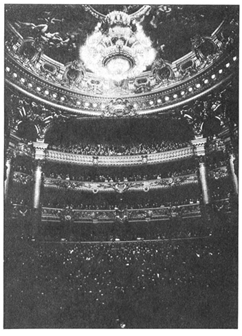
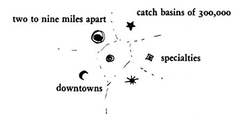

<section class="pattern-plate" aria-labelledby="t-magic-of-the-city">
<a href="/patterns">A Pattern Language</a> · <a href="/patterns#towns">Towns</a> · Pattern 10 · p. 58
<h1 class="pattern-title" id="t-magic-of-the-city">Magic Of The City</h1><figure class="pattern-figure pl-figure"></figure><nav class="pattern-links" aria-label="Connections"><h2>Links to</h2><ul><li><a href="/patterns/city-country-fingers">3 City Country Fingers</a></li><li><a href="/patterns/mosaic-of-subcultures">8 Mosaic Of Subcultures</a></li><li><a href="/patterns/local-transport-areas">11 Local Transport Areas</a></li><li><a href="/patterns/web-of-public-transportation">16 Web Of Public Transportation</a></li><li><a href="/patterns/four-story-limit">21 Four-Story Limit</a></li><li><a href="/patterns/density-rings">29 Density Rings</a></li><li><a href="/patterns/promenade">31 Promenade</a></li><li><a href="/patterns/night-life">33 Night Life</a></li><li><a href="/patterns/carnival">58 Carnival</a></li><li><a href="/patterns/dancing-in-the-street">63 Dancing In The Street</a></li></ul><h2>Linked from</h2><ul><li><a href="/patterns/the-countryside">7 The Countryside</a></li><li><a href="/patterns/local-transport-areas">11 Local Transport Areas</a></li><li><a href="/patterns/web-of-shopping">19 Web Of Shopping</a></li><li><a href="/patterns/four-story-limit">21 Four-Story Limit</a></li><li><a href="/patterns/eccentric-nucleus">28 Eccentric Nucleus</a></li><li><a href="/patterns/shopping-street">32 Shopping Street</a></li><li><a href="/patterns/night-life">33 Night Life</a></li><li><a href="/patterns/travelers-inn">91 Traveler’s Inn</a></li></ul></nav></section><article class="pattern-text" aria-label="The text of Magic Of The City">
59… next to the <a class="pl-ref" href="/patterns/mosaic-of-subcultures">MOSAIC OF SUBCULTURES (8)</a>, perhaps the most important structural feature of a city is the pattern of those centers where the city life is most intense. These centers can help to form the mosaic of subcultures by their variety; and they can also help to form <a class="pl-ref" href="/patterns/city-country-fingers">CITY COUNTRY FINGERS (3)</a>, if each of the centers is at a natural meeting point of several fingers. This pattern was first written by Luis Racionero, under the name “Downtowns of 300,000.”

◆ ◆ ◆

<strong>There are few people who do not enjoy the magic of a great city. But urban sprawl</strong> takes it <strong>away from everyone except the few who are lucky enough, or rich enough, to live close to the largest centers.</strong>

This is bound to happen in any urban region with a single high density core. Land near the core is expensive; few people can live near enough to it to give them genuine access to the city’s life; most people live far out from the core. To all intents and purposes, they are in the suburbs and have no more than occasional access to the city’s life. This problem can only be solved by decentralizing the core to form a multitude of smaller cores, each devoted to some special way of life, so that, even though decentralized, each one is still intense and still a center for the region as a whole.

The mechanism which creates a single isolated core is simple. Urban services tend to agglomerate. Restaurants, theaters, shops, carnivals, cafes, hotels, night clubs, entertainment, special services, tend to cluster. They do so because each one wants to locate in that position where the most people are. As soon as one nucleus has formed in a city, each of the interesting services—especially those which are most interesting and therefore require the largest catch basin—locate themselves in this one nucleus. The one nucleus keeps growing. The downtown becomes enormous. It becomes rich, various, fascinating. But gradually, as the metropolitan area grows, the average distance from an individual house 60to this one center increases; and land values around the center rise so high that houses are driven out from there by shops and offices—until soon no one, or almost no one, is any longer genuinely in touch with the magic which is created day and night within this solitary center.

The problem is clear. On the one hand people will only expend so much effort to get goods and services and attend cultural events, even the very best ones. On the other hand, real variety and choice can only occur where there is concentrated, centralized activity; and when the concentration and centralization become too great, then people are no longer willing to take the time to go to it.

If we are to resolve the problem by decentralizing centers, we must ask what the minimum population is that can support a central business district with the magic of the city. Otis D. Duncan in “The Optimum Size of Cities” (<em>Cities and Society</em>, P. K. Hatt and A. J. Reiss, eds., New York: The Free Press, 1967, pp. 759–72), shows that cities with more than 50,000 people have a big enough market to sustain 61 different kinds of retail shops and that cities with over 100,000 people can support sophisticated jewelry, fur, and fashion stores. He shows that cities of 100,000 can support a university, a museum, a library, a zoo, a symphony orchestra, a daily newspaper, AM and FM radio, but that it takes a population of 250,000 to 500,000 to support a specialized professional school like a medical school, an opera, or all of the TV networks.

In a study of regional shopping centers in metropolitan Chicago, Brian K. Berry found that centers with 70 kinds of retail shops serve a population base of about 3 50,000 people (<em>Geography of Market Centers and Retail Distribution</em>, New Jersey: Prentice-Hall, 1967, p. 47). T. R. Lakshmanan and Walter G. Hansen, in “A Retail Potential Model” (<em>American Institute of Planners Journal</em>, May 1965, pp. 134–43), showed that full-scale centers with a variety of retail and professional services, as well as recreational and cultural activities, are feasible for groups of 100,000 to 200,000 population.

It seems quite possible, then, to get very complex and rich urban functions at the heart of a catch basin which serves no more than 300,000 people. Since, for the reasons given earlier, it is 61desirable to have as many centers as possible, we propose that the city region should have one center for each 300,000 people, with the centers spaced out widely among the population, so that every person in the region is reasonably close to at least one of these major centers.

To make this more concrete, it is interesting to get some idea of the range of distances between these centers in a typical urban region. At a density of 5000 persons per square mile (the density of the less populated parts of Los Angeles) the area occupied by 300,000 will have a diameter of about nine miles; at a higher density of 80,000 persons per square mile (the density of central Paris) the area occupied by 300,000 people has a diameter of about two miles. Other patterns in this language suggest a city much more dense than Los Angeles, yet somewhat less dense than central Paris—<a class="pl-ref" href="/patterns/four-story-limit">FOUR-STORY LIMIT (21)</a>, <a class="pl-ref" href="/patterns/density-rings">DENSITY RINGS (29)</a>.We therefore take these crude estimates as upper and lower bounds. If each center serves 300,000 people, they will be at least two miles apart and probably no more than nine miles apart.

One final point must be discussed. The magic of a great city comes from the enormous specialization of human effort there. Only a city such as New York can support a restaurant where you can eat chocolate-covered ants, or buy three-hundred-year-old books of poems, or find a Caribbean steel band playing with American folk singers. By comparison, a city of 300,000 with a second-rate opera, a couple of large department stores, and half a dozen good restaurants is a hick town. It would be absurd if the new downtowns, each serving 300,000 people, in an effort to capture the magic of the city, ended up as a multitude of secondclass hick towns.

This problem can only be solved if each of the cores not only serves a· catch basin of 300,000 people but also offers some kind of special quality which none of the other centers have, so that each core, though small, serves several million people and can therefore generate all the excitement and uniqueness which become possible in such a vast city.

Thus, as it is in Tokyo or London, the pattern must be implemented in such a way that one core has the best hotels, another the best antique shops, another the music, still another has the fish and sailing boats. Then we can be sure that every person 1s 62within reach of at least one downtown and also that all the downtowns are worth reaching for and really have the magic of a great metropolis.

Therefore:

<strong>Put the magic of the city within reach of everyone in a metropolitan area. Do this by means of collective regional policies which restrict the growth of downtown areas so strongly that no one downtown can grow to serve more than 300,000 people. With this population base, the downtowns will be between two and nine miles apart.</strong>

<figure class="pl-figure"></figure>
◆ ◆ ◆

Treat each downtown as a pedestrian and local transport area—<a class="pl-ref" href="/patterns/local-transport-areas">LOCAL TRANSPORT AREAS (11)</a>, <a class="pl-ref" href="/patterns/promenade">PROMENADE (31)</a>, with good transit connections from the outlying areas—<a class="pl-ref" href="/patterns/web-of-public-transportation">WEB OF PUBLIC TRANSPORTATION (16)</a>; encourage a rich concentration of night life within each downtown—<a class="pl-ref" href="/patterns/night-life">NIGHT LIFE (33)</a>, and set aside at least some part of it for the wildest kind of street life—<a class="pl-ref" href="/patterns/carnival">CARNIVAL (58)</a>, <a class="pl-ref" href="/patterns/dancing-in-the-street">DANCING IN THE STREET (63)</a> ….
</article>

Christopher Alexander, Sara Ishikawa and Murray Silverstein, with Max Jacobson, Ingrid Fiksdahl-King and Shlomo Angel, <cite>A Pattern Language</cite> (Oxford University Press, 1977), pattern 10, pp. 58–62. Text and illustrations from the <a href="https://github.com/natureoforder/sources">Nature of Order sources</a> reading edition, transcribed from the 1977 printing; report errors on <a href="https://github.com/natureoforder/alexander-wiki/issues">GitHub</a>.

<a href="/patterns/scattered-work">← 9 Scattered Work</a> · <a href="/patterns">All 253 patterns</a> · <a href="/patterns/local-transport-areas">11 Local Transport Areas →</a>

