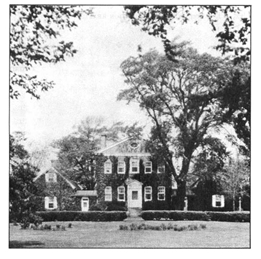
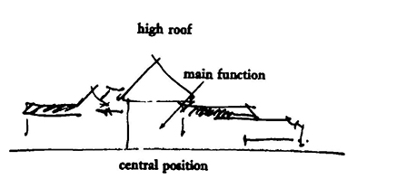

<section class="pattern-plate" aria-labelledby="t-main-building">
<a href="/patterns">A Pattern Language</a> · <a href="/patterns#buildings">Buildings</a> · Pattern 99 · p. 485 · *
<h1 class="pattern-title" id="t-main-building">Main Building</h1><figure class="pattern-figure pl-figure"></figure><nav class="pattern-links" aria-label="Connections"><h2>Links to</h2><ul><li><a href="/patterns/building-complex">95 Building Complex</a></li><li><a href="/patterns/number-of-stories">96 Number Of Stories</a></li><li><a href="/patterns/circulation-realms">98 Circulation Realms</a></li><li><a href="/patterns/cascade-of-roofs">116 Cascade Of Roofs</a></li><li><a href="/patterns/common-areas-at-the-heart">129 Common Areas At The Heart</a></li><li><a href="/patterns/structure-follows-social-spaces">205 Structure Follows Social Spaces</a></li></ul><h2>Linked from</h2><ul><li><a href="/patterns/building-complex">95 Building Complex</a></li><li><a href="/patterns/number-of-stories">96 Number Of Stories</a></li><li><a href="/patterns/circulation-realms">98 Circulation Realms</a></li><li><a href="/patterns/cascade-of-roofs">116 Cascade Of Roofs</a></li><li><a href="/patterns/roof-layout">209 Roof Layout</a></li></ul></nav></section><article class="pattern-text" aria-label="The text of Main Building">
486… once you have decided more or less how people will move around within the <a class="pl-ref" href="/patterns/building-complex">BUILDING COMPLEX (95)</a>, and roughly how high the buildings will be—<a class="pl-ref" href="/patterns/number-of-stories">NUMBER OF STORIES (96)</a>—it is time to try and find the natural heart or center of the building complex, to help complete its <a class="pl-ref" href="/patterns/circulation-realms">CIRCULATION REALMS (98)</a>.

◆ ◆ ◆

<strong>A complex of buildings with no center is like a man without a head.</strong>

In circulation realms we have explained how people understand their surroundings and orient themselves in their surroundings by making mental maps. Such a map needs a point of reference: some point in the complex of buildings, which is very obvious, and so placed, that it is possible to refer all the other paths and buildings to it. A main building, which is also the functional soul of the complex, is the most likely candidate for this reference point. Without a main building, there is very little chance of any natural points of reference being strong enough to act as an organizer for one’s mental map.

Furthermore, from the point of view of the group of users—the workers or the inhabitants—the sense of community and connection is heightened when one building or a part of one building is singled out and treated as a main building, common to all, the heart of the institution. Some examples: the meeting hall among a collection of government buildings; a guild hall in a work community; the kitchen and family room in a communal household; the merry-go-round in a park; a temple on sacred ground; the swimming pavilion in a health center; the workshop in an office.

Great care must be taken to pick that function which is actually the soul of the group, in human terms, for the main building. Otherwise, some irrelevant set of functions will dominate the building complex. The United Nations complex in New York fails for just this reason. The General Assembly, the heart and soul of the institution, is dwarfed by the bureaucratic Secretariat. And, indeed, this institution has suffered from the 487red-tape mentality. (See the excellent aeries of articles by Lewis Mumford, discussing the U.N. buildings in <em>From the Ground Uf</em>, Harvest Books, 1956, pp. 20–70.)

Therefore:

<strong>For any collection of buildings, decide which building in the group houses the most essential function—which building is the soul of the group, as a human institution. Then form this building as the main building, with a central position, higher roof.</strong>

<strong>Even if the building complex is so dense that it is a single building, build the main part of it higher and more prominent than the rest, so that the eye goes immediately to the part which is the most important.</strong>

<figure class="pl-figure"></figure>
◆ ◆ ◆

Build all the main paths tangent to the main building, in arcades or glazed corridors, with a direct view into its main functions—<a class="pl-ref" href="/patterns/common-areas-at-the-heart">COMMON AREAS AT THE HEART (129)</a>. Make the roof cascade down from the high roof over the main building to lower roofs over the smaller buildings—<a class="pl-ref" href="/patterns/cascade-of-roofs">CASCADE OF ROOFS (116)</a>. And for the load bearing structure, engineering, and construction, begin with <a class="pl-ref" href="/patterns/structure-follows-social-spaces">STRUCTURE FOLLOWS SOCIAL SPACES (205)</a>….
</article>

Christopher Alexander, Sara Ishikawa and Murray Silverstein, with Max Jacobson, Ingrid Fiksdahl-King and Shlomo Angel, <cite>A Pattern Language</cite> (Oxford University Press, 1977), pattern 99, pp. 485–487. Text and illustrations from the <a href="https://github.com/natureoforder/sources">Nature of Order sources</a> reading edition, transcribed from the 1977 printing; report errors on <a href="https://github.com/natureoforder/alexander-wiki/issues">GitHub</a>.

<a href="/patterns/circulation-realms">← 98 Circulation Realms</a> · <a href="/patterns">All 253 patterns</a> · <a href="/patterns/pedestrian-street">100 Pedestrian Street →</a>

