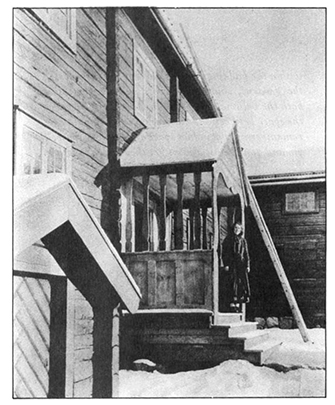
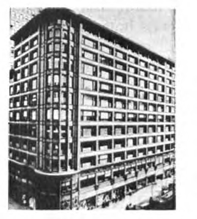
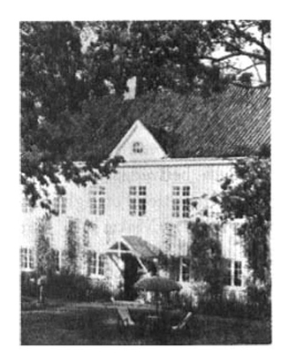
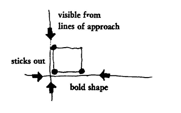

<section class="pattern-plate" aria-labelledby="t-main-entrance">
<a href="/patterns">A Pattern Language</a> · <a href="/patterns#buildings">Buildings</a> · Pattern 110 · p. 540 · **
<h1 class="pattern-title" id="t-main-entrance">Main Entrance</h1><figure class="pattern-figure pl-figure"></figure><nav class="pattern-links" aria-label="Connections"><h2>Links to</h2><ul><li><a href="/patterns/shielded-parking">97 Shielded Parking</a></li><li><a href="/patterns/circulation-realms">98 Circulation Realms</a></li><li><a href="/patterns/family-of-entrances">102 Family Of Entrances</a></li><li><a href="/patterns/site-repair">104 Site Repair</a></li><li><a href="/patterns/south-facing-outdoors">105 South Facing Outdoors</a></li><li><a href="/patterns/wings-of-light">107 Wings Of Light</a></li><li><a href="/patterns/entrance-transition">112 Entrance Transition</a></li><li><a href="/patterns/car-connection">113 Car Connection</a></li><li><a href="/patterns/entrance-room">130 Entrance Room</a></li></ul><h2>Linked from</h2><ul><li><a href="/patterns/main-gateways">53 Main Gateways</a></li><li><a href="/patterns/corner-grocery">89 Corner Grocery</a></li><li><a href="/patterns/building-complex">95 Building Complex</a></li><li><a href="/patterns/shielded-parking">97 Shielded Parking</a></li><li><a href="/patterns/circulation-realms">98 Circulation Realms</a></li><li><a href="/patterns/family-of-entrances">102 Family Of Entrances</a></li><li><a href="/patterns/long-thin-house">109 Long Thin House</a></li><li><a href="/patterns/half-hidden-garden">111 Half-Hidden Garden</a></li><li><a href="/patterns/entrance-transition">112 Entrance Transition</a></li><li><a href="/patterns/car-connection">113 Car Connection</a></li><li><a href="/patterns/paths-and-goals">120 Paths And Goals</a></li><li><a href="/patterns/stair-seats">125 Stair Seats</a></li><li><a href="/patterns/intimacy-gradient">127 Intimacy Gradient</a></li><li><a href="/patterns/entrance-room">130 Entrance Room</a></li><li><a href="/patterns/staircase-as-a-stage">133 Staircase As A Stage</a></li><li><a href="/patterns/low-doorway">224 Low Doorway</a></li><li><a href="/patterns/front-door-bench">242 Front Door Bench</a></li><li><a href="/patterns/ornament">249 Ornament</a></li></ul></nav></section><article class="pattern-text" aria-label="The text of Main Entrance">
541… you have a rough position for your building on the site—<a class="pl-ref" href="/patterns/site-repair">SITE REPAIR (104)</a>, <a class="pl-ref" href="/patterns/south-facing-outdoors">SOUTH FACING OUTDOORS (105)</a>, <a class="pl-ref" href="/patterns/wings-of-light">WINGS OF LIGHT (107)</a>. You also have an idea of the major circulation in the building complex and the lines of approach which lead toward the building—<a class="pl-ref" href="/patterns/circulation-realms">CIRCULATION REALMS (98)</a>, <a class="pl-ref" href="/patterns/family-of-entrances">FAMILY OF ENTRANCES (102)</a>. Now it is time to fix the entrance of the building.

◆ ◆ ◆

<strong>Placing the main entrance (or main entrances) is perhaps the single most important step you take during the evolution of a building plan.</strong>

The position of main entrances controls the layout of the building. It controls movement to and from the building, and all the other decisions about layout flow from this decision. When the entrances are placed correctly, the layout of the building unfolds naturally and simply; when the entrances are badly placed, the rest of the building never seems quite right. It is therefore vital that the position of the main entrance (or entrances) be made early and correctly.

The functional problem which guides the placing of main entrances is simple. <em>The entrance must be placed in such a way that people who approach the bulding see the entrance or some hint of where the entrance is, as soon as they see the building itself</em>. This makes it possible for them to orient their movements toward the entrance as soon as they start moving toward the building, without having to change direction or change their plan of how they will approach the building.

The functional problem is rather obvious, but it is hard to overestimate the contribution it makes to a good building. We have had the experience over and again, that until this question is settled and an appropriate position chosen, a project is at a stalemate. And conversely, once the main entrances have been located and they can be felt to be in the right position, then other decisions begin to come naturally. This is true for single 542houses, house clusters, small public buildings, large complexes of public buildings. Apparently, the pattern is basic, no matter the scale of the building.

Let us look into the functional question in more detail. Everyone finds it annoying to search around a building, or a precinct of buildings, looking for the proper entrance. When you know just where the entrance is, you don’t have to bother thinking about it. It’s automatic—you walk in, thinking about whatever’s on your mind, looking at whatever catches your eye—you are not forced to pay attention to the environment simply to get around. Yet the entrances to many buildings are hard to find; they are not “automatic” in this sense.

There are two steps to solving the problem. First, the main entrances must be placed correctly. Second, they must be shaped so they are clearly visible.

<em>1. Position</em>

Consciously or unconsciously, a person walking works out his path some distance ahead, so as to take the shortest path. (See Tyrus Porter, <em>A Study of Path Choosing Behavior</em>, thesis, University of California, Berkeley, 1964). If the entrance is not visible when the building itself becomes visible, he cannot work out his path. To be able to work out his path, he must be able to see the entrance early, as soon as he sees the building.

And for other reasons too, the entrance needs to be the first thing that you come to. If you have to walk a long distance along the building before you can enter, the chances are high that you will have to turn back after entering, and walk back in the direction you came from. This is not only annoying, but you may even begin to wonder whether you are going the right way and whether you haven’t perhaps even missed the proper entrance. It is hard to pin this down numerically, but we suggest a threshold of some 50 feet. No one is bothered by a detour of 50 feet; if it gets much longer, it begins to be annoying.

Therefore, the first step in placing the entrances is to consider the main lines of approach to the site. Locate entrances so that, once the building(s) come into view, the entrance, too, comes into view; and the path toward the entrance is not more than 50 feet along the building.

543

<figure class="pl-figure"><figcaption><em>Entrance position</em>.</figcaption></figure>

<em>2. Shafie</em>

A person approaching a building needs to see the entrance clearly. Yet many of the people approaching the building are walking along the front of the building and parallel to it. Their angle of approach is acute. From this angle, many entrances are hardly visible. An entrance will be visible from an acute angled approach if:

a. The entrance sticks out beyond the building line.

b. The building is higher around the entrance, and this height is visible along the approach.

<figure class="pl-figure"><figcaption><em>Entrance shape</em>.</figcaption></figure>

544And of course, the relative color of the entrance, the light and shade immediately around it, the presence of mouldings and ornaments, may all play a part too. But above all, it is important that the entrance be strongly differentiated from its immediate surroundings.

Therefore:

<strong>Place the main entrance of the building at a point where it can be seen immediately from the main avenues of approach and give it a bold, visible shape which stands out in front of the building.</strong>

<figure class="pl-figure"></figure>
◆ ◆ ◆

If possible, make the entrance one of a family of similar entrances, so that they all stand out as visibly as possible within the street or building complex—<a class="pl-ref" href="/patterns/family-of-entrances">FAMILY OF ENTRANCES (102)</a>; build that part of the entrance which sticks out, as a room, large enough to be a pleasant, light, and beautiful place—<a class="pl-ref" href="/patterns/entrance-room">ENTRANCE ROOM (130)</a> and bring the path between the street and this entrance room through a series of transitions of light and level and view—<a class="pl-ref" href="/patterns/entrance-transition">ENTRANCE TRANSITION (112)</a>. Make sure that the entrance has the proper relationship to parking—<a class="pl-ref" href="/patterns/shielded-parking">SHIELDED PARKING (97)</a>, <a class="pl-ref" href="/patterns/car-connection">CAR CONNECTION (113)</a> …
</article>

Christopher Alexander, Sara Ishikawa and Murray Silverstein, with Max Jacobson, Ingrid Fiksdahl-King and Shlomo Angel, <cite>A Pattern Language</cite> (Oxford University Press, 1977), pattern 110, pp. 540–544. Text and illustrations from the <a href="https://github.com/natureoforder/sources">Nature of Order sources</a> reading edition, transcribed from the 1977 printing; report errors on <a href="https://github.com/natureoforder/alexander-wiki/issues">GitHub</a>.

<a href="/patterns/long-thin-house">← 109 Long Thin House</a> · <a href="/patterns">All 253 patterns</a> · <a href="/patterns/half-hidden-garden">111 Half-Hidden Garden →</a>

