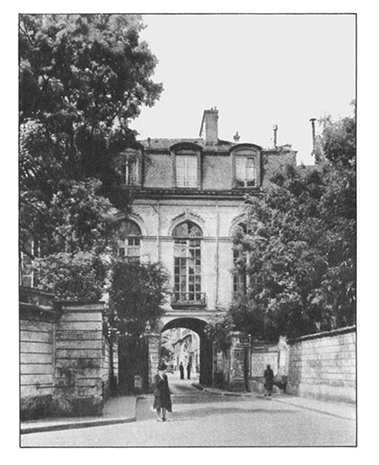
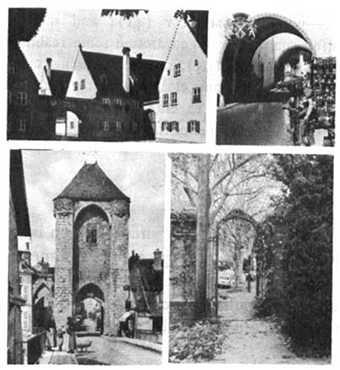
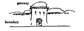

<section class="pattern-plate" aria-labelledby="t-main-gateways">
<a href="/patterns">A Pattern Language</a> · <a href="/patterns#towns">Towns</a> · Pattern 53 · p. 276 · **
<h1 class="pattern-title" id="t-main-gateways">Main Gateways</h1><figure class="pattern-figure pl-figure"></figure><nav class="pattern-links" aria-label="Connections"><h2>Links to</h2><ul><li><a href="/patterns/circulation-realms">98 Circulation Realms</a></li><li><a href="/patterns/main-entrance">110 Main Entrance</a></li></ul><h2>Linked from</h2><ul><li><a href="/patterns/identifiable-neighborhood">14 Identifiable Neighborhood</a></li><li><a href="/patterns/neighborhood-boundary">15 Neighborhood Boundary</a></li><li><a href="/patterns/housing-in-between">48 Housing In Between</a></li><li><a href="/patterns/public-outdoor-room">69 Public Outdoor Room</a></li><li><a href="/patterns/bus-stop">92 Bus Stop</a></li><li><a href="/patterns/circulation-realms">98 Circulation Realms</a></li><li><a href="/patterns/small-parking-lots">103 Small Parking Lots</a></li><li><a href="/patterns/entrance-transition">112 Entrance Transition</a></li></ul></nav></section><article class="pattern-text" aria-label="The text of Main Gateways">
277… at various levels in the structure of the town, there are identifiable units. There are neighborhoods—identifiable neighborhood (14), clusters—house cluster (37), communities of work—work community (41); and there are many smaller building complexes ringed around some realms of circulation—building complex (95), <a class="pl-ref" href="/patterns/circulation-realms">circulation realms (98)</a>. All of them get their identity most clearly from the fact that you pass through a definite gateway to enter them—it is this gateway acting as a threshold which creates the unit.

◆ ◆ ◆

<strong>Any part of a town—large or small—which is to be identified by its inhabitants as a precinct of some kind, will be reinforced, helped in its distinctness, marked, and made more vivid, if the paths which enter it are marked by gateways where they cross the boundary.</strong>

Many parts of a town have boundaries drawn around them. These boundaries are usually in people’s minds. They mark the end of one kind of activity, one kind of place, and the beginning of another. In many cases, the activities themselves are made more sharp, more vivid, more alive, if the boundary which exists in people’s minds is also present physically in the world.

A boundary around an important precinct, whether a neighborhood, a building complex, or some other area, is most critical at those points where paths cross the boundary. If the point where the path crosses the boundary is invisible, then to all intents and purposes the boundary is not there. It will be there, it will be felt, only if the crossing is marked. And essentially, the crossing of a boundary by a path can only be marked by a gateway. That is why all forms of gateway play such an important role in the environment.

A gateway can have many forms: a literal gate, a bridge, a passage between narrowly separated buildings, an avenue of trees, a gateway through a building. All of these have the same function: they mark the point where a path crosses a boundary and help 278maintain the boundary. All of them are “things”—not merely holes or gaps, but solid entities.

<figure class="pl-figure"><figcaption><em>Gateways mark the point of transition</em>.</figcaption></figure>

In every case, the crucial feeling which this solid thing must create is the feeling of transition.

Therefore:

<strong>Mark every boundary in the city which has important human meaning—the boundary of a building cluster, a neighborhood, a precinct—by great gateways where the major entering paths cross the boundary.</strong>

<figure class="pl-figure"></figure>
279Make the gateways solid elements, risible from every line of approach, enclosing the paths, punching a hole through a building, creating a bridge or a sharp change of level—but above all make them “things,” in j ust the same way specified for <a class="pl-ref" href="/patterns/main-entrance">main entrance (110)</a>, but make them larger. Whenever possible, emphasize the feeling of transition for the person passing through the gateway, by allowing change of light, or surface, view, crossing water, a change of level—entrance transition (112). In every case, treat the main gateway as the starting point of the pedestrian circulation inside the precinct—circulation realms (98)….
</article>

Christopher Alexander, Sara Ishikawa and Murray Silverstein, with Max Jacobson, Ingrid Fiksdahl-King and Shlomo Angel, <cite>A Pattern Language</cite> (Oxford University Press, 1977), pattern 53, pp. 276–279. Text and illustrations from the <a href="https://github.com/natureoforder/sources">Nature of Order sources</a> reading edition, transcribed from the 1977 printing; report errors on <a href="https://github.com/natureoforder/alexander-wiki/issues">GitHub</a>.

<a href="/patterns/network-of-paths-and-cars">← 52 Network Of Paths And Cars</a> · <a href="/patterns">All 253 patterns</a> · <a href="/patterns/road-crossing">54 Road Crossing →</a>

