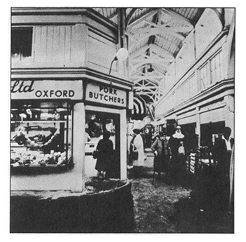
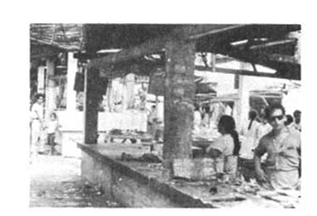
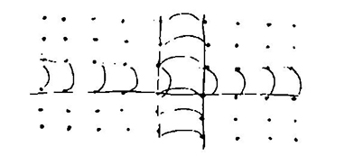
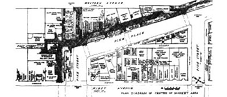
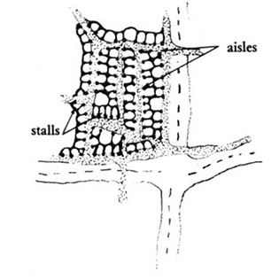

<section class="pattern-plate" aria-labelledby="t-market-of-many-shops">
<a href="/patterns">A Pattern Language</a> · <a href="/patterns#towns">Towns</a> · Pattern 46 · p. 246 · **
<h1 class="pattern-title" id="t-market-of-many-shops">Market Of Many Shops</h1><figure class="pattern-figure pl-figure"></figure><nav class="pattern-links" aria-label="Connections"><h2>Linked from</h2><ul><li><a href="/patterns/web-of-shopping">19 Web Of Shopping</a></li><li><a href="/patterns/shopping-street">32 Shopping Street</a></li><li><a href="/patterns/old-people-everywhere">40 Old People Everywhere</a></li><li><a href="/patterns/individually-owned-shops">87 Individually Owned Shops</a></li><li><a href="/patterns/corner-grocery">89 Corner Grocery</a></li><li><a href="/patterns/pedestrian-street">100 Pedestrian Street</a></li><li><a href="/patterns/opening-to-the-street">165 Opening To The Street</a></li></ul></nav></section><article class="pattern-text" aria-label="The text of Market Of Many Shops">
247… we have proposed that shops be widely decentralized and placed in such a way that they are most accessible to the communities which use them—web of shopping (19). The largest groups of shops are arranged to form pedestrian streets or shopping streets (32) which will almost always need a market to survive. This pattern describes the form and economic character of markets.

◆ ◆ ◆

<strong>It is natural and convenient to want a market where all the different foods and household goods you need can be bought under a single roof. But when the market has a single management, like a supermarket, the foods are bland, and there is no joy in going there.</strong>

It is true that the large supermarkets do have a great variety of foods. But this “variety” is still centrally purchased, centrally warehoused, and still has the staleness of mass merchandise. In addition, there is no human contact left, only rows of shelves and then a harried encounter with the check-out man who takes your money.

The only way to get the human contact back, and the variety of food, and all the love and care and wisdom about individual foods which shopkeepers who know what they are selling can bring to it, is to create those markets once again in which individual owners sell different goods, from tiny stalls, under a common roof.

As it stands, supermarkets are likely to get bigger and bigger, to conglomerate with other industries, and to go to all lengths to dehumanize the experience of the marketplace. Horn and Hardart, for example, have been contemplating this scheme:

… the customer either drives her car or walks onto a moving ramp, is conveyed decorously through the whole store, selects her groceries by viewing samples displayed in lighted wall panels (or unlocking the cases with a special key or her credit card), and chooses her meat and produce via closed circuit TV. She then drives around to a separate warehouse area to collect her order, paid for by a 248universal credit card system…. Most of the people would be invisible…. (Jennifer Cross, <em>The Supermarket Trap</em>, New York: Berkeley Medallion, 1971).

Now contrast this with the following description of an old fashioned market place in San Francisco:

If you visit the Market regularly you come to have favorite stalls, like the one with the pippin and Hauer apples from Watsonville. The farmer looks at each apple as he chooses it and places it in the bag, reminding you to keep them in a cool place so they will remain crisp and sweet. If you display interest, he tells you with pride about the orchard they come from and how they were grown and cared for, his blue eyes meeting yours. His English is spoken with a slight Italian accent so you wonder about the clear blue eyes, light brown hair and long-boned body until he tells you about the part of northern Italy where he was born.

There is a handsome black man offering small mountains of melons where the stalls end. Tell him you are not enough of an expert to choose one you would like to have perfect for the day after tomorrow, and he will not only pick one out that he assures you will be just right (as it turns out to be), but gives you a lesson in choosing your next melon, whether cranshaw, honeydew or watermelon, wherever you may happen to buy it. He cares that you will always get a good one and enjoy it. (“The Farmers Go to Market,” <em>California Living</em>, San Francisco Chronicle Sunday Magazine, February 6, 1972.)

There is no doubt that this is far more human and enlivening than the supermarket conveyor belt. The critical question lies with the economics of the operation. Is there a reasonable economic basis for a marketplace of many shops? Or are markets ruled out by the efficiencies of the supermarket?

There do not seem to be any economic obstacles more serious than those which accompany the start of any business. The major problem is one of coordination—coordination of individual shops to form one coherent market and coordination of many similar shops, from several markets, to make bulk purchase arrangements.

If individual shops are well located, they can operate competitively, at profit margins of up to 5 per cent of sales (“Expenses in Retail Business,” National Cash Register, Dayton, Ohio, p. 15). According to National Cash Register figures, this profit margin stays the same, regardless of size, for all convenience food stores. The small stores are often undercut by supermarkets because they are located by themselves, and therefore cannot offer shoppers 249the same variety at one stop, as the supermarket. However, if many of these small shops are clustered and centrally located, and together they offer a variety comparable to the supermarket, then they can compete effectively with the chain supermarkets.

The one efficiency that chain stores do maintain is the efficiency of bulk purchase. But even this can be offset if groups of similar shops, all over the town, coordinate their needs and set up bulk purchase arrangements. For example, in the Bay Area there are a number of flower vendors running their business from small carts on the street. Although each vendor manages his own affairs independently, all the vendors go in together to buy their flowers. They gain enormously by purchasing their flowers in bulk and undersell the established florists three to one.

Of course, it is difficult for a market of many shops to get started—it is hard to find a place and hard to finance it. We propose a very rough and simple structure in the beginning, that can be filled in and improved over time. The market in the photo, in Lima, Peru, began with nothing more than freestanding columns and aisles. The shops—most of them no more than six feet by nine—were built up gradually between the columns.

<figure class="pl-figure"><figcaption><em>A market in Peru …</em></figcaption></figure>
<figure class="pl-figure"><figcaption><em>… began ’with nothing more than columns</em>.</figcaption></figure>

250A spectacular example of a simple wood structure that has been modified and enlarged over the years is the Pike Place Market in Seattle, Washington.

<figure class="pl-figure"><figcaption><em>The Pike Place Market—a market of many shaft in Seattle</em>.</figcaption></figure>

Therefore:

<strong>Instead of modem supermarkets, establish frequent marketplaces, each one made up of many smaller shops which are autonomous and specialized (cheese, meat, grain, fruit, and so on). Build the structure of the market as a minimum, which provides no more than a roof, columns which define aisles, and basic services. Within this structure allow the different shops to create their own environment, according to their individual taste and needs.</strong>

<figure class="pl-figure"></figure>
◆ ◆ ◆

251Make the aisles wide enough for small delivery carts and for a dense throng of pedestrians—perhaps 6 to 12 feet wide—building thoroughfare (101); keep the stalls extremely small so that the rent is low—perhaps no more than six feet by nine feet—shops which need more space can occupy two—individually owned shops (87); define the stalls with columns at the corners only—columns at the corners (212); perhaps even let the owners make roofs for themselves—canvas roofs (244); connect the aisles with the outside so that the market is a direct continuation of the pedestrian paths in the city just around it—pedestrian street (100) ….
</article>

Christopher Alexander, Sara Ishikawa and Murray Silverstein, with Max Jacobson, Ingrid Fiksdahl-King and Shlomo Angel, <cite>A Pattern Language</cite> (Oxford University Press, 1977), pattern 46, pp. 246–251. Text and illustrations from the <a href="https://github.com/natureoforder/sources">Nature of Order sources</a> reading edition, transcribed from the 1977 printing; report errors on <a href="https://github.com/natureoforder/alexander-wiki/issues">GitHub</a>.

<a href="/patterns/necklace-of-community-projects">← 45 Necklace Of Community Projects</a> · <a href="/patterns">All 253 patterns</a> · <a href="/patterns/health-center">47 Health Center →</a>

